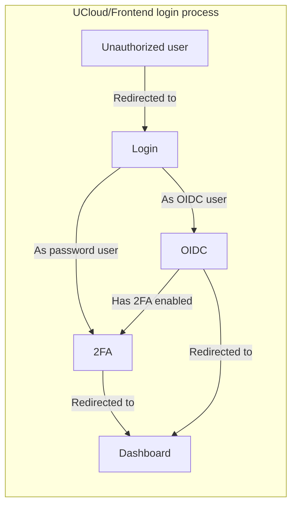

# Authentication

Authentication the end-user can happen in one of two ways:

- Authentication with OIDC
- Authentication with password

A OIDC-user will go through the OIDC-system for initial authentication, while a password user will be prompted for a username and password directly in the UCloud frontend.

For a password-user, 2FA is required, and the user will be prompted to enable it on first login, with a challenge every following login. For OIDC users, 2FA is optional, but encouraged.

<figure>



<figcaption>
    The login flow for the UCloud frontend.
</figcaption>

</figure>

## Sessions and Tokens

<!-- ref https://github.com/SDU-eScience/UCloud/blob/9ab1ea4d5c99e45d4755f3b37c455bf99e7ed284/docs/developer-guide/core/users/authentication/users.md -->

Once a user has been successfully authenticated with UCloud a number of tokens are issued for the user. These tokens are
used during the authentication workflow.

The table below summarizes the tokens and where they are stored when the web interface is being used.

| **Name**       | **Token Type**        | **Storage Type** | **Purpose**                                           |
| -------------- | --------------------- | ---------------- | ----------------------------------------------------- |
| `accessToken`  | [JWT](https://jwt.io) | Local Storage    | Authenticate API calls                                |
| `refreshToken` | Opaque                | HTTP Only Cookie | Used for creating new `accessToken`s                  |

The `accessToken` is used to authenticate all API calls. It is passed as a bearer token in the `Authorization` header.
The token contains a JSON web token. These are tokens which contain a JSON encoded payload and are signed by the
authority issuing them.

We store the `accessToken` in [local
storage](https://developer.mozilla.org/en-US/docs/Web/API/Web_Storage_API/Local_storage).  This is a technical
requirement given that our JavaScript code must be able to attach the token to each request in the `Authorization`
header. However, storing secret tokens, such as the `accessToken`, in local storage can be problematic since it can
easily be stolen by malicious JavaScript. This could happen in case of a successful XSS attack. To minimize the impact
of a successful attack we ensure that the JWTs are relatively short lived. We do not implement a JWT
blacklist and rely only on the short expiry time of the JWTs.

Given that JWTs expire after a short lifetime, we need a different mechanism for keeping the user logged in. For this we use
the `refreshToken`. The refresh token is an opaque token which can be used to generate a new `accessToken`. A user can
keep using the same refresh token for creating new access tokens until the refresh token is invalidated. A refresh token
will be invalidated once the user logs out.

In order to protect against XSS attacks the `refreshToken` is stored as a cookie with the following flags:

- `HttpOnly`
- `SameSite Strict`
- `Secure`
- Expires after 30 days

## JWT Payload

The following is an example of a JWT payload. This payload is decodable by
anyone who has a JWT. As a result it is crucial that we do not store
sensitive data in it.

```javascript
{
  // Token properties
  "iat": 1234,
  "exp": 5678,
  "iss": "cloud.sdu.dk",

  // Authorization properties
  "role": "ADMIN",
  "aud": ["all:write"],

  // Extension metadata
  "extendedByChain": [],

  // Session reference
  "publicSessionReference": "ref",
  
  // Project and group mappings
  "membership": { "project-id": "ROLE" },
  "groups": { "project-id": "group-id" },

  // User metadata
  "sub": "user1",
  "uid": 1000,
  "principalType": "password",
  "firstNames": "User",
  "lastName": "User",
  "orgId": "sdu.dk",
  "email": "user@user.tld",
  "domain": "user.tld",
  "serviceLicenseAgreement": true,
  "twoFactorAuthentication": true,
}
```

### Token Properties

These properties are about the token itself and are used as part of the verification process.

| **Property** | **Description**                                                                                    |
| -------- | ---------------------------------------------------------------------------------------------- |
| `iat`    | Unix timestamp indicating when the token was issued at                                         |
| `exp`    | Unix timestamp indicating when the token will expire                                           |
| `iss`    | The issuer of this token. For UCloud this should always be `cloud.sdu.dk`                    |
| `jti`    | A unique ID of this token. If this field is present then this JWT is used as a one-time token. |

#### One-Time Tokens

All users are allowed to use their normal JWT to create a one-time token.  This one-time token is designed to be used
only once and we keep a list of already claimed JWTs to ensure this. A one-time token is created for a specific security
scope and this scope must be covered by the JWT requesting it. The JWT created will only last for thirty seconds.

### Authorization in UCloud

These properties are related to the authorization mechanisms of UCloud.  This is tightly related to how the RPC layer is
defined.

| **Property** | **Description**                                             |
| -------- | ------------------------------------------------------- |
| `role`   | The role of this user. See table and description below. |
| `aud`    | A list of security scopes. See below.                   |

#### Roles

UCloud contains a few basic roles used for global authorization. These
attributes only refer to the global authorization, more fine-grained
authorization is done at the service level. A service can declare that a
single API endpoint should only be accessible to users with a given role.

The table below shows the possible roles for a user accessing the UCloud frontend.

| **Role**   | **Description**                                                           |
| ---------- | --------------------------------------------------------------------------|
| `USER`     | A 'normal' end-user                                                       |
| `ADMIN`    | An administrator of the system. Has access to certain privileged actions. |

#### Security Scopes

A security scope in UCloud puts a limit on which calls a JWT can be used for. In order to understand security scopes in
UCloud we must first understand some of the metadata associated with API endpoints. All API endpoints in UCloud have
metadata associated with them, the table below summarizes the important metadata:

| **Property**      | **Description**                                                                                                                                           |
| ------------- | ----------------------------------------------------------------------------------------------------------------------------------------------------- |
| `namespace`   | Each endpoint belongs to a collection. We refer to the collection's name as the namespace. Namespaces can be hierarchical and are separated by a `.`. |
| `name`        | A unique name for the API endpoint within its collection.                                                                                            |
| `accessRight` | `read` if the operation is purely read otherwise `write`.                                                                                             |

A security scope is a string combining these three properties in the
following format: `${path}:${accessRight}:${metadata}`. The `path` can be
some part of the namespace or it can refer to just a specific call by
combining the namespace with the name. The security scope grants the
`accessRight` for all calls that are children of the `path`. A special
namespace exists called `all` which can be used for any and all namespaces.

Below are some examples:

| **Scope**                        | **Grants**                                                                 |
| ---------------------------- | ---------------------------------------------------------------------- |
| `all:write`                  | Grants read/write access to all endpoints.                             |
| `files:read`                 | Grants read only access to all endpoints within the `files` namespace  |
| `files:write`                | Grants read/write access to all endpoints within the `files` namespace |
| `files.listAtDirectory:read` | Grants read access to the `files.listAtDirectory` endpoint             |
| `a.b.c.d.e:read`             | Grants read access to the hierarchy at `a.b.c.d.e`                     |

The `metadata` section of the security scope is optional. It encodes a
dictionary. Entries are separated by a `,` and each entry is encoded as:
`${base64encode(key)}!${base64encode(value)}`. The `metadata` section can be
used to store call specific metadata. This could for example be used to
create an `accessToken` which can only be used to read files from a specific
directory.

The default scope for tokens created by the web interface is `all:write`.
Security scopes are an important part of token extension.

### User Metadata

| **Property**        | **Description**                                |
| --------------- | ------------------------------------------ |
| `sub`           | The username of this user.                 |
| `principalType` | The type of users. (wayf/password/service) |
| `firstNames`    | First name(s).                             |
| `lastName`      | Last name.                                 |
| `email`         | The user's email                          |
| `domain`        | The user's email domain                   |
| `uid`           | Unique user ID                             |
| `orgId`         | Organization ID (provided by WAYF)         |
| `serviceLicenseAgreement` | Indicates if the ToS agreement has been agreed |
| `twoFactorAuthentication` | Indicates if 2FA is enabled |

### Project and group metadata

| **Property** | **Description** |
|--------------|-----------------|
| `membership` | An object mapping a project the user is in, to their role in the project. |
| `groups`     | An object mapping the group-id to the project-id                          |
