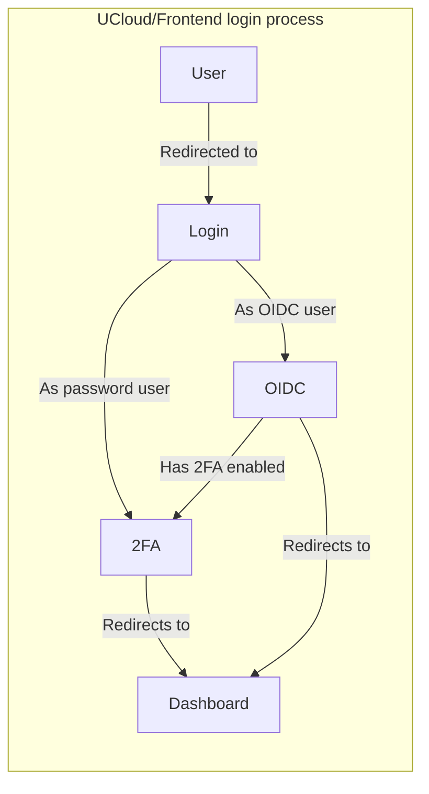
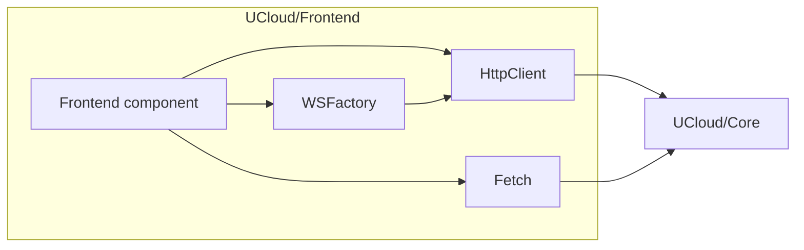

# Authentication

Authentication the end-user can happen in one of two ways:

- Authentication with OIDC
- Authentication with password

A OIDC-user will go through the OIDC-system for initial authentication, while a password user will be be prompted for as username and password directly in the UCloud frontend.

For a password-user, 2FA is required, and the user will be prompted to enable it on first login, with a challenge every following login. For OIDC users, 2FA is optional, but encouraged.

