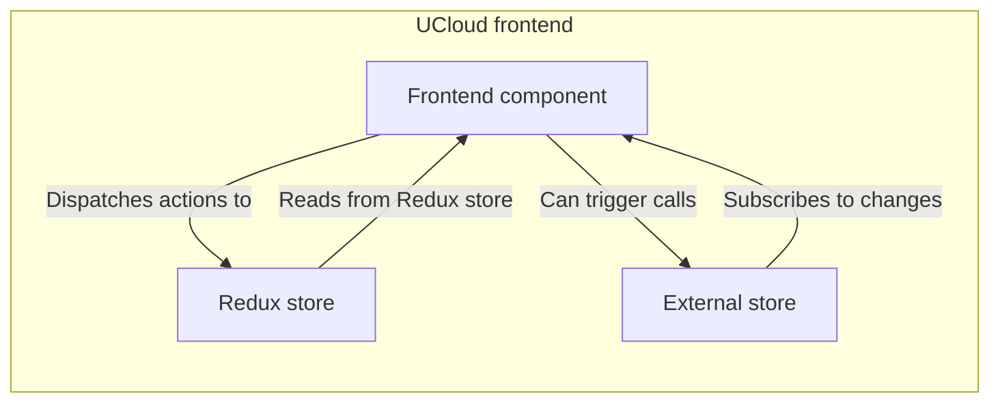

# UCloud frontend architecture

Some notable architecture choices are describe here.

## React Router

The library `React Router` is used to routing. What the [main container](./frontend-layout.md) shows is decided by the URL, and will mount the relevant component in most cases. While using `React Router` is not notable, some cases where is does not behave as intended are. 

The UCloud frontend has some cases where the component will not be mounted as expected. These include:

- If the user is not logged in, and the component requires it.
    - The user will be redirected to the login page.
- The Service License Agreement is required to be accepted and has not yet been accepted.
    - The user will be redirected to read and accept the SLA.
- Two factor authentication is required, but not yet enabled.
    - The user is redirected to enable 2FA.

Some components require the project-role to be admin, or above, and some require the user to be a UCloud Admin. These checks are handled inside the components themselves, and not at the router level. They also handle the navigation, if needed.

### Adding a route to a component

When creating a new component that needs its own route-path, the approach to follow is in the file `Core.tsx`.

If frontend authentication is required for accessing the component, the component should be wrapped in the function `requireAuth`, like so:

```tsx
<Route 
    path={AppRoutes.dev.pathForAuthenticatedComponent()}
    element={React.createElement(requireAuth(MyNewComponent))} 
/>
```

If authentication is not needed, this can be omitted, like so:

```jsx
<Route path={AppRoutes.dev.pathForComponent()} element={<MyNewComponent />} />
```

The route-path must be added to the `AppRoutes`.

Relevant code can be found in:

- `Core.tsx` found in [`/app/Core.tsx`](https://github.com/sdu-eScience/UCloud/tree/master/frontend-web/webclient/app/Core.tsx)
- `AppRoutes` found in [`/app/Routes.ts`](https://github.com/sdu-eScience/UCloud/tree/master/frontend-web/webclient/app/Routes.ts)

### React Redux and External Stores

The frontend uses both the Redux store and custom external stores. The Redux store is not used with the content expected to be serializable and exists between sessions. The Redux store is populated on page load with calls to the backend.

The external stores keep more state about the contents and can be used in a non-React context. These stores can make calls directly from the stores themselves, and do not rely on dispatching the actions with the contents to be stored.


<figure>



<figcaption>
    How a React component can communicate with either stores.
</figcaption>
</figure>

Where the Redux store depends on actions to update its content, the external stores can manage the data on its own, and update its store after a timeout, for instance.
