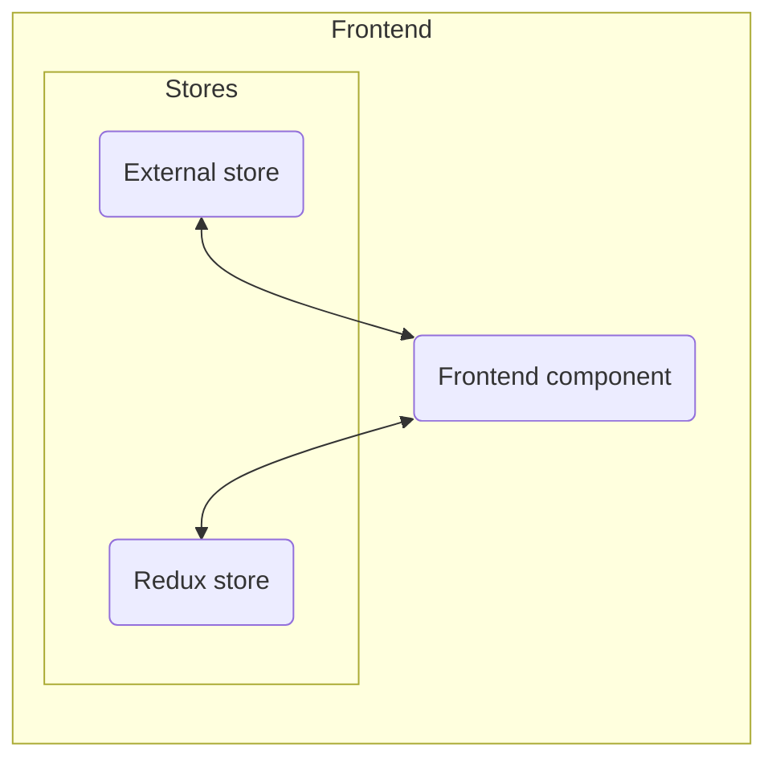

# UCloud frontend development


## UCloud description

See [introduction](../../overview/introduction.md#introduction)

## Technologies

The UCloud UI is written in Typescript, with the frontend library React. Some use of the library Redux exists in the codebase, but it is rarely used when developing new features. TypeScript was chosen to reduce the friction that comes from Vanilla JavaScripts dynamic nature, and TypeScript letting developers use upcoming TC-39 features, compiling to an older target, making UCloud available for people running older versions of JavaScript.

React was chosen because of its ubiquity and being battle-tested and the framework authors do "dogfooding".

Where the performance of React has not been adequate, Vanilla TypeScript/ECMAScript has been used instead. An example of this is the [ResourceBrowser](https://github.com/SDU-eScience/UCloud/blob/master/frontend-web/webclient/app/ui-components/ResourceBrowser.tsx) component, where very little use of React is present.

## Project structure

The UCloud frontend is found in the [`frontend-web/webclient`](https://github.com/SDU-eScience/UCloud/blob/master/frontend-web/webclient/). Configuration files, tests and node modules reside at the base, along with the `app` folder containing the code for the web interface. The contents of the `app` folder is subdivided into folders containing different contexts, i.e. resource types and component groupings.

## Installation

### Running the UI

For a local dev environment, the `launcher`-tool, available in the root folder of the repository, can be run, which will prompt the user to initialize and start the environment.
The UI will be available at `ucloud.localhost.direct` and will use the local environment as the backend. An admin user will be generated with the following login info:

- Username: user
- Password: mypassword

If using another backend is required, the frontend can be run using two commands, while in the `webclient` folder:

First:
- `npm i`

And depending on what backend is needed:
- For `dev` run `npm run start` (requires VPN access)
- For `production` run `npm run start:prod`

Logins for these can be provided upon request.

Note for `production` case: If logging in requires Wayf, see [this section](#production-backend-with-a-wayf-user).

Some editors will only run type checking on open files and not the entire project. To have the compiler type check the frontend, run `npm run watch`. If the frontend is running using the `launcher`, open a shell to the frontend using the `launcher` and run the command there instead.

## On adding NPM packages

Every added NPM-package is a potential security or licensing risk. With this in mind, keep new NPM packages to a minimum as they are something that might need to be updated, increasingly through issues with security. Whether or not to add a package will be up to the programmer, depending on saving time through offloading the complexity to the package or similar. If a package is added to `package.json` file, the version must only consist of the version number, fixing it to that version.

This means no `~`, `^`, `>=`, `>`, `<=`, `<`, `x`, `*` or `latest`, as this provides less control over which version of the package will be installed.

## Adding a route to a component

When creating a new component that needs its own route-path, the approach to follow is in the file `Core.tsx`.

If frontend authentication is required for accessing the component, the component should be wrapped in the function `requireAuth`, like so:

```tsx
<Route 
    path={AppRoutes.dev.pathForAuthenticatedComponent()}
    element={React.createElement(requireAuth(MyNewComponent))} 
/>
```

If authentication is not needed, this can be omitted, like so:

```jsx
<Route path={AppRoutes.dev.pathForComponent()} element={<MyNewComponent />} />
```

The route-path must be added to the `AppRoutes`.

Relevant code can be found in:

- `Core.tsx` found in [`/app/Core.tsx`](https://github.com/sdu-eScience/UCloud/tree/master/frontend-web/webclient/app/Core.tsx)
- `AppRoutes` found in [`/app/Routes.ts`](https://github.com/sdu-eScience/UCloud/tree/master/frontend-web/webclient/app/Routes.ts)

## Color references and icons

The `Playground` component can be accessed at `/app/playground` and has a list of colors used on the site.
Additionally, every icon currently available can be viewed here, showing the name of it by hovering with the mouse.

The component is intended for experimenting and the component is not available in any non-local environment.

Icons can be added to the site, by adding the file as an SVG in the folder `/app/ui-components/icons`, then running the command `npm run refresh-icons`.
The icon is now available to use in the `name` parameter for the Icon-component.


### Coding-style preferences

`let` is to be used over `var`, due to the reduced lifetime of `let`.

For function definitions, TypeScript/ECMAScript allows using both `function` and `const`. `function` is preferred, due to the different lifetimes and positioning requirements in files between the two options.
If the function is exported, `function` is usually the one to use. If the function is local to the file, the `const` approach is fine to use.

Semi-colons should be used, where it makes sense, e.g. after an expression, but not after a curly brace.

If a magic string/number is present more than once, it's to be extracted into a constant. This is not the case for styling (pixels, colors, etc.) in components.

HTML/JSX tags that close immediately and have no children, should have a space before closing, e.g. `<br />`, but not in the case of `<div></div>`.

Imports ands objects should not have a preceeding or succeeding space.

Yes

```typescript
import {thing} from "thing";

const foo = {thing: "a"};
```

No

```typescript
import { thing } from "thing";

const foo = { thing: "a" };
````

Spaces for alignment with newlines are fine, e.g.:

```typescript
import {
    thing
} from "thing";
```

But newlines in imports should usually only happen with multiple imports from the same source.

### Production backend with a Wayf-user

Note: production should not be used as a backend unless required. 

- Go to cloud.sdu.dk and log in. Open developer tools and access a console within. Enter `localStorage.setItem("ALLOW_JWT_COPY", "true")` and reload the page. This allows for copying login tokens with a keyboard shortcut.
- Open a second tab and go to `localhost:9000/app` and open developer tools.
- In the `cloud.sdu.dk`-tab, press `alt + k` (`option + k` on MacOS) to copy the tokens into your clipholder.
- Go back to the second tab and paste the tokens into the console and press enter. Reloading the page should navigate you to the dashboard with your user logged in.
