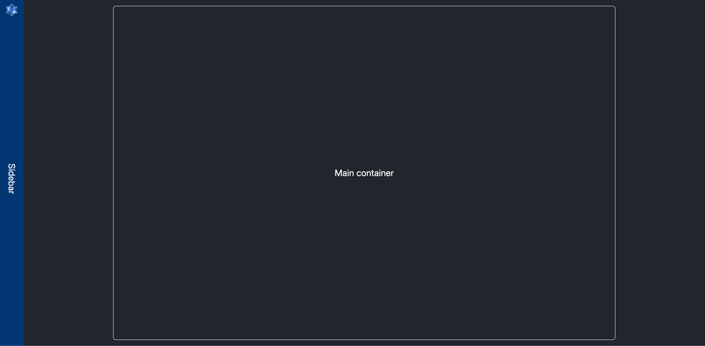
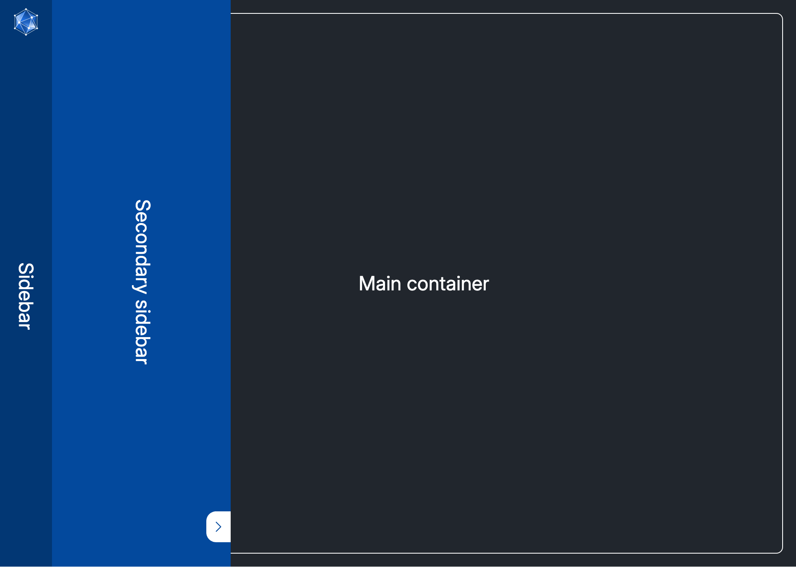
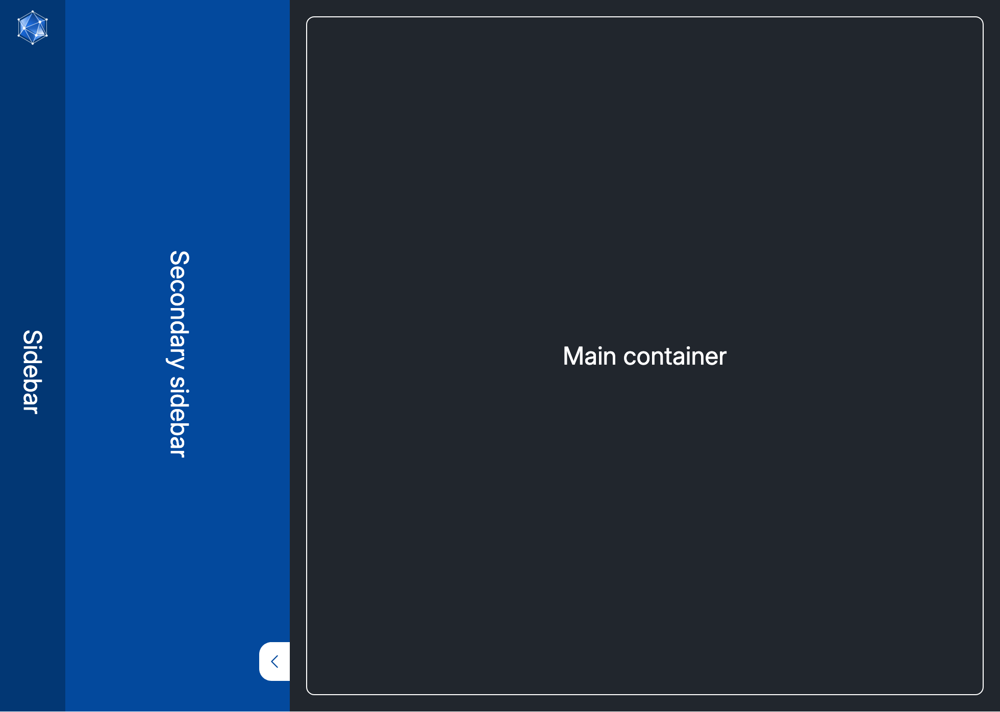
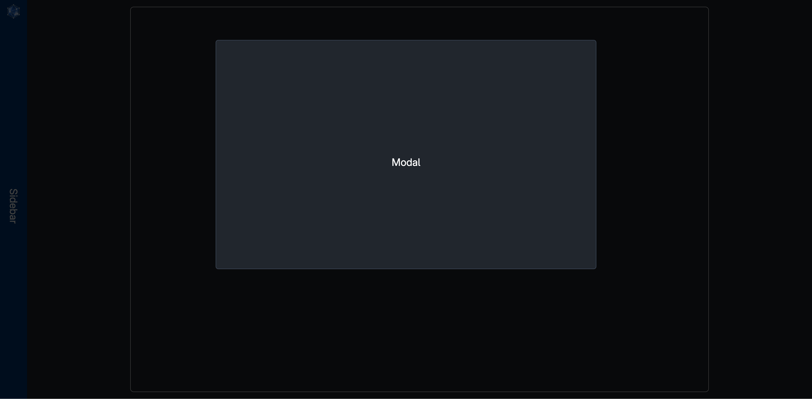

### Layout

The UCloud page layout always consists of three parts and additional optional one:

- Sidebar
- Main content
- Secondary sidebar
- Modal (Optional)

The sidebar, positioned on the left side of the screen. This is used for navigation and is always shown.

The main container is a component that centers the content, and restricts to a max width of 1400px and resizes for smaller widths. The main container shows the content navigated to by either the sidebar or secondary sidebar. Navigation can happen from the main container, but it shouldn't change the resource type being viewed.

The secondary sidebar can be in one of two states: either hovering over the main container, or pushing the main container, hover being the default. This is used for further navigation and quick access.

Modals are placed on top the other parts, which are not interactive as long as a modal is present.
Modals do not use the main container, and are styled as relevant for what they contain. They cannot be stacked when presented, as only one will be visible at most. Modals are used for confirmation, resource selection, resource creation, etc.

