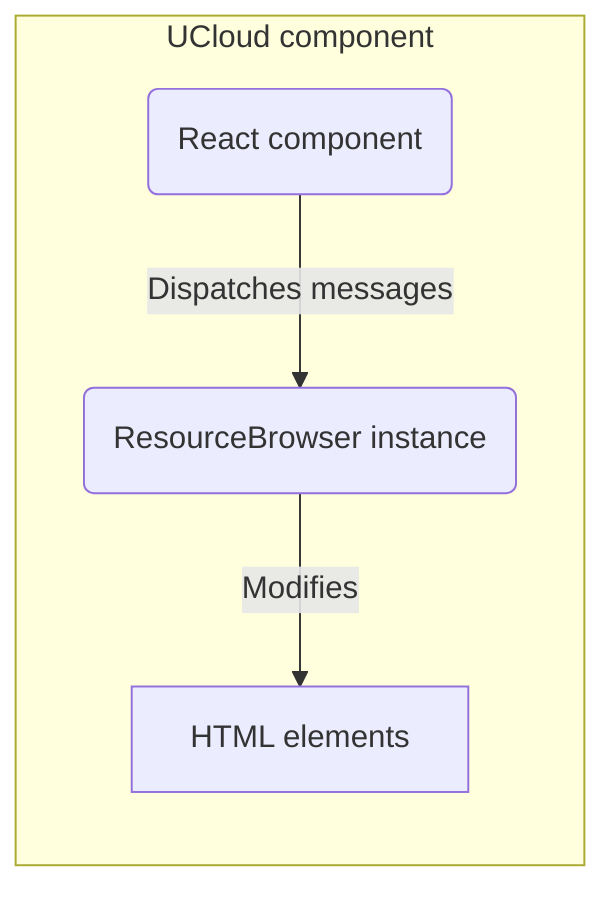

## Resource Browser

The Resource Browser is a component intended to bring a user interface for generic resources, with features a user would expect from a native file explorer. The component is written in Vanilla TypeScript, but is mounted within the React-mounted root, as to be compatible with the rest of the frontend.

Additionally, keyboard navigation, either by arrow-keys or shortcuts, are available when using the component.

### Motivation

The component was written to accomodate rendering directories containing thousands of files, without any significant slowdowns. The component supports keyboard inputs, like navigation and shortcuts. The component replaced the previous custom 'List'-component, that was written in React, which had major slowdowns for larger directories. While packages like `react-window` could be used, this would only fix the performance aspect, and not the wanted interactions like keyboard shortcuts or drag to select. Initially, the component was written with file-browsing in mind, which is why some of the operations relate heavily to functionality to files, but were applicable to a lot of other resources on UCloud.

### Implementation

See [`Use`](./use.md) for a how-to with implementing a component that uses the ResourceBrowser.

The ResourceBrowser-component is, as mentioned, written in TypeScript. The component is a class that handles setting up the HTML-elements the Resource Browser adds and removes resource entries from directly, as opposed to React that keeps a shadow DOM to guage whether updates need to happen. Instead of running checks for differences, different parts of the Resource Browser are targeted for updates when needed, like the rows, operations or filters.

The setup of the ResourceBrowser happens in two steps:

1. `constructor`
2. `init`

With the Resource Browser instantiated, `init` is called. `init` takes a callback as an argument, that is responsible for defining the hooks into the Resource Browser:

It is here the custom parts of the Resource Browser is defined, including how `open`, `wantToFetchNextPage`, `fetchOperations`, etc. should behave when called. This is defined using `browserInstance.on(method-key, callback)`. Variables local to the resource browser can be defined inside this scope as well, like `FileBrowse` that defines local caches, used for the currently viewed files.



### RenderRows

Instead of rendering every item in the viewed page, the Resource Browser uses a similar approach to `react-window`, that is, based on the available space, initialize as many entries that can be visible at any time, plus an additional buffer, in the container. When rendering rows, the rows are reset, and placed relative to their sorting. Each page (See [Page](https://github.com/SDU-eScience/UCloud/blob/master/frontend-web/webclient/app/UCloud/index.ts#L41)) entry is checked if it is in view, and if so, renders using the prepered ro checked if it is in view, and if so, renders them using the prepared rows. 

Each row is divided into multiple parts: `star`, `title`, `stat1`, `stat2`, `stat3`, and `stat4`.

`star` is used to denote favoriting. At the time of writing on FileBrowse and FavoritesBrowse uses the star, both having files as their resource type.

The title is the name of the entry, a locally unique identifier. This could be the file name (but not the full file path), job name or grant application ID. The `stat`-parts are used for info about the entry. This can be information, like created by, created by, or state of the resource. What is actually rendered is like `title` also handled by the React-component wrapping the instance of the ResourceBrowser.

The `renderTitle` or `renderStat{i}` methods largely share the same arguments, with `renderTitle` having an additional `dims: RenderDimensions`-argument. 

`renderStat1: (entry: T, stat: HTMLElement, row: ResourceBrowserRow, size: ContainerSize) => void;`

<TODO-ALREADY-DESCRIBED-QUESTION-MARK>

When rendering a stat in the row, the entry, part of the row, specifically the relevant `stat` or `title`-element and the container width breakpoint of the resource browser. With the container width provided, the implementation of the rendering of the stat can be handled differently, swapping positions for `stat`-entries or render them differently. JobBrowse swaps the stats for smaller screens and renders "Created by" using only the avatar-image without the name, like so:

```typescript
(entry: T, stat: HTMLElement, row: ResourceBrowserRow, size: ContainerSize) => {
    browser.on("renderStat1", (job, stat, row, size) => {
        if (size <= ContainerSize.SMALL) {
            renderCreatedBySmall(job, stat);
        } else {
            renderCreatedBy(job, stat);
        }
    });
}
```

The container size breakpoints are as follows:

```typescript
enum ContainerSize {
    LARGE = 1080,
    MEDIUM = 860,
    SMALL = 600,
    TINY = 460,
}
```

A container size breakpoint is considered active, provided the current container width is equal or bigger than the breakpoint.

The amount of visible rows are reevaluated when resizing the browser window using an event-handler.

### Adding new functionality

If new functionality is needed in the Resource Browser:

- Add the type definition to `ResourceBrowserListenerMap<T>` in `ResourceBrowser.ts`.
- If the method is not required, add entry to `ResourceBrowser#defaultHandlers`, with a noop-call like `doNothing`.
    - If it is required, it is preferable that it crashes the frontend during development to highlight when it is missing.
- Add the calls where applicable in the Resource Browser, like `pathToEntry` or `renderTitle`-calls in `renderRows()`.

#### Example

If we were to implement the `sort` method, we would do the following:

Add `"sort": (page: T[]) => void;` to the `ResourceBrowserListenerMap<T>`. With the method now recognized by the class, add `sort: doNothing` to the default handlers, as this is not a required function.

The sort function can now be called using `this.dispatchMessage("sort", fn => fn(page))`, both in the Resource Browser-component internally, or React-components mounting the Resource Browser using `resourceBrowserInstance.dispatchMessage("sort", fn => fn(page))`.

### Resource Browser styling

The Resource Browser has many lines of CSS, which has been extracted into its own file, [ResourceBrowserStyle.ts](https://github.com/SDU-eScience/UCloud/blob/master/frontend-web/webclient/app/ui-components/ResourceBrowserStyle.ts). The styling relies on `injectStyle` mentioned in (../inject-style). 

Changes can be done directly in the Resource Browser, if changes should not persist between components.
