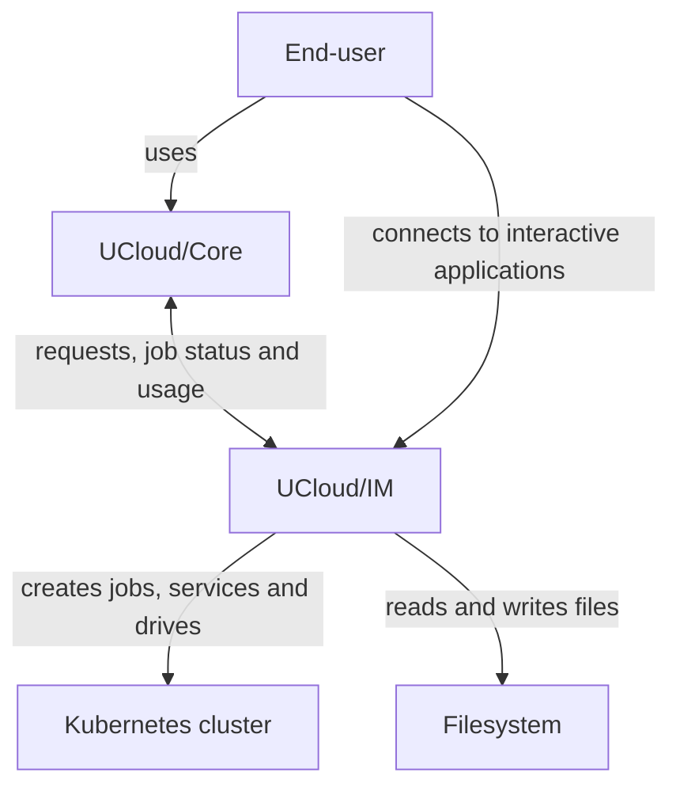

# Architecture and Networking

In this article we will go through the overall architecture and networking modes of UCloud/IM for Kubernetes.
We will start by explaining the overall architecture, followed with a discussion on networking requirements.

## Architecture Views

This section describes UCloud/IM from the outside in. Each view answers one question. Start at the top and follow the
links when you need more detail.

| View | Question it answers | Where |
|------|---------------------|-------|
| System context | Who uses UCloud/IM, and which systems does it talk to? | [the first figure below](#system-context) |
| Deployment | Which containers make up UCloud/IM, and how does traffic reach them? | [the second figure below](#deployment), and [Networking Requirements](#networking-requirements) |
| Containers and mappings | How do UCloud projects, drives and users map to the provider's systems? | [Filesystem Integration](./storage.md) |
| Component | How is one compute application built from products and machine slices? | [Compute Jobs](./compute.md) |
| Component and dynamic | How does the AI inference feature serve a request? | [AI Inference](./inference/overview.md) |

## Overall Architecture

UCloud/IM is a software system that the provider deploys and operates. The figure below places it in its context: the
people who use it, the platform that forwards to it, and the provider systems it uses.

<figure class="diagram" id="system-context">

<figcaption>

UCloud/IM and the systems around it. The figure shows the people and the external systems, and how they relate. It does
not show the parts inside UCloud/IM.

</figcaption>
</figure>

The end-user reaches UCloud/IM through UCloud/Core. Interactive applications are the exception: the end-user connects
to those directly.

The figure below zooms in one step, to the deployment.

<figure class="diagram" id="deployment">

<figcaption>

The UCloud/IM deployment for Kubernetes. This diagram depicts a production-like setup. It does not show the networking
modes; see [Networking Requirements](#networking-requirements).

</figcaption>
</figure>

In the deployment above, we have several actors. We have summarised the role of each actor in the table below:

<table>
<thead>
<tr>
<th>Actor</th>
<th>Purpose</th>
</tr>
</thead>

<tbody>
<tr>
<td>[End-user](../glossary.md#end-user)</td>
<td>

The end-user is a user of the UCloud platform and of the service provider. As we have discussed in the introduction
chapter, the end-user primarily communicates with UCloud/Core, and in rare cases 
directly with a service provider.

</td>
</tr>

<tr>
<td>[UCloud/Core](../glossary.md#ucloudcore)</td>
<td>

The UCloud platform itself. This is the service hosting the user-interface and core APIs. It is not part of the
provider's deployment. You can read more about the role of UCloud/Core [here](../overview/introduction.md).

The core will to a large extent, forward requests to service providers after performing validation, authentication and
authorization.

</td>
</tr>

<tr>
<td>[K8s deployment](../glossary.md#ucloudim)</td>
<td>

The UCloud/IM is deployed as a Kubernetes deployment. It will communicate with Kubernetes to deliver the filesystem 
and compute services.

</td>
</tr>

<tr>
<td>[UCloud/IM (Gateway)](../glossary.md#ucloudim-gateway)</td>
<td>

The gateway is a publicly accessible web-server and is part of the integration module. It accepts all traffic destined
to the integration module. In then forwards to either the UCloud/IM server instance or one of the user applications. 

</td>
</tr>

<tr>
<td>[UCloud/IM (Server)](../glossary.md#ucloudim-server)</td>
<td>

The server instance of the integration module. This server is responsible for handling server-to-server traffic which is
not related to an end-user request. For example, this server instance will tell UCloud/Core about which services it
exposes. In addition to this, it is also responsible for keeping track of jobs and reporting the state
back to UCloud/Core.

</td>
</tr>

<tr>
<td>[Inference backend](../glossary.md#inference-backend)</td>
<td>

The system that runs the models and answers the OpenAI-compatible API. It is not part of the integration module. The
integration module discovers its models and forwards chat requests to it. See
[AI Inference](./inference/overview.md) and [Dynamo Deployments](./inference/dynamo.md).

</td>
</tr>

</tbody>

</table>

## Networking Requirements

In this section, we will recap the requirements listed from the section above. 

### DNS and Certificates

In this section we will list DNS entries and accompanying TLS certificates required for your service. All certificates
must be signed by a trusted root CA. DNS entries must resolve through public DNS servers. In the table below we use
`my-provider.example.com` as a placeholder representing your provider, please replace this with whichever domain you
control (for example `hippo.cloud.sdu.dk`).

| Mandatory | Hostname                    | Resolves to | Purpose                                        |
|-----------|-----------------------------|-------------|------------------------------------------------|
| Yes       | `my-provider.example.com`   | Gateway IP  | Accepting general IM traffic (user and server) |
| No        | `*.my-provider.example.com` | Gateway IP  | Traffic destined for interactive applications  |

The gateway IP refers to the IP address on which the UCloud/IM gateway listens. This must be a publicly routable IP
address.

### Firewall Configuration

| Protocol | Port | Source     | Destination | Purpose                                                  |
|----------|------|------------|-------------|----------------------------------------------------------|
| TCP      | 80   | All        | Gateway IP  | Redirecting to HTTPS (443)                               |
| TCP      | 443  | All        | Gateway IP  | Accepting IM traffic and interactive application traffic |
| TCP      | 443  | Gateway IP | UCloud      | Sending messages to UCloud/Core                          |

