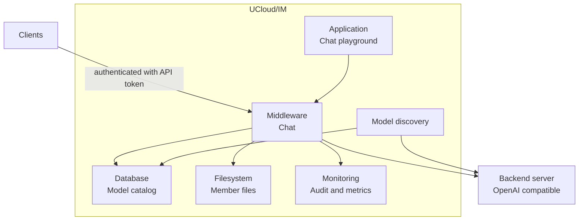
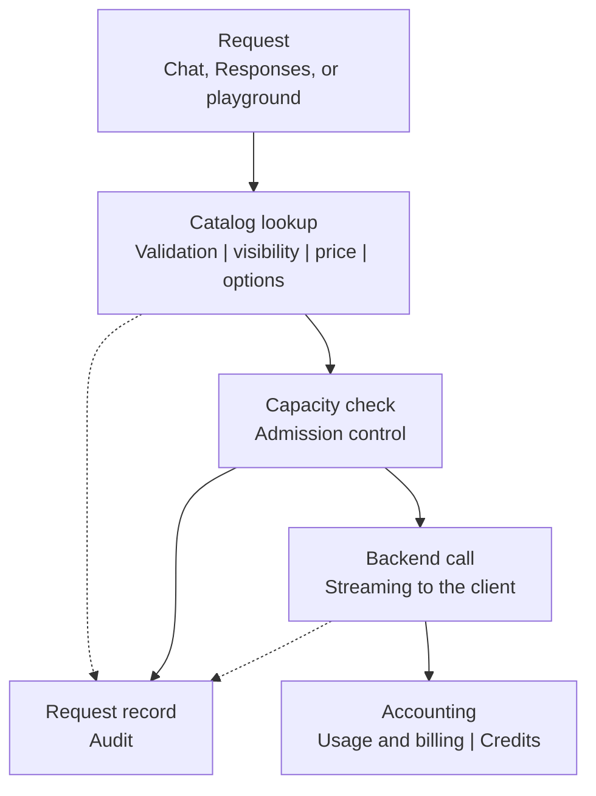

# Architecture

In this article we describe the parts of the inference feature, the public surface, the backends, the lifecycle of
one request, the limits, and the stored content.

## Components

The feature lives in the Integration Module, and it uses the same storage and accounting systems as the other
features.

<figure class="diagram" id="components">



<figcaption>

The parts of UCloud/IM that serve inference, and the systems they touch. It does not show how a request is handled
inside a part.

</figcaption>
</figure>

The components are described below:

| Component | Purpose |
|-----------|---------|
| [Model catalog](../../glossary.md#model-catalog) | Holds the model entries in the `inference_model` table of the Integration Module database. |
| [Model discovery](../../glossary.md#model-discovery) | Polls the backend for models, and creates or refreshes catalog entries. |
| [Chat middleware](./middleware.md#chat-middleware) | Serves `/v1/chat/completions` and the chat call of the playground. It validates the request against the catalog, selects the endpoint, and streams the response. |
| [Chat playground](../../glossary.md#chat-playground) | A UCX application with [threads](../../glossary.md#thread), [attachments](../../glossary.md#attachment), and tools. Threads are stored in the member filesystem. See [Chat Playground](./playground.md). |
| [API tokens](../../glossary.md#api-token) | Inference keys with the `inference/use` permission. Tokens created from the model page expire after 90 days by default. UCloud/Core also issues tokens to jobs. |
| [Audit](./observability.md) | Writes audit records for chat, response, and conversation access. |
| [Metrics](./observability.md#metrics) | Exports Prometheus metrics for usage and latency. |

## Public surface

The Integration Module serves the inference API on the `authority` hostname. OpenAI clients reach it directly.
The playground calls the shared chat middleware internally, without using this public HTTP endpoint.

| Route | Purpose |
|-------|---------|
| `/v1/models` | Lists the models that the caller may use. |
| `/v1/models/{name}` | Reports one model. |
| `/v1/chat/completions` | Chat, with streaming and tool calls. |
| `/v1/responses` | The Responses API, with `/v1/responses/{id}` and `/v1/responses/{id}/cancel`. |
| `/v1/conversations/{id}` | Response conversations. |

The request body must be JSON and it must stay under 16 MB. The chat middleware accepts the fields that the
OpenAI-compatible APIs define, including `messages`, `tools`, `response_format`, `reasoning_effort`, `temperature`,
`top_p`, and `stream`. A message may carry text, an image, a video, or audio, depending on the capabilities of the
model.

## Backends

The `provider` field selects how the Integration Module finds models and how it validates endpoints.

| Provider | Use | Behaviour |
|----------|-----|-----------|
| `dynamo` | Production | Discovery lists services in the configured namespace whose name ends with `-frontend`. Every model call must go to an in-cluster service address. See [Dynamo Deployments](./dynamo.md). |
| `development` | Development | One OpenAI-compatible backend, taken from `development.server`. A request must match that URL exactly, including the scheme, the host, and the path. |

In development mode, `development.provider: localai` makes the Integration Module start a LocalAI backend and apply a
small fallback model. Tools are disabled for that backend.

## Request lifecycle

<figure class="diagram" id="request-lifecycle">



<figcaption>

What happens to one inference request, step by step. It does not show the retries; see
[Reporting and retries](./usage.md#reporting-and-retries).

</figcaption>
</figure>

1. The Integration Module identifies the caller through API authentication or the playground session.
2. The catalog lookup finds the model, checks access, reads the price, and validates the request options.
3. Admission control checks capacity. When capacity is full, the request waits for capacity, cancellation, or the admission timeout.
4. The Integration Module calls the backend endpoint of the model, and it relays the stream to the client.
5. The Integration Module reports the token usage to the accounting system. The price of the model decides the cost.
6. The Integration Module writes an audit record for the request.

## Limits

| Limit | Value |
|-------|-------|
| Concurrent requests, all owners | 4096 |
| Concurrent requests, one authenticated user | 64 |
| Admission queue wait | 60 seconds |
| Request timeout | 30 minutes |
| Request body | 16 MB |
| Chat choices per request (`n`) | 8 |
| Completion tokens | The limit of the model |

Admission control uses the wallet owner as the limit key when the request has no authenticated username.

## Storage

All persisted chat content lives in member files, next to the files that the user or the project already has.
This includes messages, attachments, and stored responses, not catalog or accounting metadata.
A user can inspect, back up, or delete this content with ordinary file operations.

```text
<member files>
└── Inference
    ├── Attachments
    │   └── <attachment id>
    ├── Chats
    │   └── 2026
    │       └── 10
    │           └── 19
    │               └── 20261019T073000.000Z-<thread id>.json
    └── Resources
        ├── Conversations
        │   └── <conversation id>.json
        └── Responses
            └── <response id>.json
```

- **Chats** holds one JSON file per playground thread. The store partitions the files by the UTC creation date of the
  thread, so the directory does not grow flat. These threads live until the user manually deletes them.
- **Attachments** holds one file per request attachment, up to 64 MB, and a converted Markdown copy when the request
  needs one. The Integration Module removes an attachment after 14 days without activity. A backend reads an
  attachment through a temporary download link, backed by a secure token.
- **Resources** holds the state of the Responses API. The periodic drive scan deletes response and conversation files
  whose modification time is at least 30 days old.
