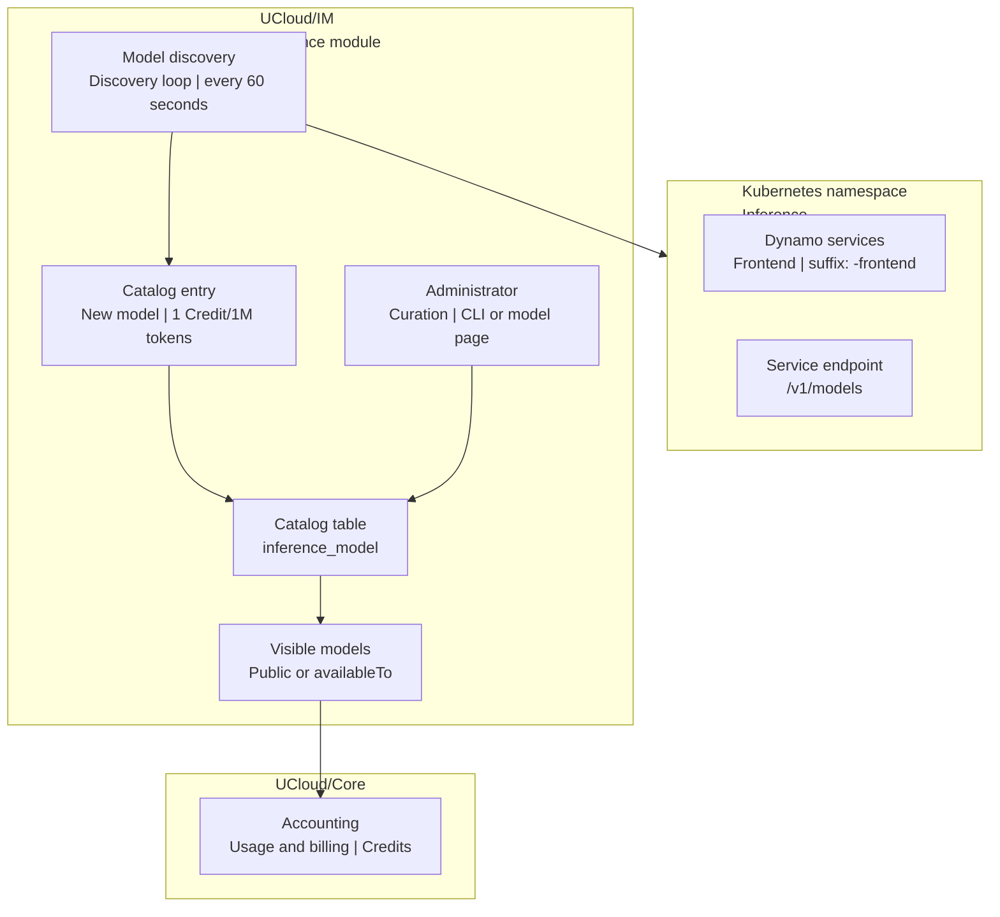

# Model Discovery and Catalog

The catalog is the list of models that the Integration Module publishes to users. Discovery keeps the catalog in
step with the backend, and an operator curates the entries that discovery creates.

<figure class="diagram" id="discovery">



<figcaption>

The discovery loop and the catalog, and who reads and writes them. It does not show the CLI commands or the pricing
rules.

</figcaption>
</figure>

## Discovery

Discovery runs when the Integration Module starts, and then every 60 seconds. For the `dynamo` provider it does the
following:

1. List the services in the namespace from `services.compute.inference.dynamo.namespace`.
2. Keep the services whose name ends with `-frontend`.
3. Build the endpoint `http://<name>-frontend.<namespace>.svc.cluster.local:<port>/v1`, where the port is the first
   port of the service.
4. Call `/v1/models` on that endpoint, with a 15 second timeout.

Every entry of the response with an object type of `model` and a non-empty identifier becomes a catalog entry.

When the same backend model is already in the catalog under another name, discovery only refreshes the context window
of that entry. It does not add a second entry.

The `development` provider has no discovery loop. It reads the single backend from `development.server`, so each model
must be added by hand. See [Creating an entry](#creating-an-entry). The exception is the LocalAI bootstrap, which runs
in development mode, applies a fallback model, and discovers that model once at startup.

## Values applied by discovery

| Field | Value |
|-------|-------|
| `name` and `title` | The model identifier from the backend. |
| `capabilities` | `TextGeneration`. Vision, video, and audio are opt in per model. |
| `pricePerMillion` | One Credit per million tokens for cached input, input, and output. |
| `availability` | Private, and visible to the projects in `access.testers`. |
| `endpoint.basePath` | The endpoint of the service. |
| `endpoint.backendModelName` | The model identifier from the backend. |
| `contextWindow` | The value the backend reports, when it reports one. |
| `chatSettings.temperature` | `0.8`. |
| `chatSettings.topP` | `0.1`. |
| `chatSettings.maxCompletionTokens` | `131072`. |
| `chatSettings.disableTools` | `false`, and `true` for the LocalAI bootstrap. |

Discovery overwrites none of these values on an existing entry, except the context window. Prices, titles, and
visibility stay as the operator set them.

## Visibility

A model is either public or private.

- A public model is visible to every user.
- A private model is visible to the projects in its `availableTo` list. A user without a project cannot see a private
  model at all.

Two configuration lists decide who curates and who tests:

- `access.administrators` lists the project IDs that may curate the catalog. An administrator also joins the testers.
- `access.testers` lists the project IDs that newly discovered private models are visible to.

An administrator can see every model, including the models that are not visible to the administrator as a user.

## Curation

An administrator can change every field of a catalog entry, from the model page in the web interface or from the CLI
on the host of the Integration Module. The CLI also creates an entry when the name is not in the catalog.

### Model page

Open a model from the Models page, select Edit, and change the price, the capabilities, the reasoning efforts, the
endpoint, the chat defaults, and the benchmark scores. The page also holds the datasheet of the model and the API
usage section.

### Creating an entry

Discovery creates an entry when it finds a model that the catalog does not hold. The `dynamo` provider does this at
startup and every 60 seconds. The LocalAI bootstrap does it once at startup.

A backend that discovery does not cover needs one entry for each model. Give `ucloud inference models update` a name
that the catalog does not hold, and the command creates the entry from the flags:

```terminal
$ ucloud inference models update my-model \
    --title "My model" \
    --base-path http://my-server:8080/v1 \
    --backend-model-name the-name-the-backend-expects
```

A create needs `--base-path` and `--backend-model-name`, because the catalog cannot guess which backend model the name
belongs to.

A new entry starts with the defaults that discovery also applies:

| Field | Default |
|-------|---------|
| `title` | The name of the model. |
| `capabilities` | `TextGeneration`. |
| `pricePerMillion` | One Credit per million tokens for cached input, input, and output. |
| `availability` | Private, and visible to the projects in `access.testers`. |
| `chatSettings.temperature` | `0.8`. |
| `chatSettings.topP` | `0.1`. |
| `chatSettings.maxCompletionTokens` | `131072`. |

The endpoint must follow the rules of the provider. With the `development` provider, the base path must equal
`development.server` exactly, including the scheme, the host, and the path. See [Backends](./architecture.md#backends).

An entry is private until an administrator publishes it. Do not pass `--name` when you create an entry, because that
option renames an entry that the catalog already holds.

### CLI

All catalog commands run as `root` on the host of the Integration Module:

```terminal
$ ucloud inference models ls
$ ucloud inference models update <name> [options]
$ ucloud inference models rm <name>
```

| Option | Effect |
|--------|--------|
| `--name <name>` | Rename the model. Only while the model is not public. |
| `--title <title>` | Set the display title. |
| `--capabilities <list>` | Set a comma-separated capability list. The allowed value is `TextGeneration`. |
| `--reasoning-efforts <list>` | Set the reasoning values, as `display=value` pairs. |
| `--default-reasoning-effort <value>` | Set the default reasoning value. |
| `--price-per-million-cached <n>` | Set the price of cached input. |
| `--price-per-million-input <n>` | Set the price of input. |
| `--price-per-million-output <n>` | Set the price of output. |
| `--public=true` / `--public=false` | Publish or withdraw the model. |
| `--available-to <list>` | Set the project IDs that may use a private model. |
| `--base-path <url>` | Set the endpoint of the backend. |
| `--backend-model-name <name>` | Set the model name that the backend receives. |
| `--temperature <n>` | Set the default temperature, from 0 to 2. |
| `--top-p <n>` | Set the default top P, from 0 to 1. |
| `--max-completion-tokens <n>` | Set the default completion limit. |
| `--system-prompt <text>` | Set the default system prompt. An empty value clears it. |

The command creates the entry when the catalog does not hold the name. See [Creating an entry](#creating-an-entry).

## Pricing

A price is a fixed point integer in Credits per one million tokens. The scale is `1000000`, so `1000000` means one
Credit per million tokens. Zero is valid and means free.

A model has three prices: cached input, input, and output. The Integration Module reads the reported token usage of
each request and reports the cost to the accounting system. See [Usage and Accounting](./usage.md).

Review the price of a discovered model before you publish it. The default of one Credit per million tokens is a
placeholder.

## Rules to remember

- A public model cannot be renamed. Withdraw it, rename it, and publish it again.
- Removing a catalog entry stops new requests for that model. It does not stop the backend, and the next discovery
  pass adds the entry back. To retire a model, remove the backend service first.
- A chat request for a name that the catalog does not hold fails validation. Curation decides what users may call.
- The capabilities of a model are advertised to clients in the model list. Set them to match the backend, so that a
  client knows which modalities the model accepts.

## Next steps

- [Architecture](./architecture.md) describes the request lifecycle and the limits.
- [CLI reference](../cli-reference.md) lists every catalog command.
