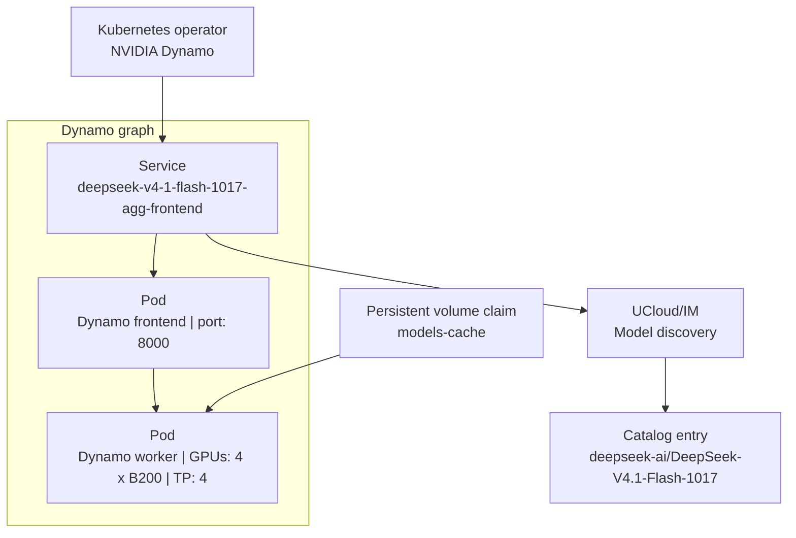

# Dynamo Deployments

NVIDIA Dynamo serves models from a graph of components. A Dynamo deployment has at least a frontend, which answers the
OpenAI-compatible API, and one or more workers, which hold the model on the GPUs.

The Integration Module talks only to the frontend. It does not talk to the workers, and it does not need to know how
the model is divided across them.

<figure class="diagram" id="topology">



<figcaption>

The Dynamo deployment as seen by UCloud/IM. It does not show the other graphs in the namespace, or the parts inside
the operator.

</figcaption>
</figure>

## What the Integration Module expects

| Item | Requirement |
|------|-------------|
| Namespace | The deployment runs in `services.compute.inference.dynamo.namespace`. Services in other namespaces are invisible. |
| Frontend service | The name of the frontend service ends with `-frontend`. For a graph named `deepseek-v4-1-flash-1017-agg`, the service is `deepseek-v4-1-flash-1017-agg-frontend`. |
| Port | The Integration Module uses the first port of that service. |
| Scheme and path | The endpoint is plain `http` and the base path is exactly `/v1`. A model call to another address is rejected. |
| Address form | `http://<name>-frontend.<namespace>.svc.cluster.local:<port>/v1`. |
| Model list | The frontend answers `/v1/models` with the model identifiers. |
| Model name | The value of `--model-name` on the frontend and `--served-model-name` on the worker agree with the catalog entry. |

Set `authority` and route it to the gateway of the Integration Module. See [AI Inference](./overview.md#enabling-the-feature).

## A worked example

The example below is the DeepSeek-V4.1-Flash-1017 deployment on four B200 GPUs. It shows the parts that the
integration depends on.

```yaml
apiVersion: nvidia.com/v1beta1
kind: DynamoGraphDeployment
metadata:
  name: deepseek-v4-1-flash-1017-agg
  namespace: ucloud-inference
spec:
  backendFramework: vllm
  components:
    - name: Frontend
      type: frontend
      replicas: 1
      podTemplate:
        spec:
          containers:
            - name: main
              workingDir: /workspace
              env:
                - name: HF_HOME
                  value: /workspace/models
              command:
                - /bin/bash
                - -lc
              args:
                - |-
                  exec python3 -m dynamo.frontend \
                    --http-host 0.0.0.0 \
                    --http-port 8000 \
                    --dyn-chat-processor vllm \
                    --model-name deepseek-ai/DeepSeek-V4.1-Flash-1017
              startupProbe:
                httpGet:
                  path: /health
                  port: 8000
              volumeMounts:
                - name: models-cache
                  mountPath: /workspace/models
          volumes:
            - name: models-cache
              persistentVolumeClaim:
                claimName: models-cache

    - name: VllmDecodeWorker
      type: worker
      sharedMemorySize: 64Gi
      podTemplate:
        spec:
          containers:
            - name: main
              env:
                - name: HF_HOME
                  value: /workspace/models
              args:
                - |-
                  exec python3 -m dynamo.vllm \
                    --model deepseek-ai/DeepSeek-V4.1-Flash-1017 \
                    --served-model-name deepseek-ai/DeepSeek-V4.1-Flash-1017 \
                    --tensor-parallel-size 4 \
                    --enable-expert-parallel \
                    --max-model-len 1048576 \
                    --max-num-seqs 256 \
                    --gpu-memory-utilization 0.90
              resources:
                limits:
                  nvidia.com/gpu: "4"
              volumeMounts:
                - name: models-cache
                  mountPath: /workspace/models
          volumes:
            - name: models-cache
              persistentVolumeClaim:
                claimName: models-cache
          affinity:
            nodeAffinity:
              requiredDuringSchedulingIgnoredDuringExecution:
                nodeSelectorTerms:
                  - matchExpressions:
                      - key: nvidia.com/gpu.product
                        operator: In
                        values:
                          - NVIDIA-B200
                      - key: ucloud.dk/machine
                        operator: In
                        values:
                          - inference
```

What each part contributes:

- `metadata.name` and `metadata.namespace` decide the service name and the discovery namespace.
- `type: frontend` makes the operator create the `-frontend` service that the Integration Module looks for.
- `--http-port 8000` decides the port of that service, and therefore the port of the endpoint.
- `--model-name` and `--served-model-name` decide the model identifier that discovery reads.
- `--tensor-parallel-size 4` divides the model across four GPUs, and `--enable-expert-parallel` adds expert
  parallelism. The worker holds four GPUs through its resource limit.
- `--max-model-len` decides the context window of the model.
- `--gpu-memory-utilization 0.90` leaves room for the cache and for the vision encoder.
- `HF_HOME` directs model downloads to the mounted `models-cache` claim, so cached weights survive pod restarts.
- The worker's node affinity selects B200 machines that are reserved for inference.
- `sharedMemorySize: 64Gi` gives the worker the shared memory that vLLM needs.

The full manifest holds more, including the image, additional probes, and the version pins.
It is not part of this article, because none of it changes how the Integration Module reaches the model.

## The catalog entry

Discovery creates one entry for the deployment above:

| Field | Value |
|-------|-------|
| `name` and `title` | `deepseek-ai/DeepSeek-V4.1-Flash-1017` |
| `endpoint.basePath` | `http://deepseek-v4-1-flash-1017-agg-frontend.ucloud-inference.svc.cluster.local:8000/v1` |
| `endpoint.backendModelName` | `deepseek-ai/DeepSeek-V4.1-Flash-1017` |
| `pricePerMillion` | One Credit per million tokens, until an operator changes it |
| `availability` | Private, and visible to the projects in `access.testers` |
| `contextWindow` | The value of `--max-model-len` when the backend reports it, otherwise the value an operator sets |

Review the entry and publish the model before the general users see it. See
[Model Discovery and Catalog](./catalog.md#curation).

## Verify the deployment

1. Call the frontend from inside the cluster and check that the model appears:

   ```terminal
   $ kubectl run --rm -it --image=curlimages/curl curl -n ucloud-inference -- \
       curl -s http://deepseek-v4-1-flash-1017-agg-frontend.ucloud-inference.svc.cluster.local:8000/v1/models
   ```

2. Wait for the next discovery pass, which runs every 60 seconds, and look for the log line
   `Discovered inference model ... at ...` in the log of the Integration Module.

3. List the catalog on the host of the Integration Module:

   ```terminal
   $ ucloud inference models ls
   ```

4. Send a chat request through the authority hostname with an inference API token. The
   [CLI reference](../cli-reference.md) shows how to inspect the entry, and the model page shows how to create a
   token.

## Operational notes

- A worker loads weights for a long time. Keep the startup probe generous, and raise
  `VLLM_ENGINE_READY_TIMEOUT_S` for a large model.
- The frontend holds no model state. It is safe to restart it, and one replica is enough for a single worker.
- A frontend and a worker must use the same runtime version. Set `runtimeVersionOverride` on both components.
- Dynamo and vLLM are separate projects with separate release cycles. Pin both versions in the image, and test an
  upgrade of one against the other before you roll it out.
