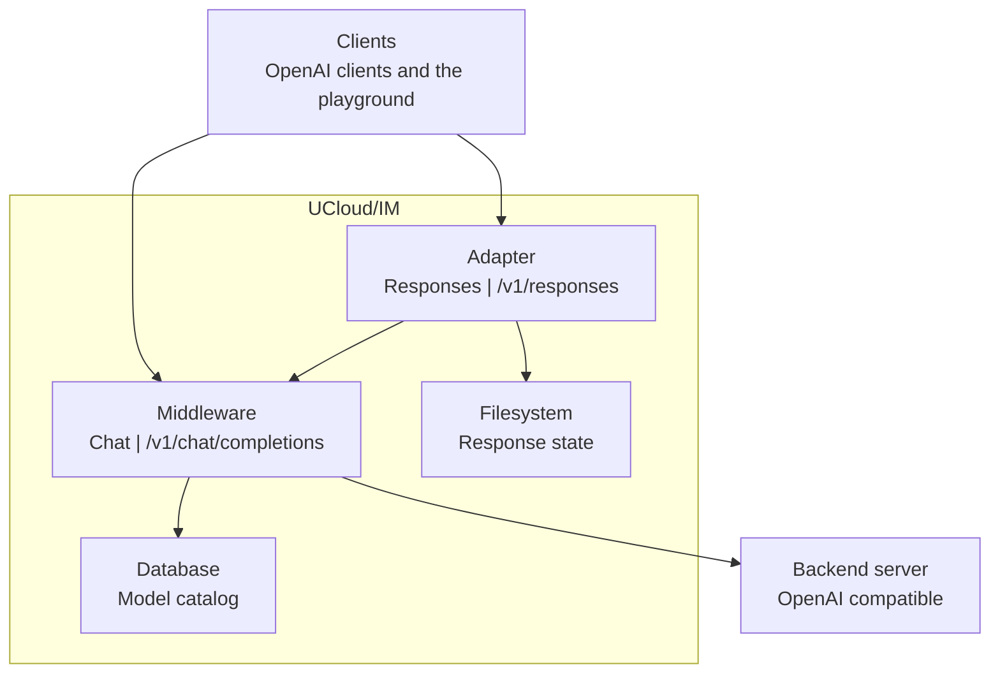

# Chat Middleware

The chat middleware serves the Chat Completions API, and it serves the chat call of the playground. The responses
adapter serves the Responses API. Both live in the Integration Module, and both share the same authentication, catalog
lookup, admission control, usage reporting, and audit records. See
[Request lifecycle](./architecture.md#request-lifecycle).

The routes of the two parts are in the [Public surface](./architecture.md#public-surface). The chat playground also
reaches the chat middleware, and the responses adapter sends a chat call to it for every response.

<figure class="diagram" id="request-routing">

<figcaption>

Which component serves which API, and what each part owns. The responses adapter sends its calls through the chat
middleware. It does not show the order of the steps inside a call.

</figcaption>
</figure>

## Chat middleware

The middleware validates the options of the request against the model, and it rejects an option that the model does not
allow.

The middleware forwards the fields that the OpenAI-compatible APIs define, and it drops a field that it does not know.
It replaces the requested model name with the name that the backend expects (`endpoint.backendModelName`). The endpoint
must also follow the rules of the provider. See [Backends](./architecture.md#backends).

The middleware relays the stream of the backend to the client without a change, including the deltas of tool calls. It
switches on `stream_options.include_usage`, so that the backend reports the token usage at the end of a stream.

When the client cancels a request, the middleware charges nothing before it has called the backend. After the call, it
reports an estimate: the input text of the request, and the output text that the client has already received, or the
running time at 50 tokens per second. A request that a user cancels while it waits for capacity receives the status 499.

The middleware reports the usage that the backend sends with a successful answer. When the usage is absent, the request
receives the reason `success_missing_usage`, and the middleware writes a warning at most once a minute for the model.

### Upstream limits

| Limit | Value |
|-------|-------|
| Request body | 16 MB |
| Response header from the backend | 4 minutes |
| A stream without data | 2 minutes |
| Dial and TLS handshake | 10 seconds |
| Body of an upstream JSON answer | 8 MB |
| One event of an upstream stream | 8 MB |
| Write of one event to the client | 30 seconds |

## Responses adapter

The adapter holds a response as a small state machine: a response starts as `queued`, becomes `in_progress` while the
model answers, and ends as `completed` or as `failed`. A response stores its state by default. See
[Storage](./architecture.md#storage) for the files.

A conversation is an ordered list of items: the input items and the output items of every turn. Each turn rewrites the
conversation file.

The adapter continues an earlier turn in one of two ways:

| Request | Result |
|---------|--------|
| `previous_response_id` | The new response continues from the stored context of that response. |
| `conversation` | The new response continues the whole conversation. |
| Neither of the two | The adapter starts a new conversation. |

A request that points at state which the platform no longer holds fails with 404.

The adapter reports the state of a response as a stream of events: `response.created`, `response.in_progress`,
`response.output_item.added`, `response.content_part.added`, `response.output_text.delta`,
`response.reasoning_text.delta`, and `response.function_call_arguments.delta`, each with a matching `*.done` event. A
custom tool call reports `response.custom_tool_call_input.delta` and closes with `response.output_item.done`. The
stream ends with `response.completed` or `response.failed`.

A cancel request answers with the current state of the response, as a read does. A background response that does not
survive a restart becomes `failed`.

The adapter writes one audit record for one logical call, and it suppresses the record of the chat call inside it.
Deleting a conversation writes `inference.conversations.delete`. See [Audit and Metrics](./observability.md).
