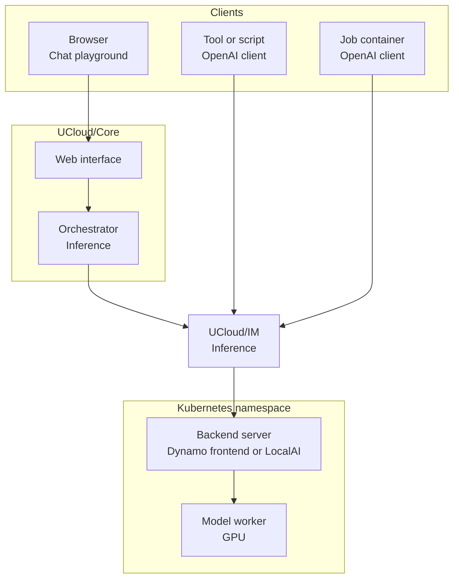

# AI Inference

The inference feature gives users and jobs access to language models through an OpenAI-compatible API. Users chat
with models from the web interface, tools, scripts, and jobs call the same models from their own code.

The Integration Module mostly acts as middleware in front of an OpenAI-compatible backend. It holds the models that
users may call, and it forwards the requests to the backend. The backend runs the models. It is any server that
answers the OpenAI-compatible API.

<figure class="diagram" id="request-path">



<figcaption>

The systems that a request passes, from a user or a job to a model worker. It does not show the parts inside
UCloud/IM, or the networking modes.

</figcaption>
</figure>

## Enabling the feature

The feature is off until you enable it. Add the `inference` section under `services.compute`:

```yaml
services:
  compute:
    inference:
      enabled: true
      authority: "chat.example.org"
      provider: dynamo
      dynamo:
        namespace: ucloud-inference
      access:
        administrators: []
        testers: []
```

For details, see the [configuration reference](../config-reference.md).

Then do the following:

- Create a DNS record for the `authority` hostname, and route it to the gateway of the Integration Module next to the
  `web` hostname.
- Deploy a backend.
  - For Dynamo, set `provider: dynamo` and see [Dynamo Deployments](./dynamo.md).
  - Alternatively, use `provider: development`. Discovery does not run for this provider, so add each model to the catalog with
    `ucloud inference models update`. See [Creating an entry](./catalog.md#creating-an-entry).
- Add the project IDs that curate models to `access.administrators`. See
  [Model Discovery and Catalog](./catalog.md).
- Create a root allocation for AI credits and award them to your administrator project for initial testing and
    verification. See [Accounting and Resource Management](../../overview/accounting.md).

## Where users meet the feature

| Surface | Location | Purpose |
|---------|----------|---------|
| Models | `/app/inference/models` | The catalog. Admins also curate models here. |
| Model page | `/app/inference/model?name=<model>` | One model, with benchmark scores and the API usage section. |
| [Chat](./playground.md) | `/app/inference/playground` | A chat client with threads, attachments, and tools. |
| API tokens | The API usage section of a model page | Tokens that let tools and scripts call the API. |
| OpenAI-compatible API | The `authority` hostname | `/v1/chat/completions`, `/v1/responses`, and `/v1/models`. See [Public API](./architecture.md#public-surface). |

Job containers receive inference servers through environment variables when the application asks for them. See
[Inference servers](../compute.md#inference-servers).

## What the feature does not do

- It does not deploy or update the model servers.
- It does not create API tokens without a user or an application that asks for them.

## Troubleshooting

| Symptom | Checks |
|---------|--------|
| Dynamo model is missing | Check the discovery namespace, `-frontend` service suffix, first service port, and `/v1/models` response. Check discovery logs. See [Verify the deployment](./dynamo.md#verify-the-deployment). |
| Model exists but users cannot see it | Check public availability and the current project's `availableTo` entry. See [Visibility](./catalog.md#visibility). |
| Model appears but requests fail | Check the catalog endpoint, backend model name, and connectivity from IM. See [Backends](./architecture.md#backends). |
| Request reports insufficient Credits | Check inference allocations and wallet status. Administrator access does not bypass accounting. See [Usage and Accounting](./usage.md) and [Accounting and Resource Management](../../overview/accounting.md). |
| Playground reports insufficient storage | Check usable storage resources from the selected inference provider. See [Accounting and Resource Management](../../overview/accounting.md). |
| Requests wait or fail under load | Check concurrent requests, admission rejection metrics, and backend response times. See [Limits](./architecture.md#limits) and [Audit and Metrics](./observability.md). |
| Usage is missing or delayed | Check backend usage reports and IM accounting logs. Failed accounting reports remain pending for retry. See [Reporting and retries](./usage.md#reporting-and-retries). |

## Next steps

- [Architecture](./architecture.md) describes the components, the public routes, and the limits.
- [Chat Middleware](./middleware.md) describes the handling of a request and the state of the Responses API.
- [Chat Playground](./playground.md) describes the playground, its threads, its attachments, and its tools.
- [Model Discovery and Catalog](./catalog.md) describes discovery and curation.
- [Dynamo Deployments](./dynamo.md) describes the Dynamo backend.
- [Usage and Accounting](./usage.md) describes the price of a model and the reporting of usage.
- [Audit and Metrics](./observability.md) describes the audit records and the Prometheus metrics.
