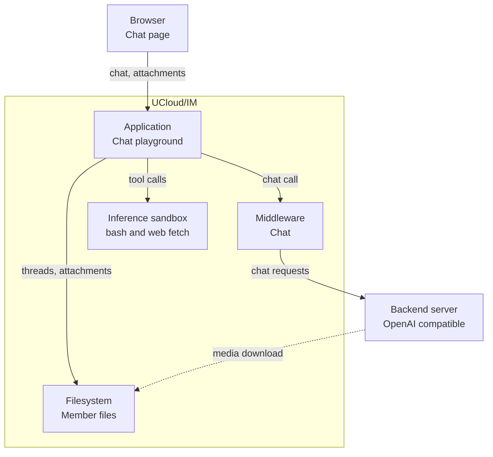

# Chat Playground

The chat playground is a UCX application in the web interface, at `/app/inference/playground`. It is a chat client with
[threads](../../glossary.md#thread), [attachments](../../glossary.md#attachment), and tools.

The playground calls the chat middleware of the Integration Module directly, so a chat in the playground uses the same
models, the same prices, and the same limits as a call to the API.

<figure class="diagram" id="playground">

<figcaption>

How a chat in the playground reaches a model, and where the threads, the attachments, and the tools live. The backend
reads an image, a video, or an audio file through the download link. It does not show the steps inside the chat
middleware.

</figcaption>
</figure>

The playground keeps its content in the [member drive](../../glossary.md#member-drive), as files of the user or of the
project. See [Storage](./architecture.md#storage) for the layout of the files.

## Threads

A thread is one conversation: a title, the messages, the model, and the token usage. A thread also remembers whether the
[inference sandbox](../../glossary.md#inference-sandbox) may use the internet.

The playground creates a thread when the user sends the first message, and it holds the thread in memory while the
browser session is open. It writes the thread to the member files at most every five seconds while the session is open,
and once when the session ends. A write replaces the file of the thread.

A thread holds at most 8 MB of JSON, and the title is cut at 80 characters. A user can delete a thread, and the platform
then removes its file. Threads stay until the user deletes them.

## Attachments

A user can add a file to a message. The playground sends the file in chunks of at most 8 MB, and the file must stay
under 64 MB. A copy stays in the member files, so that the user and the model can read it again later.

| Content | How it reaches the model |
|---------|--------------------------|
| Text | The playground puts the text into the prompt, in an `attachment` block that names the file. A text attachment must stay under 128 KB. |
| Image, video, audio | The file becomes a message part with a URL, and the model reads it through the download link. |
| A document | The playground converts the file to Markdown, and the Markdown becomes the text of the message. |

The playground converts the formats PDF, PowerPoint, Word, Excel, EPUB, and ZIP. A conversion runs as a background task
on the Kubernetes cluster of the provider, with a limit of 120 seconds. The playground stops waiting after 125 seconds,
and it reports an error when the task does not finish.

A backend reads an image, a video, or an audio file through a download link with an unguessable token, because a backend
has no UCloud credentials. The link works while the file stays in the member files.

The platform removes an attachment after 14 days without activity, and a user can delete an attachment earlier. The
cleanup runs once an hour, and it removes the Markdown copy of a converted document too.

## Tools

The playground offers these tools to a model:

| Tool | Purpose |
|------|---------|
| `bash` | Runs one non-interactive shell command, for example a calculation. The command starts in `/`. |
| `web_fetch` | Reads one public URL, or one document from the sandbox cache. A cached document expires after 10 minutes. |
| `request_internet_access` | Asks the user for internet access for the thread. |

A thread has no internet access until the user grants it. When the user grants the request, the sandbox receives internet
access, and the playground remembers the answer on the thread.

A shell command runs for 60 seconds by default and for 2 minutes at most. A web fetch has 15 seconds by default and 30
seconds at most.

The playground gives the model at most ten rounds of tool calls in one turn. It then asks for a final answer without
tools. An answer can carry a large tool result. When the conversation approaches the context window of the model, the
playground replaces an old result with a short note that the output is omitted, and it cuts the text of an error at 512
characters.

### The inference sandbox

UCloud/IM runs the sandbox as a job on the Kubernetes cluster of the provider. It starts the sandbox on demand, and it
stops the sandbox after 15 minutes without a call. Each user and each project has its own sandbox, and the sandbox
belongs to the wallet of the playground session.

The sandbox does not mount a drive of the workspace, so a tool cannot read the files of the user. The platform mounts
the tools in a read-only directory at `/mnt/exe`. Files that a tool writes stay in the sandbox, and the platform removes
them with the sandbox.

The sandbox always reaches the cluster DNS. It reaches the internet on the ports 80 and 443 after the user grants
access. The grant covers the sandbox, so it applies to every thread of the same workspace.

A provider can turn the tools off for a model with `chatSettings.disableTools`. See
[Values applied by discovery](./catalog.md#values-applied-by-discovery).
