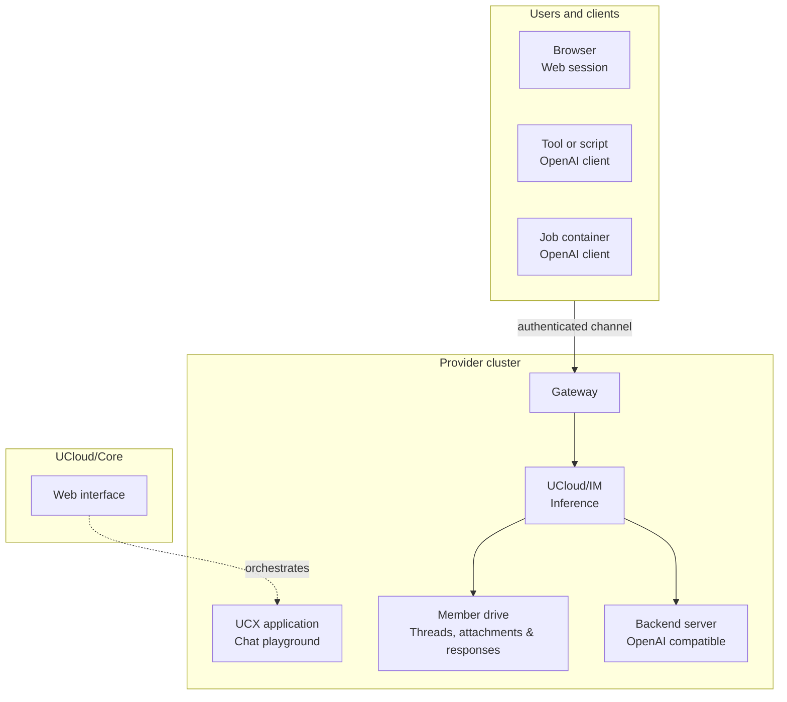

# Security

This page describes the security controls of the AI inference feature. It covers the public API, the token model, the
playground, and the stored data.

## Trust boundaries

<figure class="diagram" id="trust-boundaries">

<figcaption>

The trust boundaries of the AI inference feature. The clients reach the provider through an authenticated channel at the
gateway. UCloud/Core orchestrates the provider-hosted playground in UCloud/IM and proxies the browser connection. The
dotted arrow shows the control path. The figure does not show the internal request flow.

</figcaption>
</figure>

The feature spans three groups of systems:

- **The clients.** Browsers, tools, scripts, and job containers. A client holds a bearer token or a web session.
- **UCloud/Core.** The web interface and the accounting system. Core orchestrates the playground and proxies its
  connection to the provider.
- **The provider.** The gateway, UCloud/IM with the provider-hosted playground, the member drive, and the inference
  backend.

A request crosses into the provider at the gateway. The gateway forwards the request to UCloud/IM. UCloud/IM
authenticates the caller, checks the model, applies admission control, and calls the backend.

The playground is a UCX application that runs in UCloud/IM. The browser uses a web session with UCloud/Core. Core
communicates with the provider on the user's behalf through the standard Core-to-provider mechanism. The playground does
not use an API token.

## Authentication and authorization

### Public API

The public inference API authenticates each request with a bearer token in the `Authorization` header. The token must
have the `inference/use` permission. UCloud/IM resolves the token to its owner, either a user or a project. The owner
selects the wallet that pays for the request.

| Condition | Result |
|-----------|--------|
| The request has no bearer token, or the secret is invalid. | `403` |
| The token does not have `inference/use`. | `403` |
| The model is not visible to the owner. | `403` |
| The model is not in the catalog. | `404` |
| The wallet of the owner is locked. | `402` |
| Admission control has no free slot before the timeout. | `429` |

The catalog check runs after authentication. A public model is visible to every user. A private model is visible only
to the projects in its `availableTo` list. See [Visibility](./catalog.md#visibility).

Admission control limits the load that one caller can add. The limit is 64 concurrent requests per authenticated user
and 4096 concurrent requests for all owners. The wallet owner is the limit key when the request has no username. The
request body limit is 16 MB, and a request times out after 30 minutes. See [Limits](./architecture.md#limits).

### Chat playground

The chat playground is a UCX application that the provider hosts in UCloud/IM. It uses the web session of the user and
does not use an API token. The owner of the playground session selects the wallet that pays for the calls.

### Jobs

UCloud/Core creates the inference tokens for a job, links them to the job, and revokes them when the job ends. The
tokens have no fixed expiry. They arrive as environment variables in the job container. A job token has the same
inference permission as a token that a user creates. See [Inference servers](../compute.md#inference-servers) and
[Provider API Tokens](../../overview/provider-api-tokens.md).

### Administration

The `access.administrators` list holds the project IDs that may curate the model catalog. An administrator can see
every model, including models that are not visible to the administrator as a user. The `access.testers` list holds the
projects that see newly discovered private models. See [Model Discovery and Catalog](./catalog.md).

## Token protection

The token table stores a salted PBKDF2-SHA512 hash. The secret is shown once when the platform creates the token. A job
token is also kept in the provider job secret store until the job starts. Treat the provider database as secret-bearing.

The validator checks the expiry date during validation. A job token has no expiry date and is revoked when the job ends.

For a provider token, UCloud/Core asks the provider to revoke the token before it deletes the token resource. A
platform token is deleted with its token resource.

The owner and the permissions of a provider token are fixed when the platform creates the token. The provider does not
check the current project membership on each request. UCloud/Core sends project membership updates to the provider, and
the provider revokes a project token when its creator is no longer a member. A project token created by a remaining
member stays valid. Job tokens follow the job lifecycle instead. If other people know the secret of a shared token,
revoke it manually.

A token is a bearer credential. Anyone who has the secret can use it until it expires or the owner revokes it. Use one
token for each client. For a token that a user creates, keep the expiry date short, and revoke the token when it leaks.

## Data protection

The feature stores chat content in the [member drive](../../glossary.md#member-drive) of the user or the project. Access
to the files follows the normal file permissions of the member drive. The feature does not create a second permission
model for the stored content.

| Content | Why it is kept | Storage | Retention |
|---------|----------------|---------|-----------|
| [Playground threads](./playground.md) | To keep the chat history, model choice, and token usage, so the user can reopen and continue a chat. | Member drive | Until the user deletes the thread. |
| [Playground attachments](./playground.md#attachments) | To keep the files that the user added to a message, so the user and the model can read them again. | Member drive | 60 minutes after the last activity. |
| [Responses and conversations](./middleware.md#responses-adapter) | To keep the state that lets the Responses API continue from `previous_response_id` or `conversation`. | Member drive | 30 days after the last modification. |

A user with access to the member drive can delete any of this content at any time. A thread or an attachment can be
deleted from the playground. A response or a conversation can be deleted through the Responses API or with ordinary file
operations in the member drive.

An attachment link is an unguessable URL. The inference backend has no UCloud credentials, so it reads the attachment
through this link. The link works while the file stays in the member drive. Treat the link as a secret.

The audit record stores the token identity, the model, the outcome, and the token usage. It does not contain the
message content. See [Audit](./audit.md).

The backend receives the prompt. When the request has an attachment, the backend receives a link to the file. The
provider must trust the backend and protect its images, model weights, and network.

## Related

- [Provider API Tokens](../../overview/provider-api-tokens.md)
- [Audit](./audit.md)
- [Metrics](./observability.md)
- [Architecture](./architecture.md)
- [Chat Playground](./playground.md)
