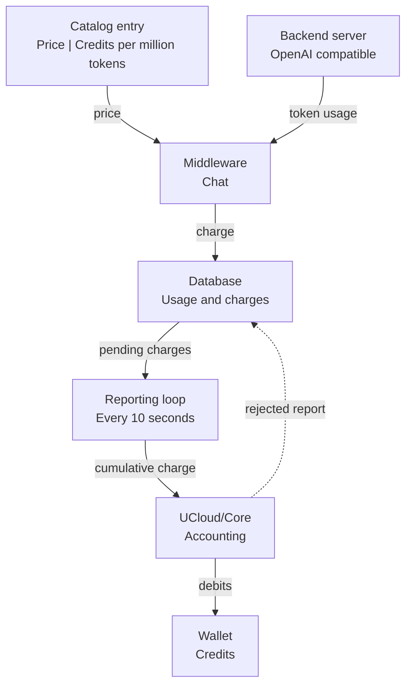

# Usage and Accounting

Inference is an accounting product with the unit Credit. The price of a model is fixed point Credits per one million
tokens, in three parts: cached input, input, and output. The operator sets the price on the catalog entry, and the
default for a discovered model is one Credit per million tokens. See
[Model Discovery and Catalog](./catalog.md#pricing).

The Integration Module reads the token usage that the backend reports for each request. It splits the usage into the
three parts, multiplies each part by the price of the model, and reports the result to the accounting system against
the wallet of the caller. A user pays from the personal wallet, and a request from a project pays from the project
wallet. The three parts follow the price of the model, so a model with a cached input price of zero makes a cached
request cheaper.

<figure class="diagram" id="charge-path">

<figcaption>

How a charge travels from the backend to the wallet of the caller. The charge is stored before it is reported, so a
report that UCloud/Core rejects stays pending. It does not show the price of a single model.

</figcaption>
</figure>

Cancelled streaming requests can incur estimated charges when the backend does not report usage.

## Reporting and retries

The Integration Module saves token totals and charges in its database before it reports charges to UCloud/Core.
It keeps fractional remainders across requests, so small charges are not lost through rounding.

A background loop sends cumulative charges for each wallet owner. New usage wakes the loop.
A timer also runs every ten seconds.
The Integration Module marks a charge as reported only after UCloud/Core accepts it.
Failed reports remain pending for a later retry, including after an Integration Module restart.
