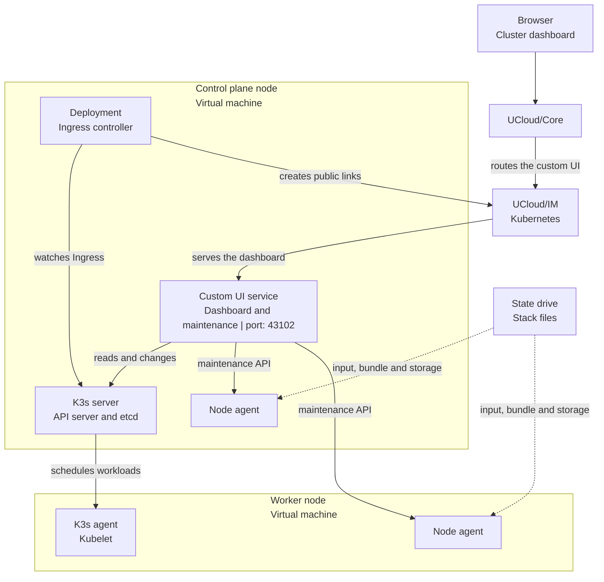
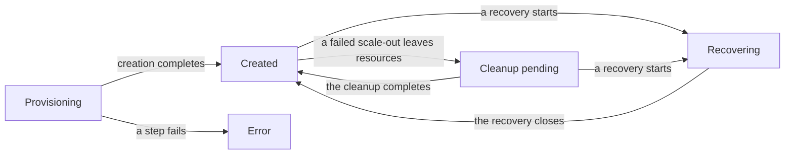

# Architecture

<i class="fa fa-triangle-exclamation"></i>

The Kubernetes cluster application is a pre-release. It is not ready for production use, and the behavior and the
interfaces can change.

The application is one executable with several roles. The platform, the machines of the cluster and the state of the
cluster decide which role starts. All roles read and write one shared state: the
[stack KV-state](../../glossary.md#stack-kv-state).

This article describes the processes, the resources of the stack, the stack KV-state, and the phases of a cluster.

## Processes

| Process | Starts on | Purpose |
|---------|-----------|---------|
| Creator | The application session of the user | Shows the deployment form and the recovery form. It creates the stack and the first nodes of the cluster. |
| [Cluster dashboard](./cluster-dashboard.md) | Every control plane node, as the custom UI service | Serves the web interface of the cluster. It reads the Kubernetes API and the stack KV-state. |
| [Maintenance coordinator](./maintenance-and-upgrades.md) | Every control plane node, in the custom UI service | Executes the maintenance operations on every node of the cluster. It reads the operations from the stack KV-state and sends the remote work to the node agents. |
| Controller | Once per cluster, as a Deployment on a control plane node | Watches the Ingress resources of the cluster. It creates a [public link](../public-links.md) for every eligible host and it keeps the members of the Ingress service correct. |
| [Node agent](./maintenance-and-upgrades.md#node-agent) | Every node, as a systemd service | Runs the remote work that needs root on the node: Kubernetes upgrades, operating-system updates and backups. |
| Recovery | A declared job of the stack | Serves the disaster recovery wizard. It runs only while a recovery is active. See [Backup and recovery](./backup-and-recovery.md). |

<figure class="diagram" id="deployment">

<figcaption>

The machines of one cluster, the processes on each machine, and the traffic that reaches them. It does not show the
networking inside the cluster; see [Networking and storage](./networking-and-storage.md).

</figcaption>
</figure>

The custom UI service and the maintenance coordinator are one process. The platform starts the service on every
control plane node and shares the mounts of the node with it. The dashboard is available while at least one control
plane node runs.

## The cluster stack

A [stack](../../glossary.md#stack) groups the resources of one cluster. [UCloud/IM for
Kubernetes](../architecture.md) creates the resources of the stack on the systems of the provider.

| Resource | Purpose |
|----------|---------|
| [State drive](../../glossary.md#state-drive) | Holds all files of the cluster: the node inputs, the script bundle, the backups and the shared storage. |
| Private network | Connects the nodes on a fixed address plan. See [Networking and storage](./networking-and-storage.md#address-plan). |
| Service | Serves the Kubernetes API on port 6443. The control plane jobs are the members of the service. |
| Public link | Serves the Kubernetes API on a public hostname, for example `<cluster-id>-api.<domain>`. |
| Node jobs | One UCloud [job](../../glossary.md#job) per node. Each job runs [Ubuntu 26.04 as a virtual machine](../kubevirt.md) with a disk from the state drive. |
| Ingress service | Serves the applications of the cluster on port 30080. See [Application access](./networking-and-storage.md#application-access). |
| Ingress public links | One public link per Ingress host of the cluster. |

If the creator stops while it creates the stack, the platform removes the resources that the stack created. The
cluster record can still list leftover resources. The application removes them in the background and clears the
record when they are gone. See [Creating a cluster](./creating-a-cluster.md#failure-during-creation).

## Stack KV-state

All roles share the stack KV-state. It holds a small record per purpose. Every write carries the revision of the
record, so two roles cannot overwrite each other by accident.

| Record | Holds |
|--------|-------|
| [Cluster record](../../glossary.md#cluster-record) | The phase of the cluster, the nodes and their jobs, the worker pools, the provider, the network, the service, the script bundle and the next free node number. |
| [Maintenance operation](./maintenance-and-upgrades.md#operation-model) | One operation per node: the kind, the phase, the deadline and the progress. |
| Rolling upgrade | The active rolling upgrade: the target release, the nodes and their operation identifiers. |
| [Traffic record](../../glossary.md#traffic-record) | The control plane jobs whose traffic is suspended during maintenance. |
| Automatic maintenance | The policy with the maintenance window, and the state of the current or last run. |
| Backup state and request | The schedule of the backup coordinator, the last attempts and the manual requests. |
| Recovery record | The active recovery: the stage, the backup and the error of the last step. |

The [Reference](./reference.md#stack-kv-state) lists the key of every record, and
[Stacks](./stacks.md#the-stack-kv-state) describes the store that holds the records.

The cluster record is the source of truth for the cluster. Every process reads the record before it changes the
cluster, and the application validates the schema revision of the record. A record that an incompatible version of the
application wrote is rejected.

## Credentials

The cluster uses four secrets. See [Reference](./reference.md#credentials) for the paths and the lifetime.

- The **join tokens** admit a node to the cluster. One token admits control plane nodes and one token admits workers.
  The tokens are static for the lifetime of the cluster.
- The **administrator token** of the Kubernetes API. It belongs to the service account of the cluster and it does not
  expire.
- The **controller registration token** admits the controller to the provider API. It belongs to the node that runs the
  controller.
- The **maintenance enrollment secret** admits the maintenance coordinator to the node agent of one node.

## Cluster phases

<figure class="diagram" id="phases">

<figcaption>

The phases of a cluster and the events that move a cluster from one phase to the next. It does not show the
background cleanup attempts.

</figcaption>
</figure>

| Phase | Meaning |
|-------|---------|
| `provisioning` | The creator creates the resources of the cluster. New nodes cannot join yet. |
| `created` | The cluster works. Maintenance, backup and recovery are available. Scale-out is available when the pending-cleanup list is empty. |
| `error` | A step of the creation failed. The cluster record holds the reason. |
| `cleanup-pending` | A failed scale-out left resources. The application removes them in the background and returns to `created`. Maintenance, backup and recovery remain available. Scale-out waits for the cleanup. |
| `recovering` | A recovery replaces the control plane nodes from a backup. All other operations wait. |
