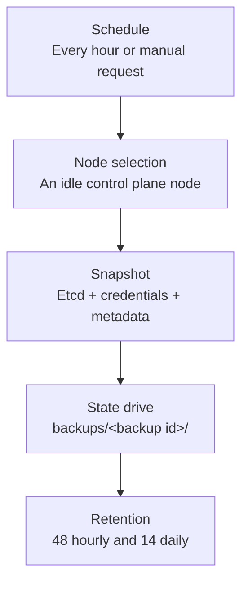
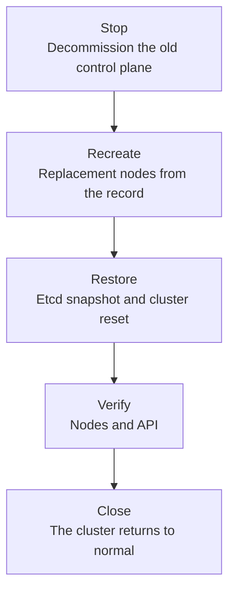

# Backup and recovery

<i class="fa fa-triangle-exclamation"></i>

The Kubernetes cluster application is a pre-release. It is not ready for production use, and the behavior and the
interfaces can change.

The application takes hourly etcd snapshots of the cluster and stores them on the
[state drive](../../glossary.md#state-drive). A cluster that loses its control plane can restore one of these snapshots
and continue with the same identity: the same node names, the same private addresses and the same join tokens.

## Backups

A [cluster backup](../../glossary.md#cluster-backup) holds:

- the etcd snapshot of the cluster, which contains every Kubernetes object of the cluster;
- the join tokens of the cluster, so a restored control plane can admit the worker nodes again;
- the metadata of the backup: the cluster, the Kubernetes release, the node that created the snapshot and the
  checksum of the snapshot.

<figure class="diagram" id="backup">

<figcaption>

The path of one backup, from the schedule to the retained backup. It does not show the retries and the locking that
keeps two backups apart.

</figcaption>
</figure>

- The backup coordinator runs on every control plane node. One attempt runs per hour, and the dashboard can ask for
  an attempt at any time.
- The coordinator claims the attempt before it starts, so only one node takes a backup. An attempt that loses its
  coordinator is recorded as failed.
- The coordinator selects a control plane node that is idle, if one exists. A node that runs a maintenance operation
  is not selected while an idle node is available.
- The node agent writes the snapshot and the credentials into a partial folder, checks them, and commits the folder
  under the backup identifier. A partial folder never counts as a backup.
- A failed attempt records the reason on the backup state. The dashboard shows the last attempt, the retained
  backups and their age.

### Retention

A cluster keeps:

- the 48 newest backups;
- the newest backup of each of the last 14 days;
- always the newest backup, also when it is older than the other rules.

The node agent removes the backups outside the retained set. A backup that the node agent could not remove appears as
a warning on the backup page.

### Freshness

The [automatic maintenance](./maintenance-and-upgrades.md#automatic-maintenance) needs a recent backup before a
Kubernetes upgrade. The default is one hour. When the newest backup is older, the run requests a new backup and waits
for it. A backup needs at least one reachable control plane node.

## Recovery

A recovery replaces the control plane nodes of a cluster from a backup. The operator starts it from the application:
the deployment form lists the clusters on which the operator has permission, and it starts a recovery job
with the state drive of the cluster mounted.

A recovery can start while the cluster is in the `created`, `cleanup-pending` or `recovering` phase. Before it
recreates nodes, the recovery job attempts to remove the leftover resources of a failed scale-out. It continues with
the recovery when the cleanup fails.

<figure class="diagram" id="recovery">

<figcaption>

The stages of one recovery. It does not show the manual retries of a failed stage.

</figcaption>
</figure>

1. **Stop.** The application marks the control plane nodes as decommissioned in their inputs and terminates their
   jobs. A node that starts again does not join the cluster with its old input. The application waits until every
   control plane job reached a final state.
2. **Recreate.** The application creates one replacement node for every control plane node of the [cluster
   record](../../glossary.md#cluster-record). A replacement node keeps the name, the number and the private address
   of the node that it replaces. The first server mounts the backup and restores the snapshot with the etcd cluster
   reset of k3s. The application verifies the checksum of the snapshot before the restore.
3. **Restore.** The application waits until the Kubernetes API answers again.
4. **Verify.** The application checks the control plane nodes and the API, and it shows the result of every check.
5. **Close.** The operator closes the recovery. The application records the closed recovery, returns the cluster to
   the `created` phase and stops the recovery job.

The worker nodes keep running during the recovery. The snapshot holds the Kubernetes objects of the whole cluster, so
the workers return to the state of the backup.

### What a recovery changes

- The etcd dataset becomes the snapshot. Every Kubernetes object that a user created after the backup is lost.
- The control plane nodes are new virtual machines. The worker nodes, the state drive and the data of the user stay.
- The cluster keeps its cluster identifier, its worker pools and its addresses.

### Failure and retry

The recovery record holds the current stage, the selected backup and the error of the last step. The wizard shows
them, and it offers these actions:

- **Restart recovery** repeats the stop and the recreate stages after a control plane node stopped. The selected
  backup can be changed while the replacement nodes do not exist yet.
- **Continue to cluster checks** moves to the verification when the API does not answer within the expected time.
- **Check again** runs the verification again.

Maintenance waits while a recovery is active. The dashboard of the cluster is not reachable during a recovery,
because its nodes are replaced. The recovery job serves its own interface.
