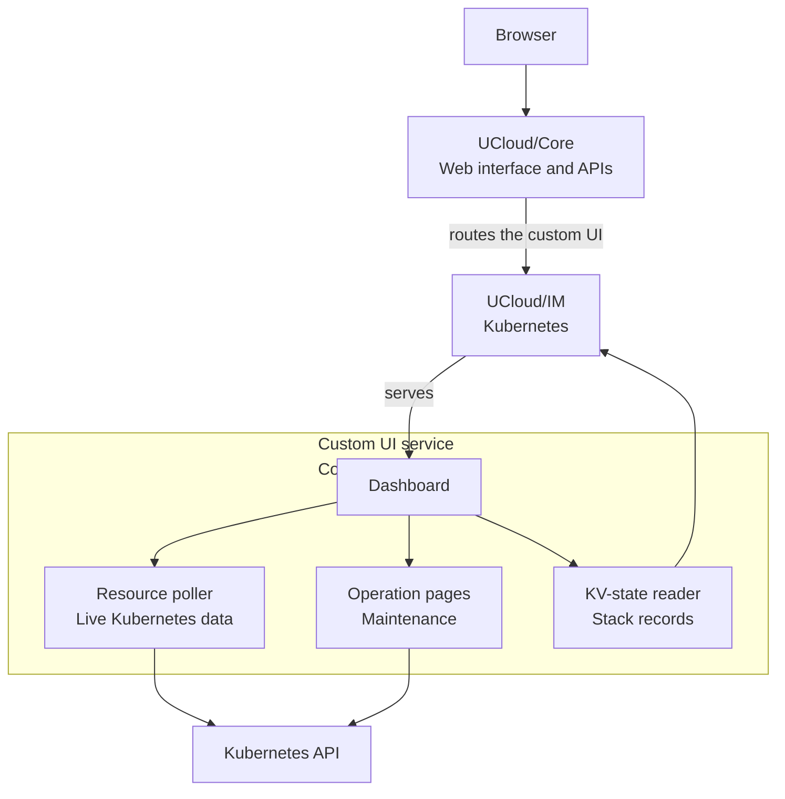

# Cluster dashboard

<i class="fa fa-triangle-exclamation"></i>

The Kubernetes cluster application is a pre-release. It is not ready for production use, and the behavior and the
interfaces can change.

The cluster dashboard is the web interface of one cluster. It runs on every control plane node as the custom UI
service and the platform routes the browser to a node that runs it. The dashboard shows the state of the cluster, the
Kubernetes resources and the operations that change the cluster.

<figure class="diagram" id="parts">

<figcaption>

The parts of the dashboard and the systems it uses. It does not show the individual pages.

</figcaption>
</figure>

## Home

The home page answers the first question of every support case: does the cluster work?

| Item | Shows |
|------|-------|
| Cluster state | The phase of the [cluster record](../../glossary.md#cluster-record), or `Healthy` and `Unhealthy` from the live nodes. A failure reason appears in the same place. |
| Nodes ready | The number of ready nodes against the number of nodes. The item links to the node table. |
| Kubernetes version | The version of the control plane. The item marks a version that passed its end of support. The item links to the rolling upgrade. |
| Resources | The number of resources that the stack created. |
| Backups | The state of the last backup. The item links to the backup page. |
| Automatic maintenance | The state of the automatic policy. The item links to the automatic maintenance page. |

The home page also holds the actions of the cluster:

- **Connect** downloads the kubeconfig and shows the `kubectl` commands for the cluster.
- **Permissions** grants cluster access to project groups. `Cluster admin` gives full cluster access, including cluster
  resources, credentials, VM shells and logs. The creator and the project administrators keep access. The platform
  stores the access control list of the stack; the application keeps no separate list.
- **Delete cluster** removes the cluster and its machines.

## Kubernetes resources

The dashboard browses the Kubernetes API of the cluster. It lists the built-in resource types in groups: Cluster,
Workloads, Networking, Storage and Config. Custom resource definitions appear in groups of their own, named after the
API group.

The resource table offers these actions, depending on the type of the resource:

| Action | Use |
|--------|-----|
| View YAML, Edit, Create, Delete | Read and change the resource. |
| Restart | Restarts a workload with a rolling restart. |
| Open shell | Opens an interactive shell in the container or on the node. |
| Container logs | Reads the log of a container. |
| Open service | Opens the address of an Ingress in a new tab. |
| Go to job | Opens the UCloud job of a node. |
| Add machine, Add worker pool | Changes the machine pools. See [Scale-out](./creating-a-cluster.md#scale-out). |
| Cordon and drain, Uncordon, Upgrade Kubernetes, Remove node | Starts a maintenance operation on one node. See [Maintenance and upgrades](./maintenance-and-upgrades.md). |

The poller reads the Kubernetes API at a fixed interval. A resource that a user changes with `kubectl` appears in the
dashboard with the next poll.

## Operation pages

| Page | Purpose |
|------|---------|
| Maintenance | Starts a cordon, a drain, an upgrade, an operating-system update or a removal on one node, and shows the progress and the log of the operation. |
| Rolling upgrade | Upgrades every node to one target release, one node at a time. See [Rolling upgrade](./maintenance-and-upgrades.md#rolling-upgrade). |
| Automatic maintenance | Holds the policy and the window of the automatic Kubernetes upgrades and operating-system updates. See [Automatic maintenance](./maintenance-and-upgrades.md#automatic-maintenance). |
| Backups | Shows the last attempt, the retained backups and the manual backup action. See [Backup and recovery](./backup-and-recovery.md). |

## The provisioning view

While the Kubernetes API does not answer, the dashboard shows the provisioning view instead of the resource tables.
The view holds the state of the cluster from the [cluster record](../../glossary.md#cluster-record): the failure
reason, the resources that the application is removing after a failed node creation or scale-out, and the progress
of the nodes. It also shows the log of every node job and links to the maintenance operations of the nodes. The view
stays available after an interrupted creation, so an operator can read the state that the creator reached. The home
page also shows a cleanup card while the cluster has pending resources.

## Support tasks

The dashboard supports the common support cases of a cluster:

- **Find a failing node.** The node table shows the state, the job and the machine. `Go to job` opens the logs of the
  node job.
- **Read a log.** Every pod offers its container log, and every node offers a shell.
- **Check the API service.** The node table and the public links show whether the cluster can serve traffic. See
  [Networking and storage](./networking-and-storage.md#kubernetes-api).
- **Check the schedule.** The backups and the automatic maintenance pages show when the next run happens and why a run
  waits.
