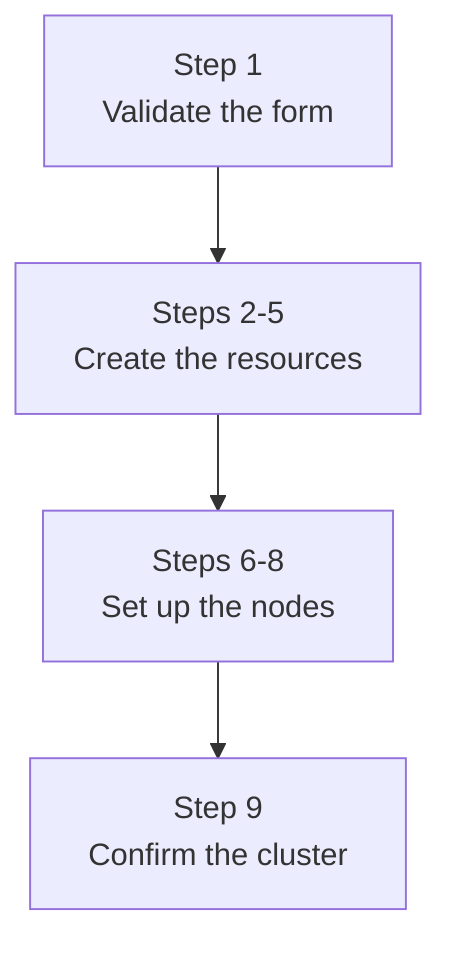
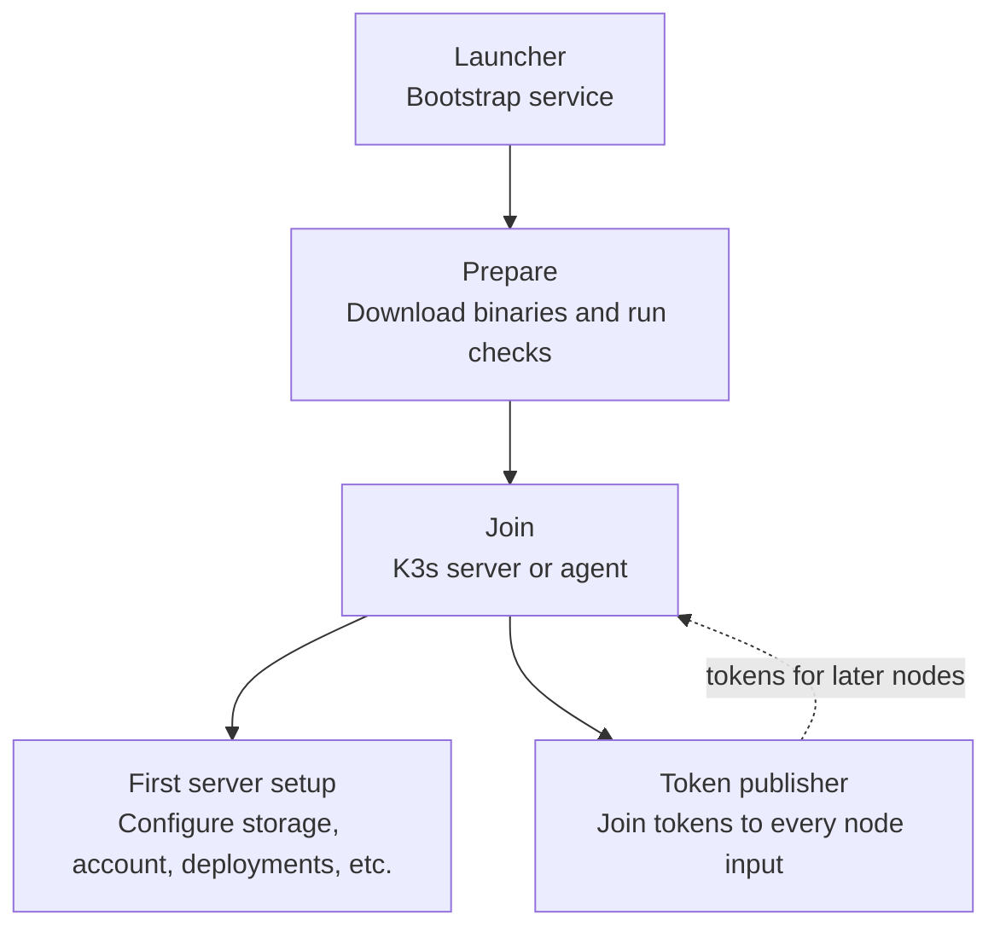

# Creating a cluster

<i class="fa fa-triangle-exclamation"></i>

The Kubernetes cluster application is a pre-release. It is not ready for production use, and the behavior and the
interfaces can change.

The [end-user](../../glossary.md#end-user) opens the Kubernetes cluster application from the application catalog and
fills the deployment form. The creator validates the form, creates the [stack](../../glossary.md#stack) and starts the
nodes. The cluster is ready after a few minutes.

## The deployment form

| Field | Meaning |
|-------|---------|
| Cluster ID | The name of the cluster. It appears in the hostname of the Kubernetes API. The ID is unique in the workspace and it contains `a-z`, `0-9` and `-` only. |
| Service provider | The provider that runs the machines. All machines of the cluster must come from one provider. |
| K8s version | One pinned k3s release from the catalog of the application. See [Reference](./reference.md#kubernetes-releases). |
| Control plane | The [machine type](../../glossary.md#machine-type), the node count and the disk size of the control plane. The count is an odd number from 1 to 7. |
| Worker pools | One or more pools. Each pool has a name, a machine type, a node count and a disk size. |

The creator rejects the form when a value is outside the limits in [Reference](./reference.md#limits), when two pools
have the same name, or when a machine does not belong to the selected provider.

The form also offers the recovery of an existing cluster. See [Backup and recovery](./backup-and-recovery.md).

## Creation flow

<figure class="diagram" id="creation-flow">

<figcaption>

The flow of one deployment, from the form to a working cluster. Each box groups the steps of the list below. It does
not show the steps inside one node; see the figure below.

</figcaption>
</figure>

1. The creator validates the form and the selected Kubernetes release.
2. The creator creates the stack and the [state drive](../../glossary.md#state-drive). The drive is a normal
   [drive](../../glossary.md#drive) of the workspace with the labels of the stack.
3. The creator creates the private network of the cluster. The network uses the fixed address plan of
   [Networking and storage](./networking-and-storage.md#address-plan).
4. The creator creates the service for the Kubernetes API. The service serves port 6443 and its members are the
   control plane nodes.
5. The creator writes the versioned script bundle and the kubeconfig template to the state drive, and it creates the
   public link of the API.
6. For every node, the creator:
   - writes the node input: the node description, the maintenance secret and, for the first control plane node, the
     join tokens;
   - reserves the private address of the node in the network;
   - creates the virtual machine;
   - adds the job of the node to the service, and writes the registration token of the controller, for control plane
     nodes.
7. Each node installs k3s from the bundle and joins the cluster. See [Node bootstrap](#node-bootstrap).
8. The first control plane node installs the storage provisioner, the administrator account and the controller. It
   writes the public and internal kubeconfigs.
9. The creator confirms the stack and writes the `created` phase. The dashboard becomes available.

The platform starts the custom UI service on every control plane node. The service serves the dashboard on port 43102
and hosts the maintenance coordinator.

## Node bootstrap

Every node runs the same bootstrap from the script bundle. The job progress bar of the node reports the stage.

<figure class="diagram" id="node-bootstrap">

<figcaption>

The bootstrap of one node. It does not show the retry behavior of the bootstrap service, or the times when each stage
runs.

</figcaption>
</figure>

- **Launcher:** installs a oneshot systemd service that runs the bootstrap once, with retries on failure and a lock
  against two runs at the same time. The service has a time limit of one hour, or two hours during a recovery.
- **Prepare:** waits for the private address, loads the kernel modules and the sysctl settings of k3s, and installs the
  k3s binary. The binary comes from the script bundle when the bundle holds an artifact for the architecture, and from
  the pinned release URL otherwise. Checksum is verified.
- **Join:** control plane nodes start the k3s server. The first control plane node starts a new etcd cluster; the other
  control plane nodes join it and wait for the secure join token from the token publisher. Worker nodes start the k3s
  agent. Every node waits until Kubernetes reports it as ready.
- **Token publisher:** runs on every control plane node. It reads the join tokens from the local k3s installation and
  publishes them to the node inputs of the nodes that did not join yet. The publication is idempotent, so several
  publishers can run at the same time.
- **First server setup:** the first control plane node installs the local-path storage provisioner on the shared
  storage, the administrator account, the controller, the kubeconfigs and the client tools.

A node refuses to start k3s when its input is decommissioned, when the generation of its input changed, when the
shared storage is missing, or when the private address is not on the node. The checks run before every start of k3s.

## Scale-out

The dashboard adds machines to an existing cluster. The user selects a pool, a disk size and a count, or creates a new
pool. The application then runs the same node steps as during creation: the node input, the address reservation, the
virtual machine and the join.

- Scale-out requires the `created` phase and an empty pending-cleanup list. The dashboard shows the current state
  otherwise.
- The machine must come from the provider that runs the cluster.
- A new pool is added with its first machines in the same operation.
- The cluster must keep at most 256 nodes in total. Currently limited by the networking architecture as there are only 
  256 subnets to give out.

## Failure during creation

A deployment creates many resources in several systems. The application handles a failure in two ways:

- When the creator stops while it creates the stack, the platform removes the resources of the failed stack. The
  creation is guarded by a lease of the stack.
- When a step fails, the creator writes the `error` phase and the reason to the [cluster
  record](../../glossary.md#cluster-record). The reason is visible on the dashboard home page.

The creator stops at the failed step. A failed scale-out can leave a machine, an address reservation or a job behind.
The [cluster record](../../glossary.md#cluster-record) then holds the phase `cleanup-pending` and lists the resources.
For a failed scale-out, the application records the cleanup before it removes anything. It retries the removal in the
background until the resources are gone, then returns the cluster to `created`. You can also remove the resources
yourself. The application detects that they are gone and clears the phase. Maintenance, backup and recovery stay
available while the cleanup runs. Scale-out waits until the cleanup finishes.
