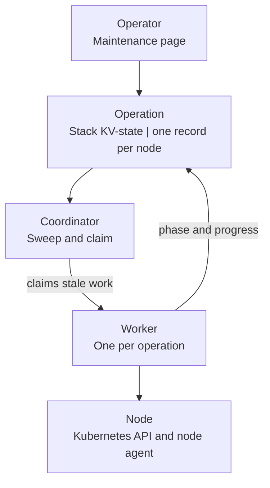
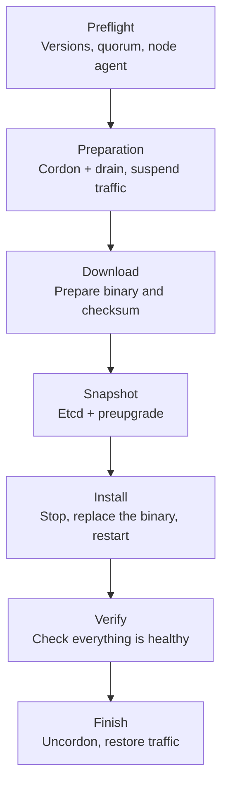
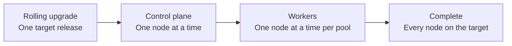

# Maintenance and upgrades

<i class="fa fa-triangle-exclamation"></i>

The Kubernetes cluster application is a pre-release. It is not ready for production use, and the behavior and the
interfaces can change.

The application maintains the nodes in place: it moves the workloads away, restarts the node, and returns it to the
cluster. Every operation is recorded in the [stack KV-state](../../glossary.md#stack-kv-state) before it starts, so an
operation survives a restart of the process that started it.

## Operation model

A maintenance operation is one record per node. The record names the kind of the operation, its phase, its deadline
and its progress. The application supports these kinds:

| Kind | Purpose |
|------|---------|
| Cordon and drain | Stops new workloads on the node and moves the current workloads away. |
| Cordon | Stops new workloads on the node. |
| Uncordon | Lets the node accept workloads again. It also releases a traffic suspension. |
| Upgrade | Installs a new Kubernetes release on the node. |
| OS update | Installs the operating-system packages of the node and reboots it when the policy asks for a reboot. |
| Remove | Deletes the node from the cluster and removes its infrastructure. |

| Phase | Meaning |
|-------|---------|
| `Pending` | The operation waits for a worker. |
| `Running` | A worker executes the operation. |
| `Completed` | The operation finished. |
| `Blocked` | The operation waits for the operator. For example, a drain stops at a pod that it must not delete. |
| `Failed` | The operation stopped with an error. |
| `Cancelled` | The operator cancelled the operation. |

The [maintenance coordinator](./architecture.md#processes) runs on every control plane node. The coordinators sweep
the operation records every few seconds:

1. A coordinator finds an operation that no live worker owns. A worker owns an operation while it writes the
   heartbeat of the operation. A heartbeat that is older than two minutes makes the operation stale.
2. The coordinator claims the operation with a write that names the current revision of the record. A second
   coordinator that loses the write skips the operation.
3. A worker executes the operation against the Kubernetes API and, for remote work, against the node agent of the
   node.
4. The worker writes the phase and the progress to the record. Every write checks the revision, so the worker stops
   quietly when another coordinator took the operation.

<figure class="diagram" id="operation">

<figcaption>

The path of one operation from the dashboard to a node. It does not show the guards that run before the submission,
or the steps of each operation kind.

</figcaption>
</figure>

Only one operation is active per node. A new submission is rejected while an operation is active, unless the active
operation is stale. The guards run before the submission:

| Guard | Rule |
|-------|------|
| Cluster | The cluster must be in the `created` phase. |
| Recovery | No recovery operation may be active. |
| Timeout | The timeout of an operation is between 30 and 3600 seconds. |
| Force delete | The deletion of pods without a grace period requires bypassing the disruption budgets. It is not available for upgrades, because the application cannot prove that the workloads stopped. |
| Removal | The cluster must keep at least two control plane nodes for the etcd quorum, and only one removal may run at a time. |

A failed upgrade or operating-system update that reached the node marks the operation with `RecoveryRequired`. Until
the operator retries the failed operation or uncordons the node, no other operation may start on that node. The rule
keeps a node from staying cordoned with an unknown version while other maintenance proceeds.

## Node agent

The node agent runs as root on every node. It is the only process that can change the software of a node. The
coordinator reaches the agent on the private address of the node, on port 9444, and it authenticates every command
with the maintenance token of the node.

- The identity of the node comes from its input: the name, the private address and the role.
- A command carries the identifier of the operation that sent it. The agent refuses a command from an older
  operation while an upgrade is in flight, so a restarted coordinator cannot disturb the node.
- The agent never exits on its own during normal operation. A failed upgrade leaves its state on disk, and the
  operator can retry it.
- The agent binary updates itself from the provider-delivered executable. The update happens only while the agent is
  idle.

## Kubernetes upgrade

A Kubernetes upgrade moves one node to a new k3s release:

- A node can move forward to another patch of the same minor release, or to the next minor release. A larger step
  needs intermediate upgrades or a replacement of the node.
- The control plane nodes must stay within one minor release of each other, and a worker may not run a newer minor
  release than the oldest control plane node.
- The application checks the node, the versions, the etcd quorum and the node agent before it starts.

<figure class="diagram" id="upgrade">

<figcaption>

The steps of one Kubernetes upgrade. It does not show the waits between the polls of the node agent, or the retries
of a failed step.

</figcaption>
</figure>

The upgrade has two stages. The coordinator performs the preflight checks and the optional cordon and drain. It then
suspends the traffic of a control plane node, and it submits the remote work to the node agent: the download, the etcd
snapshot, the restart of k3s, and the verification. The two stages are recorded, so an interrupted upgrade resumes at
the remote stage.

After a successful upgrade, the application records the desired version on the node, releases the traffic suspension
and uncordons the node. A failed upgrade leaves the operation in the `Failed` phase with the retry instructions in
the log of the operation.

## Rolling upgrade

A rolling upgrade moves every node of the cluster to one target release. The dashboard can start it, and the
[automatic maintenance](#automatic-maintenance) can start it inside a maintenance window.

- Every node must be able to reach the target release in one step. Otherwise the submission is rejected.
- One node at a time is upgraded in each group. The control plane nodes form one group; every worker pool is a
  group of its own.
- The control plane nodes upgrade first. The worker nodes upgrade after the last control plane node.
- The coordinator of the run holds a lease. A coordinator that stops is replaced by another control plane node, and
  the run continues from the recorded state.
- A failure stops the run. The failed node keeps its operation, and the operator resolves it from the maintenance
  page.

<figure class="diagram" id="rolling-upgrade">

<figcaption>

The order of a rolling upgrade: the control plane first, then the workers. It does not show the work of one node; see
the figure above.

</figcaption>
</figure>

## Operating-system update

An operating-system update installs the package updates of one node and restarts it when the update needs a restart.
The operation stages the packages first, then the coordinator cordons and drains the node, and the node agent applies
the packages.

| Node agent phase | Meaning |
|------------------|---------|
| `staging` | The node refreshes its package lists and downloads the packages. |
| `staged` | The packages wait for the restart of the node. |
| `applying` | The node installs the packages. |
| `rebooting` | The node restarts. |
| `verifying` | The node checks the services after the restart. |

The reboot policy decides when the node restarts:

- `whenRequired` restarts the node only when a pending kernel or a reboot marker asks for it.
- `always` restarts the node after every update.

The node agent reports the package state of every node to the automatic maintenance state. The coordinator asks for a
new report every six hours, before a window and on demand, so the dashboard can show the reports after a restart.

An operating-system update that was submitted to the node cannot be cancelled. The operator retries it, like a
failed upgrade.

## Node removal

A removal deletes a node from the cluster and removes its infrastructure. The operation runs in three stages:

1. **Traffic and drain.** The application suspends the traffic of a control plane node first. The node drains when the
   operator asked for a drain. The application then deletes the Kubernetes Node object. k3s removes the member from
   etcd on a control plane node.
2. **Verification.** The coordinator checks that the control plane still answers. A removal of a control plane node
   stops here when the cluster does not answer.
3. **Infrastructure.** The application terminates the job of the node, releases the private address, removes the node
   from the [cluster record](../../glossary.md#cluster-record), and deletes the input files of the node.

The deletion of the Node object is the point of no return. The application refuses a cancellation after that point,
and the operator must retry the removal. The application also refuses a removal that would leave fewer than two
control plane nodes, because the etcd quorum needs them.

## Automatic maintenance

The provider and the user can schedule maintenance inside a time window. The policy holds:

| Setting | Meaning |
|---------|---------|
| Window | The days, the start hour in UTC and the length of the window. The default window is four hours long and it starts at 02:00 UTC. |
| Kubernetes updates | Enables the automatic rolling upgrades and sets the oldest acceptable backup. The default is one hour. |
| OS updates | Enables the automatic operating-system updates and selects the reboot policy. |

A run moves through these phases: `pending`, `preflight`, `backup`, `running`, and `completed` or `blocked`. The
dashboard shows the checks of the run:

| Check | Verifies |
|-------|----------|
| Cluster | The cluster is in the `created` phase. |
| Recovery | No recovery operation is active. |
| Maintenance state | No node has an active operation. |
| Nodes | Every node is present and ready. |
| Quorum | The control plane survives the upgrade of one node. |
| Node agents | Every node answers on the maintenance API. |
| Version spread | The node versions are within the supported spread. |
| Upgrade path | Every node can reach the target release in one step. |
| Rolling upgrade | The active rolling upgrade matches the run. |
| Backup | A recent backup exists. A stale backup makes the run request a new backup and wait. |
| OS updates | The package reports of the nodes are current. |

The target release is the highest supported release that every node can reach in one step. A window runs the
Kubernetes updates first, followed by the operating-system updates.

The dashboard offers these actions:

- **Run maintenance now** opens a maintenance window of four hours and starts the enabled channels immediately.
- **Pause for 1, 3 or 7 days** defers the weekly schedule. **Resume weekly schedule** clears the pause.
- **Stop** blocks a waiting run. The operator resolves the problem and presses **Resume automatic maintenance** to
  allow a new run.

## Traffic suspension

A control plane node that restarts must not serve the Kubernetes API. The maintenance system suspends the traffic of
the node before such an operation:

1. The coordinator writes the job of the node to the [traffic record](../../glossary.md#traffic-record).
2. The controller reads the record and removes the job from the members of the API service.
3. After the operation, the maintenance system removes the entry, and the controller adds the job to the service
   again.

A suspension whose job no longer exists is cleared automatically, so a node that was removed during maintenance
cannot block another node.
