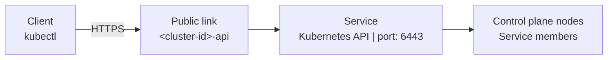

# Networking and storage

<div class="info-box warning">
<i class="fa fa-triangle-exclamation"></i>
<div>

The Kubernetes cluster application is a pre-release. It is not ready for production use, and the behavior and the
interfaces can change.

</div>
</div>

A cluster has a fixed address plan. The nodes connect on a private network, the Kubernetes API is served through a
public link, and the applications of the cluster are served through the Ingress of the cluster. All files of the
cluster live on the state drive.

## Address plan

| Network | Address range | Purpose |
|---------|---------------|---------|
| Machine network | `172.31.0.0/16` | The private addresses of the nodes. |
| Pod network | `10.14.0.0/16` | The pods of the cluster. |
| Service network | `10.15.0.0/16` | The Kubernetes services of the cluster. |

The node number decides the private address of a node. The node with the number `n` receives the address
`172.31.((n+2) div 256).((n+2) mod 256)`, so the first control plane node is `172.31.0.3`. The creator reserves the
address in the private network before it creates the machine. A replacement node keeps the number and the address of
the node that it replaces.

The nodes of a cluster run flannel with the VXLAN backend over the private interface.

## Kubernetes API

The Kubernetes API is available in two ways:

- **Inside the cluster:** every control plane node serves the API on port 6443. The nodes reach each other on the
  private network.
- **Outside the cluster:** the user connects to a public link named `<cluster-id>-api`. The link targets the service
  of the cluster, and the control plane jobs are the members of the service. The user downloads a kubeconfig from the
  dashboard and connects with `kubectl`.

<figure class="diagram" id="api-path">



<figcaption>

The path from `kubectl` to a control plane node. It does not show the internal access, the TLS details, or the
maintenance that removes a node from the service.

</figcaption>
</figure>

The controller keeps the members of the service equal to the control plane jobs of the cluster. A control plane node
that is under maintenance leaves the service, so the platform does not route the API traffic to a node that restarts.
See [Traffic suspension](./maintenance-and-upgrades.md#traffic-suspension). If the API becomes unreachable, check the
service, its members and the public link on the dashboard.

The cluster uses two kubeconfigs. The public kubeconfig points at the public link and it belongs to the user. The
internal kubeconfig points at `https://127.0.0.1:6443` and it belongs to the dashboard service. Both files hold the
administrator token of the cluster. See [Reference](./reference.md#credentials).

## Application access

The controller watches the Ingress resources of the cluster. For every host, the controller compares the host with
the public link products of the provider:

- The host must start with the prefix and end with the suffix of a public link product.
- The name between the prefix and the suffix must start with a letter and it must be 5 to 63 characters long.

The controller creates one public link per eligible host. The link targets the Ingress service of the cluster, which
serves port 30080 on the control plane nodes and forwards the traffic to Traefik. Traefik serves the packaged Ingress
controller of k3s.

| Event | Behavior |
|-------|----------|
| A user adds an Ingress | The controller creates the public link on the next reconcile. |
| A user removes an Ingress | The controller deletes the public link of the host on the next reconcile. |
| The creation of a link fails | The controller retries after 5 minutes. |
| The controller restarts | It reconciles again from the live Ingress resources and the owned links. |

A host that does not match a public link product receives no link. The controller does not use the domain of another
product and it does not create a link for an Ingress without a host rule.

## Ports

| Port | Serves | On |
|------|--------|----|
| 6443 | Kubernetes API | Control plane nodes |
| 30080 | Ingress traffic | The ingress service, on the control plane nodes |
| 43102 | Cluster dashboard | Control plane nodes |
| 43103 | Recovery application | The recovery job, while a recovery is active |
| 9444 | Maintenance API of the node agent | Every node, on its private address |

## Storage

The state drive holds every file of the cluster. It is a normal [drive](../../glossary.md#drive) of the workspace with
the labels of the stack. The creator selects a drive product of the provider that users can create.

```text
<state drive>
├── management/
│   ├── kubeconfig
│   ├── kubeconfig-internal
│   ├── kube-api-token
│   ├── tokens/
│   └── maintenance-tokens/
├── nodes/
│   └── <node number>/
│       └── input/
│           ├── node.json
│           ├── server-token
│           ├── agent-token
│           ├── controller-token
│           ├── maintenance-enrollment-secret
│           └── stack-identity.json
├── bundles/
│   └── <script revision>/<release>/
├── backups/
│   └── <backup id>/
├── k3s-storage/
└── vm-disks/
    └── <hostname>/
```

| Folder | Holds | Mounted on |
|--------|-------|-----------|
| `management/` | The kubeconfigs, the administrator token and the published join tokens. | Control plane nodes, read-write. The controller reads a part of it. |
| `nodes/<number>/input/` | The input of one node, written before the machine starts. | Control plane nodes mount the whole `nodes/` folder read-write, because the token publisher writes to the inputs of the other nodes. Every node mounts its own input read-only. |
| `bundles/<revision>/<release>/` | The versioned scripts that bootstrap a node. | Every node, read-only. |
| `backups/<backup id>/` | The etcd snapshot, the credentials and the metadata of one backup. | Control plane nodes, read-write. |
| `k3s-storage/` | The persistent volumes of the workloads of the cluster. | Every node, read-write. |
| `vm-disks/<hostname>/` | The disk of one virtual machine. | The node that uses the disk. |

### Persistent volumes

The first control plane node installs the local-path provisioner of Rancher. The provisioner uses the shared
`k3s-storage/` folder, so a persistent volume is available from every node and a pod can mount it after a move to
another node. The provisioner creates the default storage class `local-path`.

A persistent volume lives in the `k3s-storage/` folder of the state drive. The user does not work with the volume as a
normal folder; the workloads use it through Kubernetes.

### VM disks

Every machine boots from a disk that the application creates on the state drive. The disk size comes from the pool of
the node. The application creates the disk folder before it starts the machine.

### Deletion

The **Delete cluster** action removes the machines and the [cluster record](../../glossary.md#cluster-record). The
platform deletes the state drive and every file in it, including the backups. A copy of a file that the user needs
must be taken before the deletion.
