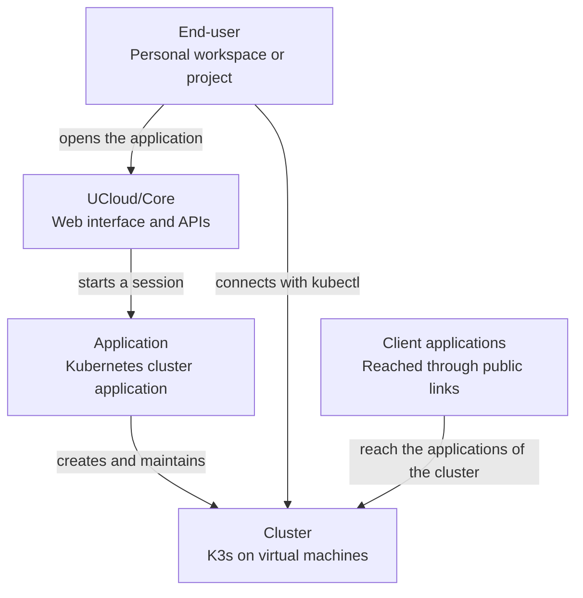

# Kubernetes clusters

<i class="fa fa-triangle-exclamation"></i>

The Kubernetes cluster application is a pre-release. It is not ready for production use, and the behavior and the
interfaces can change.

The Kubernetes cluster application is an [integrated application](../../glossary.md#integrated-application) that a
[service provider](../../glossary.md#service-provider) publishes to the application catalog. An
[end-user](../../glossary.md#end-user) opens the application to create a Kubernetes cluster on the machines of the
provider. The application builds the cluster from k3s and operates it for the user.

The application creates the cluster as a [stack](../../glossary.md#stack): one group of resources that belong together.
The stack holds the state drive, the private network, the service and the public links of the cluster. UCloud/IM for
Kubernetes creates and manages the machines of the stack. See [Architecture](./architecture.md).

<figure class="diagram" id="context">

<figcaption>

The systems around the Kubernetes cluster application. It does not show the parts of the application, or the parts of
one cluster.

</figcaption>
</figure>

## What a cluster provides

| Part | Purpose |
|------|---------|
| Control plane | An odd number of nodes, from 1 to 7, that run the Kubernetes API server and etcd. Most clusters use 1 node or 3 nodes. |
| Workers | One or more pools of worker nodes. Each pool has its own machine type and disk size. The workloads of the user run on the workers. |
| Kubernetes API | A public link that serves the Kubernetes API on port 6443. The user downloads a kubeconfig from the dashboard and connects with `kubectl`. |
| [Cluster dashboard](./cluster-dashboard.md) | The web interface of the cluster. It shows the state of the cluster, the Kubernetes resources, the maintenance operations, the backups and the permissions. |
| Application access | The controller watches the Ingress resources of the cluster and creates a [public link](../public-links.md) for every eligible host. |
| Storage | The local-path provisioner serves persistent volumes from shared storage. A volume is available from every node. See [Networking and storage](./networking-and-storage.md). |
| Backups | A backup coordinator takes hourly etcd snapshots. A cluster keeps up to 48 hourly and 14 daily backups. See [Backup and recovery](./backup-and-recovery.md). |
| Maintenance | Kubernetes upgrades, operating-system updates and node removal, one node at a time. An automatic policy can run them inside a time window. See [Maintenance and upgrades](./maintenance-and-upgrades.md). |

## Enabling the application

The provider publishes the application to the application catalog once. The provider also configures the platform for
the resources that a cluster needs. The platform must offer:

- machine types with virtual-machine support for the nodes;
- a public link product for the Kubernetes API and the Ingress hosts;
- a service product for the Kubernetes API and the Ingress traffic;
- private networks, so that the nodes can reach each other on a fixed address plan;
- a drive product that users can create for the state drive of the stack.

The provider publishes the application executable as a UCX application and signs it with the provider key. See
[Reference](./reference.md#deployment) for the manifest and the publication steps.

## Limits

| Limit | Value |
|-------|-------|
| Control plane nodes | An odd number from 1 to 7 |
| Nodes in total | 256 |
| Cluster ID | At most 30 characters from `a-z`, `0-9` and `-` |
| Worker pool names | At most 30 characters from `a-z`, `0-9` and `-` |
| Disk per node | From 10 GB to 1024 GB |

The [Reference](./reference.md#limits) holds the full set of limits.

## What the application does not do

- It does not manage the workloads that run on the cluster. The user owns the workloads, the Kubernetes objects and the
  applications that Ingress exposes.
- It does not use the Kubernetes cluster of the provider. It creates a separate cluster on virtual machines.
- It does not upgrade the nodes before the provider or the user enables maintenance.

## Troubleshooting

| Symptom | Checks |
|---------|--------|
| The cluster stays in the provisioning phase | Check the jobs of the nodes and their logs. Check that the state drive and the node input files exist, and that the machines can pull the image. |
| The cluster enters the error phase | Read the failure reason on the dashboard home page. The cluster record holds the same reason. |
| `kubectl` cannot connect | Check the API public link, the service of the cluster, and the members of the service. See [Networking and storage](./networking-and-storage.md#kubernetes-api). |
| An application is not reachable | Check the Ingress host, the public link of the host, and the controller log. See [Networking and storage](./networking-and-storage.md#application-access). |
| A node never becomes ready | Check the join tokens in the node input, the k3s unit on the node, and the node agent. |
| A backup does not run | Check that a control plane node is reachable and that the node agent answers. See [Backup and recovery](./backup-and-recovery.md). |
| Automatic maintenance does not run | Check the policy, the window and the checks on the dashboard page. See [Maintenance and upgrades](./maintenance-and-upgrades.md#automatic-maintenance). |

## Next steps

- [Architecture](./architecture.md) describes the processes, the machines and the
  [stack KV-state](../../glossary.md#stack-kv-state).
- [Creating a cluster](./creating-a-cluster.md) describes the deployment and the start of a cluster.
- [Cluster dashboard](./cluster-dashboard.md) describes the web interface of a cluster.
- [Networking and storage](./networking-and-storage.md) describes the address plan, the public links and the files of a
  cluster.
- [Maintenance and upgrades](./maintenance-and-upgrades.md) describes the node operations, the rolling upgrade and the
  automatic policy.
- [Backup and recovery](./backup-and-recovery.md) describes the backups and the disaster recovery.
- [Reference](./reference.md) holds the limits, the ports, the records of the stack KV-state and the deployment details.
