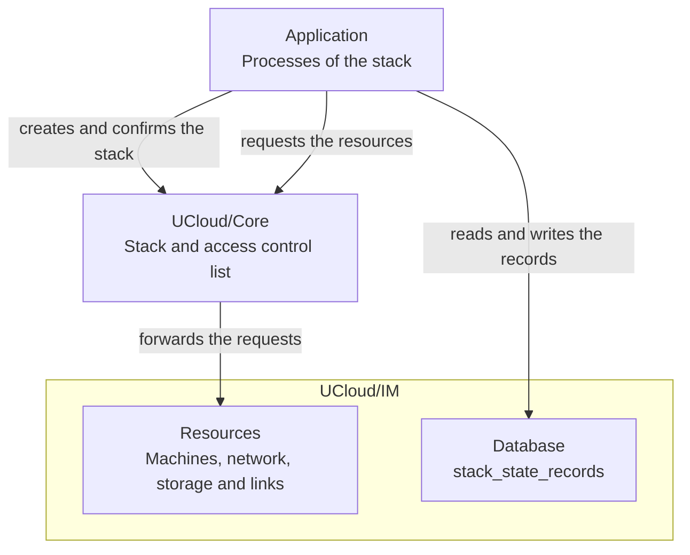
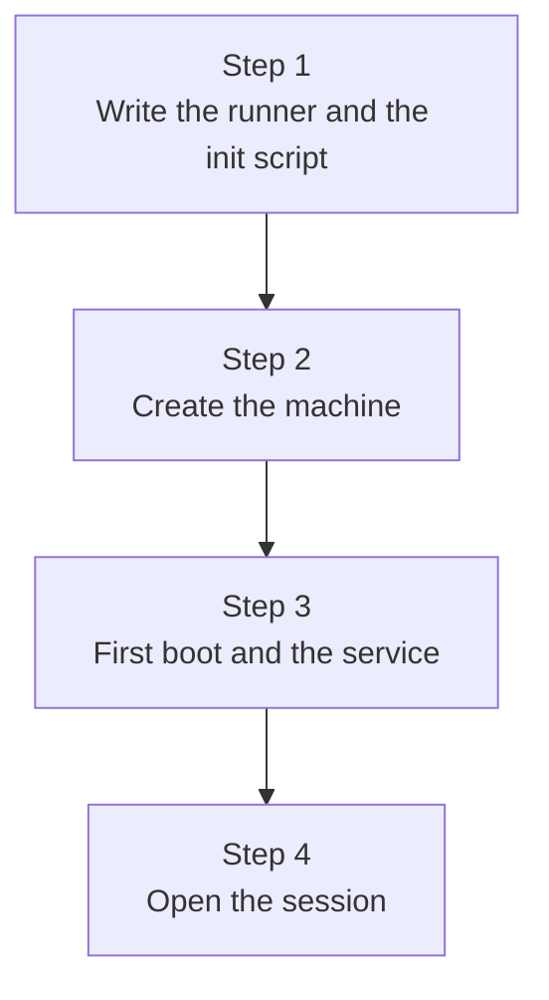

# Stacks

<i class="fa fa-triangle-exclamation"></i>

The Kubernetes cluster application is a pre-release. It is not ready for production use, and the behavior and the
interfaces can change.

A [stack](../../glossary.md#stack) groups the resources of one application and keeps their state together. The
[Kubernetes cluster application](./overview.md) is the only consumer of stacks today. This page describes the stack, its
APIs, the [stack KV-state](../../glossary.md#stack-kv-state) and the way the cluster application uses them.

## The stack

A [stack](../../glossary.md#stack) groups the resources of one application: the machines, the network, the storage and
the links. [UCloud/Core](../../glossary.md#ucloudcore) records the stack and its access control list. The application
creates and confirms the stack through the platform, and [UCloud/IM](../../glossary.md#ucloudim) provides the resources
of the stack on the systems of the provider.

<figure class="diagram" id="systems">

<figcaption>

The stack of one application and the systems around it. It does not show the parts inside UCloud/Core and UCloud/IM.

</figcaption>
</figure>

Every resource of the stack carries the label `ucloud.dk/stack-instance`, which names the stack. See the
[Reference](./reference.md#job-labels).

The creation of a stack is guarded by a lease. The application confirms the stack when the creation is complete. An
application that stops before the confirmation leaves the stack to the platform, which removes the stack and its
resources. A deletion removes the resources of the stack and its records.

## The stack KV-state

The processes of one stack share the stack KV-state: a small record per purpose. UCloud/IM keeps the records in the
`stack_state_records` table of its database. The table holds the records of every stack of the provider. Each stack has
its own records, and the keys have the same names in every stack.

| Rule | Meaning |
|------|---------|
| Record | A key, a value in JSON and a revision. |
| Write | The write names the revision that the writer read. A write that meets a newer revision fails, and the writer retries from the new value. |
| Deadline | A write can name a deadline. The store rejects the write after the deadline. |

The processes reach the records through the two [APIs of a stack](#the-apis-of-a-stack). UCloud/IM deletes the records
and the credentials of a stack when the platform deletes the stack.

The records are not files on the [state drive](../../glossary.md#state-drive). The drive holds the files of the stack,
for example the node inputs, the script bundle and the backups.

## The APIs of a stack

A process of a stack reads and changes the stack through one of two APIs.

### The session of the application

The application calls the platform over its session. The calls cover:

- the resources of the stack: [jobs](../../glossary.md#job), private networks and their addresses, services, public
  links, public IPs, [drives](../../glossary.md#drive) and licenses;
- the files of the stack on the state drive, for example the node inputs and the script bundle;
- the records of the [stack KV-state](#the-stack-kv-state);
- the user interface of the application: messages, navigation and file downloads;
- the lifecycle of the stack: the creation, the confirmation and the heartbeat that guards the creation;
- the control credential of a control plane node, for the stack-control API.

The creator, the dashboard and the recovery job of a Kubernetes cluster work this way. The
[API reference](../ucx/api-reference.md) of the UCX applications lists the calls and the helpers of the session.

### The stack-control API of UCloud/IM

A process that runs on the machines of the stack calls UCloud/IM directly. The calls cover:

- the resources of the stack: jobs, services, public links, public IPs, private networks and their addresses;
- the control of the resources: create, browse and retrieve them; terminate, suspend, unsuspend, extend and rename a
  job; change the labels; add or remove the members of a service; set the target of a public link and the firewall of
  a public IP;
- the product lists of the resource types;
- the records of the stack KV-state.

The caller presents the controller registration token of a control plane node. The token belongs to the job of the
node, and it stops working when the job ends. The application asks UCloud/IM for the token over its session and writes
it into the input files of the node. See [Credentials](./architecture.md#credentials).

The controller and the maintenance coordinator of a Kubernetes cluster work this way. They use the API directly, so
they do not depend on a session that a user opened.

Both APIs admit only the processes of the stack: the session names the stack, and the token belongs to a job of the
stack.

## The application in a virtual machine

A stack can run its application inside one of its [virtual machines](../kubevirt.md). The application then serves its
interface from the machines that it manages, and the platform delivers the executable of the application into the
machine. The image of the machine stays generic.

The application follows these steps over its session:

1. It writes two scripts into the files of the stack: a **runner** that starts the delivered executable with the UCX
   port and restarts it when a new executable arrives, and an **init script** that installs the service in the
   machine.
2. It creates a virtual-machine job of the stack. The job carries the mounts of the stack files, the label of the init
   script (`ucloud.dk/init-script`) and the UCX labels: the port (`ucloud.dk/ucxport`) and the name and the version of
   the application. The platform creates the machine, mounts the delivered executable of the application into it, and
   opens the UCX port in the firewall.
3. On the first boot, the agent of the machine runs the init script once. The service starts the runner; the runner
   runs the delivered executable and sets the UCX port; the application serves the port.
4. The platform opens sessions to the application on the port of the machine. The browser reaches the interface of the
   application, and the application acts in the stack through its session.

<figure class="diagram" id="virtual-machine">

<figcaption>

The steps that put an application into a virtual machine of the stack. It does not show the delivery of the executable
or the mounts of the machine.

</figcaption>
</figure>

For a Kubernetes cluster, the [cluster dashboard](./cluster-dashboard.md) runs this way as the custom UI service on
every control plane node, on port 43102. The platform routes the browser to a control plane node that runs the service,
and it selects another control plane node when the node does not answer, for example while its machine restarts during
maintenance.

### The update of the application

The provider can publish a new executable of the application at any time. The platform updates the application without
a new machine image. The procedure:

1. The provider builds, signs and publishes the executable ([Deployment](./reference.md#deployment)).
2. UCloud/IM fetches the manifest of the application and its signature about once per second. It verifies the signature
   with the public key of the application.
3. It fetches the executable and verifies its SHA-256 against the manifest. When the executable differs from the
   delivered file, UCloud/IM replaces the delivered file atomically, so a machine never reads a partial executable.
4. The machines mount the directory that holds the delivered executable, so the new executable is present in every
   machine. The machines do not restart.
5. The runner of the machine watches the size and the modification time of the delivered executable. When they change,
   it restarts the application with the new executable.

The platform keeps the executable of every version of the application in its own directory. A machine mounts the
directory of the version that created it, so an update of one version reaches every machine of that version.

## The stack of a Kubernetes cluster

The cluster application creates one stack per cluster. The stack holds the [state drive](../../glossary.md#state-drive),
the private network, the service, the public links and the node jobs.
[Architecture](./architecture.md#the-cluster-stack) lists every resource of the stack.

The cluster keeps the records that [Architecture](./architecture.md#stack-kv-state) lists. The processes use them as follows:

| Process | Use of the records |
|---------|--------------------|
| Creator | Writes the [cluster record](../../glossary.md#cluster-record) during the creation. |
| Dashboard | Reads the cluster record for the home page and the provisioning view. |
| Maintenance coordinator | Writes the operation records. Reads the rolling upgrade, the automatic maintenance and the backup records. |
| Controller | Reads the traffic record. |
| Recovery job | Reads the cluster record, and writes the recovery record. |

Every process reads the cluster record before it changes the cluster. The [Reference](./reference.md#stack-kv-state) lists
the key of every record.

The lifecycle of the cluster follows the lifecycle of the stack. The creator confirms the stack when the creation of
the cluster is complete. A creation that stops leaves the cleanup to the platform. See [Creating a
cluster](./creating-a-cluster.md#failure-during-creation).

The **Delete cluster** action deletes the stack. The platform removes the machines, the
[state drive](../../glossary.md#state-drive) and the records. See
[Networking and storage](./networking-and-storage.md#deletion).

The permissions of the cluster are the access control list of the stack. The platform stores the list, and the
application keeps no separate list. See the [Cluster dashboard](./cluster-dashboard.md).
