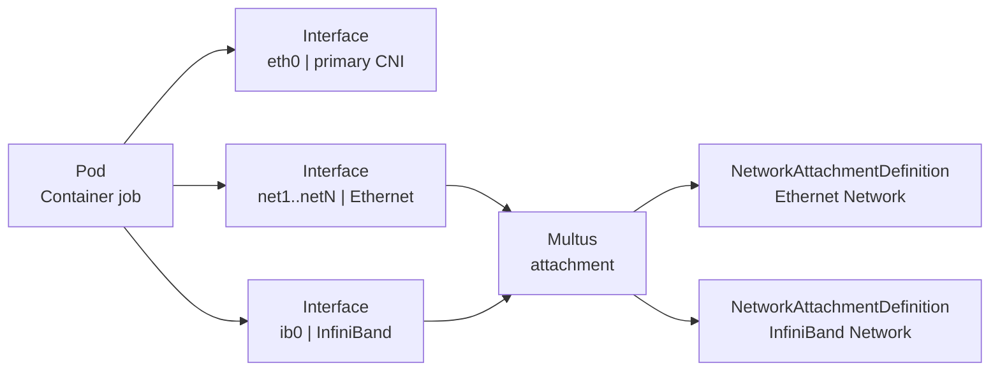
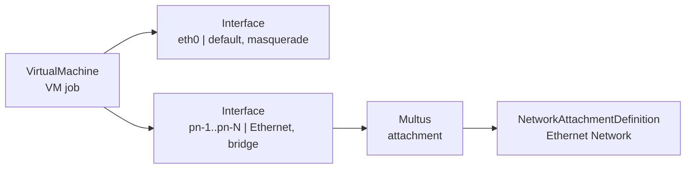
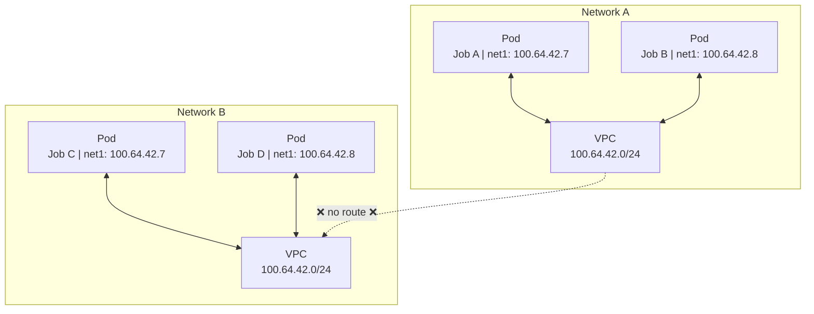
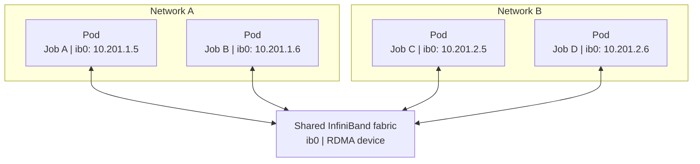

# Networks

UCloud/IM for Kubernetes runs jobs in a Kubernetes cluster. A job usually runs alone. Users often need several jobs to
work as one system. For example, MPI ranks, a coordinator and its workers, or a client and a server must exchange data
directly. A Network is the UCloud resource that provides this connection. This page explains the architecture of
Networks for providers and platform developers. It starts with the user model, then describes how interfaces reach
jobs, and then describes Ethernet and InfiniBand networks.

## Why Networks exist

The cluster network is shared and provider-owned. The platform assigns addresses from it, and the platform controls
which workloads can reach each other on the primary interface. It is not a stable, private connection domain that a user
can create for their own jobs.

A Network adds a separate connection domain. The user creates the Network, attaches it to jobs, and deletes it. The
Network has its own address block and its own set of members. Only jobs that attach the Network get an interface on it.
A job that does not attach the Network has no interface on it and no route to its addresses.

A Network is a workspace-scoped resource. It belongs to a personal workspace or a project. The job and the Network must
belong to the same workspace.

A Network does not replace the primary interface. Every pod and VM keeps `eth0`. The primary interface carries the
default route, cluster Services, SSH, public IPs, public links, kubelet probes, and the VM console. The Network carries
member-to-member traffic.

From the user's point of view: create a Network, attach it to one or more jobs, and use the addresses that the Network
assigns. The jobs can then reach each other through the Network. The Network does not provide internet access by itself.

The provider advertises the Network types that it supports as products:

| Type | Implementation | Workloads |
|------|----------------|-----------|
| Ethernet | Kube-OVN | Pods and virtual machines |
| InfiniBand | IPoIB on a shared fabric | Pods |

A Network has one type. The type determines which CNI plugin Multus calls and which address rules apply.

## How a Network attaches to a job

All Network attachment goes through Multus. Multus is a meta-CNI. It reads the pod annotation
`k8s.v1.cni.cncf.io/networks`, calls the CNI plugin for each requested attachment, and writes the result to
`k8s.v1.cni.cncf.io/network-status`. Multus does not build the Network and does not forward traffic.

Each Network has a `NetworkAttachmentDefinition` (NAD) in the compute namespace. The NAD is the Kubernetes handle for
the Network. The IM creates the NAD for an Ethernet Network. For an InfiniBand Network, the IPoIB operator creates it.

The primary CNI still owns `eth0`. The Network is a secondary interface:

- Ethernet interfaces are named `net1`, `net2`, and so on.
- InfiniBand interfaces are named `ib0`.

A job that attaches one Ethernet Network and one InfiniBand Network gets an annotation like this:

```yaml
metadata:
  annotations:
    k8s.v1.cni.cncf.io/networks: |
      [
        {"name": "tenant-a", "namespace": "ucloud-apps", "interface": "net1"},
        {
          "name": "fabric-a",
          "namespace": "ucloud-apps",
          "interface": "ib0",
          "ips": ["10.201.1.5/24"]
        }
      ]
    tenant-a.ucloud-apps.ovn.kubernetes.io/ip_address: "100.64.42.7"
```

The Ethernet address uses the Kube-OVN static IP annotation. The InfiniBand address is part of the Multus entry because
the IPoIB plugin takes the address from the attachment request.

### Container jobs

The IM allocates one address per rank for each attached Network. It stores the address in a lease before it creates the
pod. The pod gets one Multus entry per Network and, for Ethernet, a static IP annotation and an optional MAC annotation.

When a job has at least one Ethernet Network, the first Ethernet Network supplies the DNS subdomain. The IM keeps the
per-network headless Service that backs those names. The user container receives one environment variable per attached
Network:

- `UCLOUD_NET_<SUBDOMAIN>`
- `UCLOUD_PRIVATE_NET_<SUBDOMAIN>` for compatibility

The Multus network status is the evidence that the attachment exists. For Ethernet, the IM also checks the Kube-OVN
`IP` object. The IM uses both during reconciliation.

A job can attach several Ethernet Networks. A job can attach at most one InfiniBand Network.

<figure class="diagram" id="container-job-interfaces">



<figcaption>

The interfaces of a container job. Multus attaches the Ethernet and InfiniBand secondary interfaces. The figure does not
show the CNI plugins behind each Network.

</figcaption>
</figure>

### Virtual machines

KubeVirt VMs use an explicit network list. The primary interface is `default` with masquerade binding. Each Ethernet
Network becomes a `pn-N` interface with bridge binding. The IM writes the static address and MAC into the VM template
and into the cloud-init netplan configuration. The guest does not use DHCP on a secondary interface.

The IM keeps the secondary MAC stable in the lease. It also keeps the primary MAC stable. The guest interface
configuration therefore survives a VM restart, a virt-launcher pod recreation, and live migration.

InfiniBand is not available for VMs. To change the Networks of a VM, suspend the VM, change the parameters, and start it
again.

<figure class="diagram" id="virtual-machine-interfaces">



<figcaption>

The interfaces of a virtual machine. Multus attaches the Ethernet secondary interfaces. The figure does not show the CNI
plugin behind each Network. InfiniBand is not available for VMs.

</figcaption>
</figure>

## Ethernet networks

An Ethernet Network is a software-defined network. UCloud/IM implements it with Kube-OVN. The primary CNI is a
deployment choice. UCloud/IM does not require Cilium. The reference deployment uses Cilium, but another primary CNI can
manage `eth0`. The provider must supply NetworkPolicy enforcement if it wants that boundary. Kube-OVN runs in
non-primary mode, so it does not manage `eth0`.

Kube-OVN connects the members across nodes. The scheduler does not need to place members on the same node. Kube-OVN must
run on every node that can run jobs. The reference deployment uses a Geneve overlay, but the encapsulation and topology
are Kube-OVN deployment choices, not UCloud requirements.

For each Ethernet Network, the IM creates and reconciles:

- a Kube-OVN `Vpc`
- a Kube-OVN `Subnet`
- a `NetworkAttachmentDefinition`
- a headless `Service` for DNS
- a `NetworkPolicy` for the primary interface

The Service is not the data path. It provides the DNS names that members use. The NetworkPolicy applies to the primary
interface, not to the secondary interface.

Kubernetes object names derive from the Network subdomain. Labels carry the UCloud resource ID. The IM uses the ID for
reconciliation, not the name. Kube-OVN does not allow a VPC and a Subnet with the same name, so the Subnet carries a
`-net` suffix.

### Addresses

The IM database is the source of truth for address allocation. Kube-OVN IPAM does not choose addresses for a Network.
The IM assigns every address and writes it to the pod or VM as a static annotation. The Subnet excludes its full usable
range from Kube-OVN's random allocator, so a missing annotation cannot create an untracked address.

By default, a Network receives a `/24` from the provider pool. A user can supply an IPv4 CIDR with a prefix from `/16`
to `/24`. The CIDR is fixed after creation. The gateway is the first usable address in the block, by convention `.1`.

Different Networks may use overlapping CIDRs because each Network has its own VPC. A job cannot attach two Networks
with overlapping CIDRs.

Each rank gets one address in each attached Network. A user can pin an address or reserve one. The address is stable for
the life of the lease.

The Network status reports the allocated block, and the UI shows the block and the members.

### Isolation and traffic

Members of one Ethernet Network can reach each other on any port. The IM creates a `NetworkPolicy` for the primary
interface, but that policy does not filter the secondary interface. The initial implementation does not create a
per-network firewall on the secondary interface. Network membership is the security boundary for the Network. Only a
job with an interface on the Network can use its addresses. A job that is not a member cannot reach them, even if it
knows the addresses.

The VPCs have no route to each other. There is no peering, NAT, or internet gateway in the Network. A member keeps its
normal internet and cluster access through `eth0`, subject to the primary interface policy. NetworkPolicy applies to
`eth0`, not to the secondary interface.

A job can attach several Ethernet Networks. Such a job is an explicit gateway between them. UCloud does not install
routes or enable forwarding. The workload can still relay traffic at the application level. Treat it as a trusted
gateway.

### Lifecycle and reconciliation

The IM creates the objects when the Network is created and repairs them if they drift. A Network moves through
`provisioning`, `ready`, and `deleting`.

A job can use a Network only after it is `ready`. The IM allocates a lease for each rank. The lease moves from `pending`
to `attached` when Multus and Kube-OVN report the interface. When the job ends, the lease moves to `releasing`. The IM
deletes the lease only after the workload and its network attachment are gone. For Ethernet, it also waits for the
Kube-OVN address records to disappear.

The IM does not delete a Network while it has members. It also does not delete a Network while it has reserved
addresses.

<figure class="diagram" id="ethernet-isolation">



<figcaption>

Two Ethernet Networks with the same CIDR. Each Network is a separate Kube-OVN VPC, so the address ranges do not collide.
The figure does not show the connection between the nodes or the primary interfaces.

</figcaption>
</figure>

## InfiniBand networks

An InfiniBand Network is a logical network on a shared physical fabric. It provides RDMA to container jobs. The provider
prepares the fabric and the IPoIB stack. UCloud creates a logical network on top. UCloud does not configure the
switches, the subnet manager, or the physical cabling.

From the user's point of view: create an InfiniBand Network, attach it to a container job, and use the assigned
addresses for RDMA traffic.

### Objects and attachment

The IM uses the Mellanox `IPoIBNetwork` API. For each Network, the IM creates one `IPoIBNetwork` in the compute
namespace. The object uses static IPAM and the provider's InfiniBand device as `master`. The IPoIB operator creates the
matching NAD. The IM waits for the NAD before it marks the Network ready.

Multus attaches the NAD to the pod as `ib0`. The Multus annotation includes the static address with its prefix. The
container requests the RDMA resource. The scheduler treats that resource as a job dimension, so the pod lands on a node
that advertises it.

A job can attach at most one InfiniBand Network. InfiniBand Networks are not available for virtual machines.

### Provider prerequisites

Before a provider enables InfiniBand Networks:

- The `mellanox.com/v1alpha1` `IPoIBNetwork` API and its operator must be installed.
- Every eligible node must expose the same InfiniBand device. The provider sets a device label (default
  `ucloud.dk/ibdev`) and advertises the RDMA resource (default `nvidia.com/rdma_shared`).
- The IM must have an InfiniBand address pool.

The IM fails at startup if InfiniBand is enabled but the API or a usable device is missing. The device must be the same
on all eligible nodes. The label can list several devices; the IM uses the first.

### Addresses and reclaim

An InfiniBand Network always receives a `/24` from the provider's InfiniBand pool. A user cannot supply a CIDR. Each
rank gets one static address.

The InfiniBand pool is finite. Core reclaims idle InfiniBand Networks when free space falls below the configured high
watermark. It marks a Network as pending, notifies the owner, and deletes it after the grace period if it is still
unused. Active jobs and reserved addresses block reclaim. Reclaim applies only to InfiniBand Networks. Ethernet Networks
are not reclaimed automatically.

### Isolation

All InfiniBand Networks use the same physical fabric and the same device on each node. Each Network is a separate
`/24`, but the fabric is shared. The separation is logical, not physical. Do not treat an InfiniBand Network as a hard
isolation boundary like an Ethernet VPC.

Only jobs that attach the Network get an interface on it. There is no route from the cluster network to the Network.
There is no internet gateway. Addresses are static. NetworkPolicy applies to `eth0` only. It does not filter `ib0`.

<figure class="diagram" id="infiniband-fabric">



<figcaption>

Two logical InfiniBand Networks on one shared fabric. Every member uses the same device. The figure does not show the
`IPoIBNetwork` objects, the NADs, or the subnet manager.

</figcaption>
</figure>

## Ethernet and InfiniBand compared

| Property | Ethernet | InfiniBand |
|----------|----------|------------|
| Underlying network | Kube-OVN network | Shared physical InfiniBand fabric |
| Interface name | `net1`, `net2`, ... | `ib0` |
| Address block | `/24` by default, user CIDR from `/16` to `/24` | `/24` from the provider pool only |
| Workloads | Pods and virtual machines | Pods |
| Isolation | One VPC per Network | Separate `/24` on a shared fabric |
| Internet access | None through the Network | None through the Network |
| Automatic reclaim | No | Yes, when the pool is low |
| Typical use | General job-to-job IP traffic | RDMA and HPC |

## Summary

- A Network connects jobs through a secondary interface. It does not replace `eth0`.
- Multus attaches secondary interfaces. Kube-OVN and IPoIB provide the actual networks.
- Ethernet gives each Network an isolated Kube-OVN VPC with stable addresses.
- InfiniBand gives a container job a static logical network on a shared, pre-configured fabric.
- The primary interface remains the path for SSH, public IPs, public links, probes, and the VM console.

For the provider configuration, see the [Kubernetes configuration reference](./config-reference.md#kubernetes-compute).
