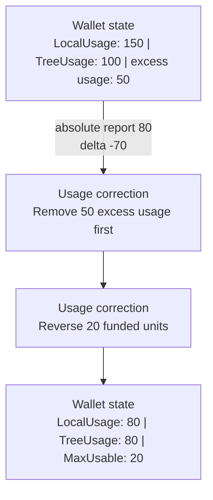
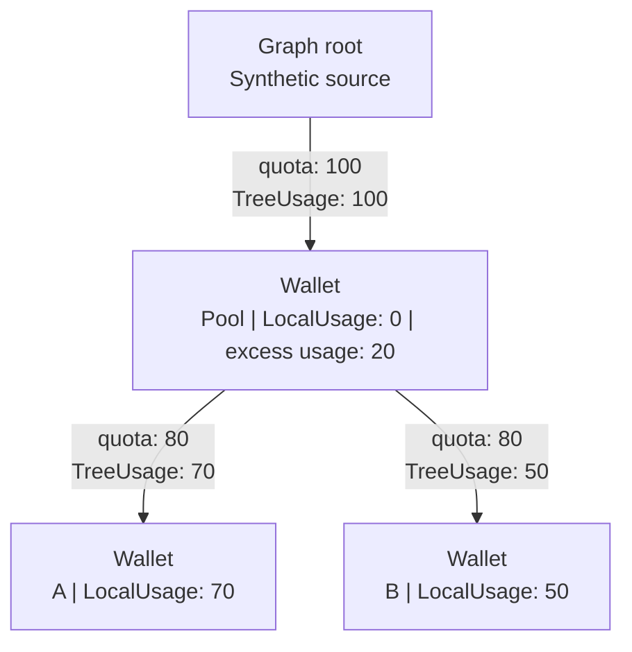
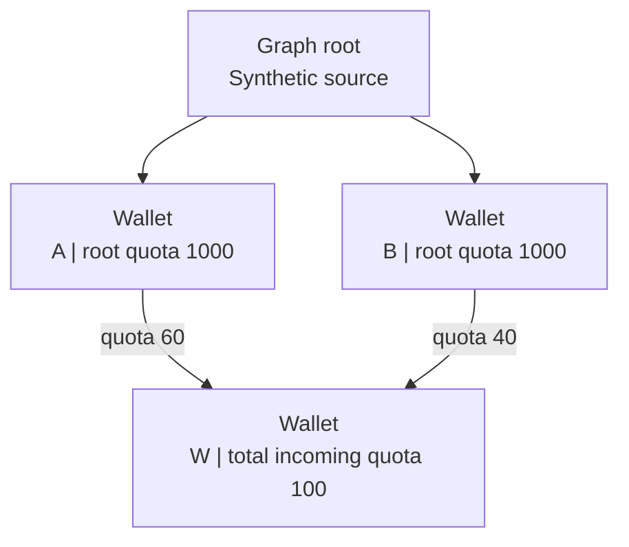
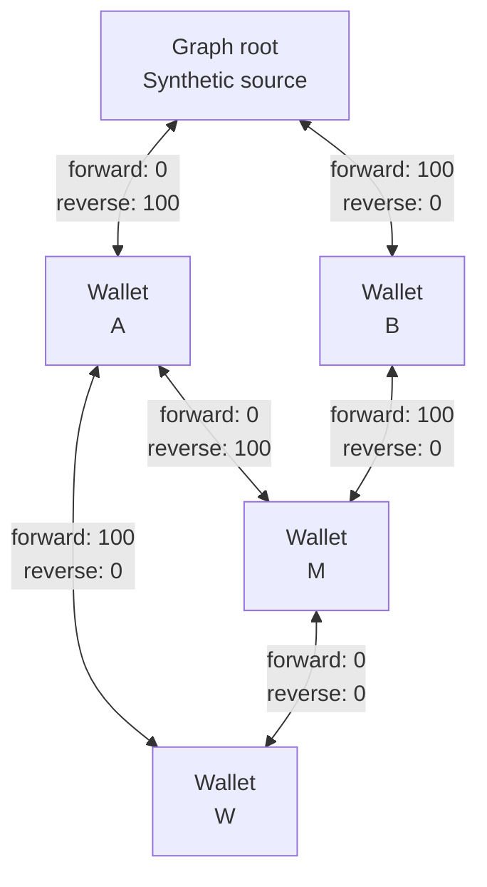

# Worked examples and edge cases

Usage reports can change a [wallet](../../glossary.md#wallet)'s `LocalUsage`, an allocation group's `TreeUsage`, and the
wallet's lock state independently.
See [Fundamentals](./model.md) for the field definitions.
Use [Graph and flow internals](./graph-flow.md) and [Allocation retirement](./retirement.md) for the mechanisms.

## How to read the examples

All amounts are integer accounting units, after any price conversion.
Allocation arrows point from parent to recipient.
Unless stated otherwise, allocations are committed and current, and no other wallets consume their funding.
Times move forward within each example.

## 1. A normal report, exact exhaustion, and a retry

**Result:** a report that exactly exhausts quota is accepted, but returns `false`.
Retrying the same absolute amount does not charge it again.

Use capacity accounting with \mathrm{root}\to P\to W. Both edges have quota 100.
P has no direct usage.

| Report for W | Delta | W `LocalUsage` | P→W `TreeUsage` | Root→P `TreeUsage` | W `MaxUsable` | API result |
|--------------|------:|---------------:|----------------:|-------------------:|--------------:|------------|
| Absolute 30 | +30 | 30 | 30 | 30 | 70 | `true` |
| Absolute 100 | +70 | 100 | 100 | 100 | 0 | `false`, no error |
| Absolute 100 again | 0 | 100 | 100 | 100 | 0 | `false`, no error |

The second report does not fail or roll back its 70-unit change.
The result describes `MaxUsable` after the report.
The provider must not retry with another positive delta merely because the result was `false`.

`CheckProviderUsable` would also return zero `MaxUsable` at this point.
That check does not reserve quota. Another report can consume available funding after a check.

## 2. Over-consumption stays recorded

**Result:** UCloud/Core keeps all 150 reported units, even though only 100 can fund the recipient's allocation group.
An extra allocation funds existing excess usage and then increases `MaxUsable`.

For \mathrm{root}\to P\to W, let the root edge have quota 1,000 and the child edge have quota 100.
Use either accounting mode. All periods remain current.

| Step | W `quota` | W `LocalUsage` | P→W `TreeUsage` | W excess usage | W `MaxUsable` |
|------|----------:|---------------:|----------------:|---------------:|--------------:|
| Report absolute 150 | 100 | 150 | 100 | 50 | 0 |
| Commit another 100-unit allocation from P | 200 | 150 | 150 | 0 | 50 |

The two allocations share one group because their endpoints are the same.
Activation reflows the existing 50 units. It does not add another 50 to `LocalUsage`.
The provider does not need to resend the original report to make that usage count against the new quota.

If the extra allocation grants only 20 units, the group `TreeUsage` becomes 120 and excess usage remains 30.
The wallet stays locked.
An allocation increase is not automatically enough to unlock an over-consuming wallet.

## 3. Capacity decreases remove excess usage before reducing `TreeUsage`

**Result:** reducing measured capacity from 150 to 80 releases only 20 funded units, not 70.

Use the same 100-unit child quota, with sufficient upstream quota.

<figure class="diagram">

<figcaption>

A capacity decrease removes excess usage before reversing funded `TreeUsage`.
The figure assumes all funding limits above this wallet permit the resulting `TreeUsage`.

</figcaption>
</figure>

The provider can send absolute 80 or delta -70.
Both produce the same measurement change if the baseline is still 150.
An absolute retry remains at 80. A repeated delta -70 would attempt another decrease.

UCloud/Core rejects a report if it would make `LocalUsage` or applicable scoped usage negative.
Consumption mode rejects this decrease even when the resulting total would remain positive.

## 4. Shared ancestors limit multiple funding paths

**Result:** two 80-unit child allocations do not create 160 units of usable root funding.
Excess usage can appear at their shared parent while both child `TreeUsage` values remain within quota.

Use either mode while the periods remain current.

<figure class="diagram">

<figcaption>

The children report 120 actual units against 100 units of root funding.
Twenty units stop at the pool. The figure omits the temporary synthetic path used to represent that excess usage.

</figcaption>
</figure>

Report A's 70 first, then B's 50.
The pool's `ChildrenUsage` total is 120, but it can propagate only 100.
Each child's own excess usage is zero. The pool's excess usage is 20.
All three wallets have zero `MaxUsable` after these reports.

The actual consumption is \operatorname{LocalUsage}(A)+\operatorname{LocalUsage}(B)=120.
The pool's `totalUsage` is also 120 here, but its propagated `TreeUsage` is only 100.
Adding the pool's total to the children's totals would double-count consumption.

If A has additional excess usage beyond its own 80-unit allocation, that excess usage does not reach the pool.
The pool's `totalUsage` would then understate actual descendant consumption.

## 5. Multiple parents and report size affect the split

**Result:** valid routing can split usage differently depending on report boundaries.
Do not rely on the split as a fairness or billing policy.

Use capacity accounting with independent root-funded parents A and B.
Each parent has root quota 1,000. A grants W 60, and B grants W 40.
All four allocations have the same end time.

<figure class="diagram">

<figcaption>

Two independent funding paths can cover W's usage. Their balance gaps guide path selection.
The figure shows quota before reports, not a fixed usage split.

</figcaption>
</figure>

Compare two fresh copies of this graph:

| Reporting sequence | A→W `TreeUsage` | B→W `TreeUsage` | W `LocalUsage` | W `MaxUsable` |
|--------------------|----------------:|----------------:|---------------:|--------------:|
| One absolute report of 80 | 60 | 20 | 80 | 20 |
| Absolute 50, then absolute 80 | 50 | 30 | 80 | 20 |

Initially A's path has the larger balance gap, so it wins.
In the first sequence, costs stay fixed while the report fills A's 60 units and then sends 20 through B.
In the second sequence, the next report builds new costs after A has already received 50.
B's path then has the larger gap and receives the next 30.

For equal balance gaps, an earlier current expiration gives an edge higher preference.
For unequal gaps, expiration is only the secondary key.
Across different path lengths, the implementation compares average edge cost rather than total cost.
See [path selection](./graph-flow.md#path-selection-and-its-limits).

## 6. Reverse residual flow can reassign earlier usage

**Result:** a report for W can move M's funding from A to B.
The `LocalUsage` of M does not change. Only the attribution of that usage moves.
This is not a refund and not a second charge.

Use capacity accounting. All groups have quota 100, except M-to-W, which has quota 0.
M has `LocalUsage` 100, funded through A. W has `LocalUsage` zero.
The M-to-W group only makes M part of W's ancestor graph. It cannot fund W.

Each allocation group has two residual capacities (see [residual edges](./graph-flow.md#residual-edges)):

- The forward residual is the group's unused contributing quota. It can add usage from the parent to the child.
- The reverse residual is the current `TreeUsage` that can be removed.
  It can move usage from the child back to the parent. A `RetiredUsage` floor can reduce it.

The residual graph shows both directions for every allocation group:

<figure class="diagram">

<figcaption>

The residual graph before W's report. Each edge is one allocation group.
Arrowheads show both directions. Labels show both residual capacities.

</figcaption>
</figure>

Before W reports, A's 100 units fund M. B has 100 unused units in root-to-B.
A-to-W has 100 quota, but A has no free funding.

When W reports 100, the residual graph can fund W and move M's funding at the same time:

1. Use 100 unused units from B: `root -> B -> M`.
2. Reverse 100 units of `A -> M` through its reverse residual `M -> A`.
   This moves M's funding from A to B. M's `LocalUsage` stays 100.
3. Redirect A's 100 units to W: `A -> W`.

The path is `root -> B -> M -> A -> W`.
The reverse residual of `root -> A` is also available, but it returns funding to the source and does not help W.

> **Key result:** M still has `LocalUsage` 100, but B now funds it.
> This frees A's funding for W, whose `LocalUsage` becomes 100.
> `A -> M` drops to 0, and `A -> W` carries 100 `TreeUsage`.

The zero-quota M-to-W group carries no `TreeUsage`, but it is still required.
It puts M and B in W's ancestor graph. Without it, the operation would not consider this reassignment.
`MaxUsable` is limited to that graph, and `RetiredUsage` floors can block a reverse step.

## 7. Capacity renewal with a funding gap

**Result:** capacity does not disappear during a gap, but it can lose all upstream attribution.
New funding later absorbs the existing usage.

For \mathrm{root}\to P\to W, keep P's root funding current and sufficient.
P grants W two 100-unit allocations:
A for `[0, 10)` and B for `[15, 25)`.
W reports absolute usage 40 at time 5 and sends no further reports.

| Time after processing transitions | W `quota` | W `LocalUsage` | P→W `TreeUsage` | W excess usage | W `MaxUsable` |
|-----------------------------------|----------:|---------------:|----------------:|---------------:|--------------:|
| 5 | 100 | 40 | 40 | 0 | 60 |
| 10 | 0 | 40 | 0 | 40 | 0 |
| 15 | 100 | 40 | 40 | 0 | 60 |

During the gap, P's `ChildrenUsage` entry for W is zero.
This does not mean the provider deleted the underlying resources.
It means no current child allocation funds them.
The provider must apply its own policy for a locked workspace's existing resources.

When B activates, UCloud/Core routes the existing 40 again.
Do not reset the provider's absolute counter at renewal.

## 8. Consumption renewal retains the old charge

**Result:** a fresh consumption allocation adds a fresh budget without resetting the lifetime usage baseline.

Again use \mathrm{root}\to P\to W, but use consumption accounting.
P grants W allocation A
with quota 100 for `[0, 10)` and B with quota 100 for `[10, 20)`.
P has sufficient contributing upstream funding throughout.

| Step | A `Quota` retained | B `Quota` current | W `LocalUsage` | Group `TreeUsage` | `activeUsage` | W `MaxUsable` |
|------|-------------------:|------------------:|---------------:|------------------:|--------------:|--------------:|
| Report 40 before time 10 | 0 | 0 | 40 | 40 | 40 | 60 |
| Process time 10 | 40 | 100 | 40 | 40 | 0 | 100 |
| Report absolute 55 | 40 | 100 | 55 | 55 | 15 | 85 |

In the first row, A is current with quota 100.
The retained-quota column is zero because A has not retired.
After retirement, A's 40 units form a `RetiredUsage` floor.
The new 15 units use current entitlement.

An absolute report of 15 would not mean “15 in the new period.”
It would attempt to reduce lifetime usage from 55 to 15, so UCloud/Core rejects it.
Keep one continuous counter, or maintain separate stable scopes whose values do not decrease.

If the ten units from a late report belong to the old period, UCloud/Core still cannot backdate them.
See [late reports](./retirement.md#late-report-across-a-consumption-boundary).

## 9. An ancestor expires before its child

**Result:** a current child allocation can have unused quota but zero `MaxUsable`.
A later upstream renewal can restore funding without changing the child's allocation dates.

Use capacity accounting:

- Root to P: quota 100, period `[0, 10)`.
- P to W: quota 80, period `[0, 30)`.
- W reports absolute 50 at time 5.
- A new root allocation to P starts at time 15 with quota 100.

| Time | Root→P `TreeUsage` | P→W `TreeUsage` | P excess usage | W `LocalUsage` | W `quota` | W `MaxUsable` |
|------|-------------------:|----------------:|---------------:|---------------:|----------:|--------------:|
| 5 | 50 | 50 | 0 | 50 | 80 | 30 |
| 10 | 0 | 50 | 50 | 50 | 80 | 0 |
| 15 | 50 | 50 | 0 | 50 | 80 | 30 |

At time 10, W's own group still funds 50 of its 80 units.
The funding failure is at P. W has no new root-to-wallet path despite 30 units between its `LocalUsage` and `quota`.

If W decreases to 20 during the gap, UCloud/Core must reverse 30 units of child `TreeUsage` even though P has no upstream `TreeUsage`.
Ancestor synthetic reverse paths allow that correction.
P's excess usage then becomes 20, and W remains locked until upstream funding returns.

## 10. Scopes make absolute reports independent

**Result:** a scope is an independent baseline within one wallet, not an independent budget.
Absolute retries are safe only when the producer preserves the same baseline and report order.

Use capacity accounting, sufficient quota, and an initially empty wallet.

| Report | Scope A baseline | Scope B baseline | Wallet `LocalUsage` |
|--------|-----------------:|-----------------:|-------------------:|
| A absolute 10 | 10 | 0 | 10 |
| B absolute 20 | 10 | 20 | 30 |
| A absolute 15 | 15 | 20 | 35 |
| A absolute 15 again | 15 | 20 | 35 |
| B absolute 5 | 15 | 5 | 20 |

The last report decreases the wallet by 15, not to 5.
UCloud/Core replaces B's baseline and applies the difference to wallet `LocalUsage`.
In consumption mode, UCloud/Core rejects that last decrease.

The key is the exact scope string. UCloud/Core does not trim it or add a provider-side resource namespace.
The same key in another wallet or category has a separate baseline.
An empty string supplied as a present scope is still a scope. It differs from an absent scope.

### Do not mix aggregate and scoped absolute reports without a plan

Continue from `LocalUsage` 35, with scope baselines A = 15 and B = 20.
An unscoped capacity report of absolute 10 sets wallet `LocalUsage` to 10.
It does not reset either scope baseline.
If A then reports absolute 16, its delta is +1 and wallet `LocalUsage` becomes 11.

The scope baselines still sum to 36, not 11.
The model permits this because unscoped usage is a separate reporting operation, not a scope reconciliation API.
Choose one consistent ownership scheme for counters.

### Retries, ordering, and counter resets

| Situation | Current behavior | Provider requirement |
|-----------|------------------|----------------------|
| Repeat the same absolute amount | Delta is zero if the baseline has not moved | Keep the same wallet, category, and scope |
| Repeat a positive delta | Adds the amount again | Deduplicate before retrying an uncertain result |
| Older capacity absolute report arrives last | Can decrease usage to the older value | Serialize or order reports per baseline |
| Older consumption absolute report arrives last | Rejected if it would decrease usage | Preserve order and investigate rejected stale reports |
| Producer restarts its consumption counter at zero | Lower absolute amount is rejected | Persist the counter or use a new stable scope for a new counter |
| Switch to a new scope but resend an old total | New scope starts from zero and can add the old total again | Define scope ownership and counter lifetime before switching |

There is no report sequence number, idempotency token, or event-time field in `ReportUsageRequest`.
`scopedUsage.LastUpdatedAt` records UCloud/Core's processing time. It does not order provider events.
An absolute API alone cannot resolve out-of-order measurements.

## 11. Consumption corrections are not ordinary reports

**Result:** the normal reporting API does not support refunds or negative consumption corrections.
This remains true before retirement and when quota is plentiful.

Suppose consumption `LocalUsage` and scope A are both 50.

| Request | Outcome |
|---------|---------|
| A absolute 50 | Accepted, delta zero |
| A absolute 55 | Accepted, delta +5 |
| A delta -5 | Rejected: non-capacity usage cannot decrease |
| A absolute 45 | Rejected: non-capacity usage cannot decrease |

A capacity category would accept a valid decrease, subject to non-negative `LocalUsage` and scoped totals.
Inference follows consumption rules even with accounting frequency `ONCE`.

If a provider reports incorrect consumption, stop automatic retries of lower totals and investigate the source counter.
The reporting API does not offer an ordinary correction path for that error.
Changing allocations does not repair the measured `LocalUsage`.

## 12. Future, zero-quota, and pending allocations

**Result:** the existence of an allocation record does not prove that it supplies usable quota.

| Allocation state | Contribution to current routing |
|------------------|---------------------------------|
| Future start | No current quota |
| Zero quota | No positive forward capacity. Its group still records a structural link |
| `Start == End` | No current interval once processed |
| Uncommitted grant allocation | Not usable or visible as a committed grant allocation |
| Retired capacity allocation | No current quota, even if its stored original quota is positive |
| Retired consumption allocation | Retained committed usage only. No unused entitlement |

Usage reported before a future allocation starts stays in `LocalUsage` as excess usage.
When the allocation activates, reflow attempts to fund it.
For example, 20 units reported before a 100-unit allocation activates leave `MaxUsable` 80 after successful funding.

A future zero-quota group can also affect cycle validation and ancestor discovery.
Those operations use topology, not only currently usable capacity.

UCloud/Core rejects start-date changes at or after the allocation's start, including the exact start boundary.
Moving a future allocation's start remains possible before it starts.

## 13. Free categories bypass the graph report

**Result:** `FreeToUse` is not the same as a funded wallet with a very large quota.

After public validation, `ReportUsage` returns `true` for a free category without calling `internalReportUsage`.
The request does not update this graph's `LocalUsage` or scoped baselines.
Do not use that result to verify that UCloud/Core recorded an accounting measurement.
Providers that require usage history for free services need to account for this behavior.

## Existing source examples

These source files contain further scenarios and regression checks.

| Subject | Source relative to repository root |
|---------|------------------------------------|
| Retirement swaps, overspend, renewal gaps, and new funding | `core2/pkg/accounting/accounting_internal_test.go` |
| Scope separation, cycle rejection, expiration preference, and pending grants | `core2/pkg/accounting/accounting_defects_test.go` |
| Capacity retirement snapshots, shared batch budgets, and start-date updates | `core2/pkg/accounting/accounting_retirement_test.go` |
| Broad state invariants and generated operation sequences | `core2/pkg/accounting/accounting_invariants_test.go`, `accounting_fuzz_test.go` |
| Public request fields and JSON names | `provider-integration/shared/pkg/accounting/accounting.go` |

Return to [Fundamentals](./model.md), [Graph and flow internals](./graph-flow.md), or
[Allocation retirement](./retirement.md) for the rules behind a sequence.
