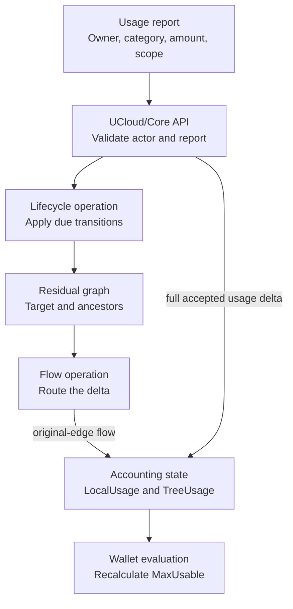
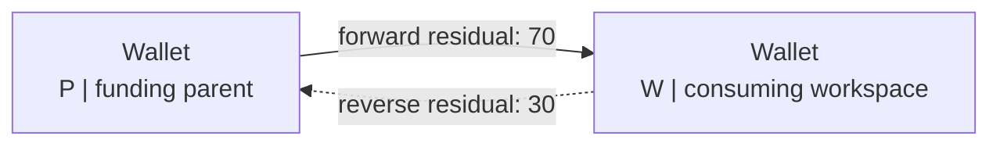
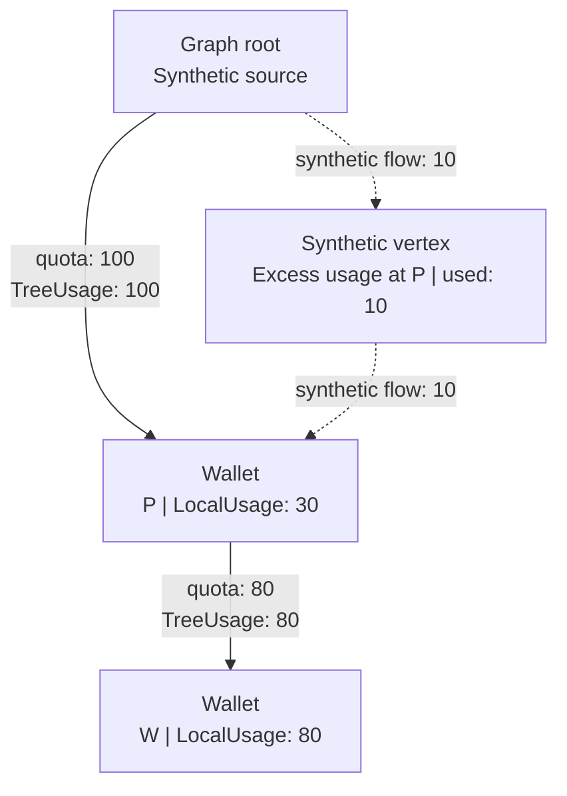

# Graph and flow internals

UCloud/Core turns the [wallet](../../glossary.md#wallet) model into a temporary residual graph for each routing operation.

Keep three separate objects in mind:

1. The provider report is a usage fact.
2. The stored allocation graph records quota and attributed usage.
3. The residual graph calculates changes to that attribution.

Changing a residual graph does not itself change accounting state.

## Usable capacity and usage routing

| Question | Graph | Algorithm | Stored effect |
|----------|-------|-----------|---------------|
| How much more can this wallet use? | Allocation residual graph, without synthetic excess paths | `MaxFlow`, using Edmonds–Karp | None. It calculates `MaxUsable` |
| Where should this usage change go? | Allocation edges plus synthetic excess paths | `MinCostFlow` | Copy changed original-edge flow into group `TreeUsage` and parent mirrors |

Both graphs contain the target wallet, its ancestors, and the synthetic root.
They do not automatically contain every wallet in the category.
UCloud/Core follows all parent groups to discover ancestors, including groups whose current quota is zero.

`MaxUsable` answers a funding question. Usage reporting answers an attribution question.
Reporting cannot assume that the provider stopped exactly at a quota boundary.

<figure class="diagram">



<figcaption>

A report updates the measurement and its funding attribution separately. The flow algorithm does not replace the measurement.
The figure omits persistence and notification delivery.

</figcaption>
</figure>

## Residual edges

Let an allocation group from <span class="math-inline">P</span> to <span class="math-inline">W</span>
have contributing quota <span class="math-inline">Q</span> and stored `TreeUsage` <span class="math-inline">U</span>.
For capacity accounting, its residual edges are:

```math
\begin{aligned}
r(P,W) &= \max(0, Q-U) && \text{unused quota} \\
r(W,P) &= U && \text{reversible flow}
\end{aligned}
```

For consumption accounting, retired usage adds a lower bound <span class="math-inline">F</span>
for allocation group <span class="math-inline">g</span>:

```math
\begin{aligned}
F &= \sum_{a \in g} \operatorname{RetiredUsage}(a) \\
r(P,W) &= \max(0, Q-U) \\
r(W,P) &= \max(0, U-F)
\end{aligned}
```

The lower bound prevents routing from removing committed retired consumption.
The current implementation applies this floor.

### Example: charge 20 units

Initially <span class="math-inline">Q=100</span>, <span class="math-inline">U=30</span>, and <span class="math-inline">F=0</span>.

<figure class="diagram">



<figcaption>

The forward edge can fund 70 more units. The reverse edge can undo 30 units of current attribution.
These labels are residual capacities, not total quota.

</figcaption>
</figure>

After routing 20 units through <span class="math-inline">P\to W</span>:

| Value | Before | After |
|-------|-------:|------:|
| Contributing quota | 100 | 100 |
| Forward residual | 70 | 50 |
| Reverse residual | 30 | 50 |
| Stored group `TreeUsage` | 30 | 50 |

`applyFlow` subtracts from each traversed residual edge and adds to its reverse.
For a path, the smallest residual capacity is its bottleneck.
The algorithm sends at most that amount before finding another path.

If <span class="math-inline">F=20</span> instead, the initial reverse residual is only 10.
After the 20-unit charge, the final reverse residual is 30.
The copied-back `TreeUsage` is the final reverse residual plus the floor, so <span class="math-inline">30+20=50</span>.

### What the matrices mean

`Graph` in `accounting_graph.go` stores dense matrices:

| Field | Meaning |
|-------|---------|
| `Adjacent[u][v]` | Residual capacity in this direction |
| `Cost[u][v]` | Signed routing preference |
| `Original[u][v]` | This direction represents a real parent-to-recipient group |
| `Floor[u][v]` | Committed consumption that must remain on the original edge |
| `VertexToWallet` | Ordinary vertex to wallet ID |
| `WalletToVertex` | Wallet ID to ordinary vertex |

The target wallet is vertex 0. The synthetic root uses wallet ID 0, but is a different graph vertex.
Do not confuse a wallet ID with a vertex index.
Synthetic excess vertices have no corresponding stored wallet.

## Provider reports

`internalReportUsage` converts every accepted report to a delta before routing it.

Without a scope, the baseline is `wallet.LocalUsage`.
With a scope, it is `wallet.ScopedUsage[key].Usage`.
For reported amount <span class="math-inline">x</span> and baseline <span class="math-inline">b</span>:

```math
\Delta =
\begin{cases}
x & \text{delta report} \\
x-b & \text{absolute report}
\end{cases}
```

For a new scope, the baseline is zero.
Scope keys are exact strings and are local to a wallet.
The same key in another category has a separate baseline.

The delta changes wallet `LocalUsage` even for a scoped report.
A scope tracks a reporting baseline. It does not have its own allocation or funding graph.

Before applying a report, UCloud/Core checks that the resulting local and applicable scoped usage stay non-negative.
It rejects decreases for non-capacity categories.
It also checks the supported numeric range.

For an accepted report, the code then:

1. Applies due transitions to the target and its ancestors.
2. Updates the scope baseline, if present.
3. Routes the applicable delta.
4. Adds the full delta to `LocalUsage`.
5. Reflows excess after a capacity decrease.
6. Recalculates affected wallet lock states.

The internal routing function does not change `LocalUsage`.
This allows retirement and reflow to change funding without inventing another provider report.

## Funding limits

### Ordinary flow is bounded by every edge

For <span class="math-inline">\mathrm{root}\to P\to W</span>, with quotas 100 and 60,
a 70-unit report can charge only 60 units through <span class="math-inline">P\to W</span>.
`W.LocalUsage` becomes 70. The other 10 units remain as excess at <span class="math-inline">W</span>.

For quotas 60 and 100, up to 100 units can reach <span class="math-inline">P</span>
from <span class="math-inline">W</span> as attributed child usage.
Only 60 can propagate from <span class="math-inline">P</span> to the root. Excess then appears at <span class="math-inline">P</span>.

The second case needs a temporary route that bypasses the exhausted upstream edge.
Otherwise the algorithm would incorrectly limit the child's group `TreeUsage` to the parent's upstream funding.

### Synthetic excess paths

When enabled, the builder allocates a synthetic vertex for each ordinary vertex.
It can add a two-edge path <span class="math-inline">\mathrm{root}\to\operatorname{excess}(W)\to W</span>.
This path represents funding that stops at <span class="math-inline">W</span>, rather than propagating through one of its parents.

For a wallet with parent groups, let <span class="math-inline">A</span> be contributing quota allocated to direct children.
Let <span class="math-inline">L</span> be `LocalUsage`, <span class="math-inline">Q</span> incoming contributing quota,
and <span class="math-inline">E</span> the wallet's excess usage.

```math
\begin{aligned}
\operatorname{escapeBudget} &= A+L-Q \\
\operatorname{escapeUsed} &= E \\
\operatorname{escapeAvailable} &= \max(0, \operatorname{escapeBudget}-E)
\end{aligned}
```

The builder creates the synthetic path when `escapeBudget > 0`.
Both synthetic forward edges receive `escapeAvailable`. Both reverse edges receive `escapeUsed`.
Wallets with no parent groups do not receive this path in the current builder.
Reports still update their `LocalUsage`, even when no route exists.

The synthetic path is an algorithm device, not an allocation and not new entitlement.
`MaxUsable` excludes it.
Only original allocation edges are copied back into accounting state.
Excess remains implicit in the difference between `LocalUsage` plus `ChildrenUsage` and propagated `TreeUsage`.

### Example: preserve a child's allocation

Suppose <span class="math-inline">P</span> has 100 incoming units, reports 30 local units,
and grants <span class="math-inline">W</span> 80 units. <span class="math-inline">W</span> reports 80 units.

<figure class="diagram">



<figcaption>

The child uses all 80 granted units. Ten units stop at the parent because its incoming quota cannot fund 110 units.
The dotted edges are temporary and are not persisted.

</figcaption>
</figure>

After the report, <span class="math-inline">P</span> has `inNode = 110`, `propagated = 100`, and `excess = 10`.
Both wallets have `MaxUsable = 0` and are locked.
An upstream funding problem must not erase the child's measured usage or change its quota.

### Capacity decreases remove local excess first

Suppose <span class="math-inline">W</span> reports 150 units against 100 units of funded quota, then decreases to 80.
The actual delta is -70.
UCloud/Core first removes the 50 units of excess usage, then reverses only 20 units of group `TreeUsage`.

The result is `LocalUsage = 80`, group `TreeUsage` 80, and `MaxUsable` 20.
Reversing all 70 funded units would leave the graph inconsistent with the measurement.

For decreases, UCloud/Core suppresses the target wallet's synthetic escape path.
It keeps ancestor escape paths, so it can reverse child `TreeUsage` even when an ancestor has no upstream `TreeUsage`.

## Path selection

`MaxFlow` ignores costs. `MinCostFlow` uses them to choose funding paths.
A wallet can receive quota from several allocation groups, so more than one valid route can exist for the same usage.
Without costs, those routes would be equally acceptable and attribution could depend on graph traversal order.
Each edge cost is a routing preference, not a price. It does not change the provider report, grant or remove quota, or
appear in billing. Capacity and floor rules decide which edges can carry flow. Cost only orders the permitted routes.
The preference is balance first, expiration second.

### Preferred balance

The main preference is the group's preferred balance: the amount of usage the group should carry at the sampled time.

- For a current capacity allocation, preferred balance is its full quota.
  Capacity usage is a current gauge, so UCloud/Core prefers to use current quota where it is available.
- For a current consumption allocation, preferred balance grows with elapsed time.

Let <span class="math-inline">Q</span> be quota, <span class="math-inline">S</span> the start time,
<span class="math-inline">T</span> the end time, and <span class="math-inline">t</span> the sampled current time.

```math
B(t) = \min\left(Q,\max\left(0,\left\lfloor Q\frac{t-S}{T-S}\right\rfloor\right)\right)
```

This lets a newer allocation carry less of the current charge than an older allocation with the same quota,
because less of its period has elapsed.
It is a routing preference, not a rate limit or a gradual release of entitlement.
An allocation's full quota is available once it activates.
Retired consumption contributes its fixed `RetiredUsage` to the group's preferred balance.
Retired capacity contributes zero.

The builder compares the group's preferred balance <span class="math-inline">B_g</span> with its current `TreeUsage`
<span class="math-inline">U_g</span>:

```math
\operatorname{balanceGap} = \max(1, B_g - U_g)
```

A group more than one unit below its preferred balance receives stronger preference.
At or above the target, the gap falls to the minimum, so the group loses to groups with unused expected capacity.
A group exactly one unit below the target also has the minimum gap.
It is simply less preferred than a group with a larger gap.
This spreads new usage across eligible groups.
Without this preference, one allocation could absorb usage while another expires unused.
For consumption, the time-prorated target also keeps routing aligned with the elapsed part of each allocation period.

Preferred balance depends on the allocation period and the sampled current time.
For example, consider these unused 100-unit consumption allocations at time 15:

| Current time | Allocation period | Preferred balance | Unused quota |
|-------------:|-------------------|------------------:|-------------:|
| 15 | `[0, 20)` | 75 | 100 |
| 15 | `[10, 20)` | 50 | 100 |
| 15 | `[0, 40)` | 37 | 100 |
| 15 | `[10, 40)` | 16 | 100 |

With otherwise equal paths, the group with the larger preferred balance receives stronger preference.
Each allocation still makes all 100 units available. Preferred balance is not a quota cap.

Expiration is the secondary preference.
A current group whose quota expires earlier receives stronger preference, which becomes a lower forward cost.
This spends short-lived quota before longer-lived quota while preserving the primary balance ordering.
Expiration never overrides a larger balance gap.
The expiration preference ignores retired allocations and zero-quota allocations.

The builder encodes both preferences in one cost per edge.
The forward cost is the negative preference, so `MinCostFlow` prefers the stronger preference.
For an ordinary allocation edge, the reverse cost is positive, so undoing existing attribution is less attractive than
assigning it through unused quota.

Synthetic excess edges receive a high positive cost because they should be chosen only when no ordinary route remains.
Expired or quota-deficient groups receive an even higher forward cost.
These costs do not restore retired capacity quota or bypass the residual-capacity and floor rules.

### Path selection and its limits

`leastExpensivePath` enumerates simple residual paths, without visiting a vertex twice in one path.
For each path, it divides the sum of edge costs by its number of edges using integer division.
It chooses the smallest **average edge cost**, not the smallest total cost.

For a path with edge costs <span class="math-inline">c</span> and edge count <span class="math-inline">n</span>:

```math
\operatorname{pathCost} = \left\lfloor\frac{1}{n}\sum_{i=1}^{n}c_i\right\rfloor
```

For illustration, a four-edge path with total cost -240 has average cost -60.
A two-edge path with total cost -180 has average cost -90 and wins, despite its higher total cost.
These small numbers illustrate the comparison. Actual edge costs use the larger scores above.

`MinCostFlow` then sends the smaller of the path bottleneck and the remaining requested amount.
It repeats until it has sent the request or no path remains.

Consequences of the current implementation:

- Path length affects preference because the algorithm compares averages.
- Costs stay fixed within one graph build, even after an augmentation changes flow.
- One large report need not produce the same split as several small reports.

The target's ancestor graph also limits rerouting.
Reverse residual edges can move earlier attribution among included ancestors.
The operation cannot move usage for an unrelated sibling, because that sibling is outside the target's ancestor graph.

## Flow updates and lock states

After routing, `lInternalReportUsage` visits original allocation edges and reads their reverse residual capacities.
It adds any retired floor, then updates both stored copies of `TreeUsage`.
It marks only changed groups and parent mirrors dirty.
It never persists synthetic-edge flow as an allocation charge.

`lInternalReevaluateAffected` recalculates `MaxUsable` for changed wallets and their descendants.
This is necessary because a parent's funding change can lock a sibling that received no new report.
Crossing the boundary where `MaxUsable` becomes zero changes `WasLocked`.

Significant updates exist for provider notifications.
A significant update is a persisted wallet timestamp for a change that providers must see.
The current code marks one when a wallet crosses the boundary where `MaxUsable` becomes zero, and when an allocation
activates, retires, or is updated.

A significant update has three effects:

1. It records `LastSignificantUpdate` on the wallet. The wallet API exposes the timestamp as
   `lastSignificantUpdateAt`.
2. It updates the bucket's newest-update index and wakes the provider notification stream.
3. It lets a reconnecting provider replay the wallets that changed after its last timestamp.

The provider notification stream reads the current wallet state and sends it to subscribed providers.
The provider can then update its local view of quota, lock state, and allocation changes.

Not every internal flow change is significant.
Rebalancing can move usage between allocation groups without changing quota, lock state, or allocation dates.
Such a change stays internal unless it also causes a lock-state transition.
This ties provider traffic to state changes that affect resource decisions instead of every routing adjustment.
An ordinary usage report can change `LocalUsage` without a significant update.
The report marks one only if it also changes the lock state or applies a due allocation lifecycle transition.

Activation and quota increases can call `lInternalReflowExcess`.
That function visits children first and attempts to fund existing excess with newly usable quota.
It changes edge `TreeUsage`, not the already recorded `LocalUsage`.
Capacity lifecycle batches can instead rebuild the bucket's current attribution from all `LocalUsage` values.
See [Allocation retirement](./retirement.md#capacity-retirement-rebuild-current-funding).

## Runtime and source reference

The live graph is in memory. Bucket locks serialize changes within a category.
The lock order is globals, then bucket.
Internal names beginning with `lInternal` require the caller to hold the required locks.

Public operations sample a current time and use it for their internal work.
The model assumes time moves forward. Passing a time parameter does not provide historical replay.
Background work scans allocations and persists dirty state, then waits 30 seconds before the next iteration.
Relevant reads and reports also apply due transitions. They do not depend only on that timer.

Paths below are relative to the repository root.

| Operation | Source |
|-----------|--------|
| Normalize, validate, and store reports | `core2/pkg/accounting/accounting_internal.go`: `internalReportUsage` |
| Construct residual edges and costs | Same file: `lInternalBuildGraph` |
| Copy original-edge `TreeUsage` back | Same file: `lInternalReportUsage` |
| Compute `MaxUsable` | Same file: `lInternalMaxUsable` |
| Reflow and evaluate | Same file: `lInternalReflowExcessEx`, `lInternalReevaluateAffected` |
| Flow algorithms and debug residual diagram | `core2/pkg/accounting/accounting_graph.go`: `MaxFlow`, `MinCostFlow`, `ToMermaid` |
| Scan and persistence loop | `core2/pkg/accounting/accounting.go`: `accountingProcessTasksNow`, `accountingProcessTasks` |
| Significant updates and replay | `core2/pkg/accounting/accounting_internal.go`: `lInternalMarkSignificantUpdate`, `internalWalletsUpdatedAfter` |
| Provider updates | `core2/pkg/accounting/provider_notifications.go` |

Next: [Allocation retirement](./retirement.md), then [Worked examples and edge cases](./examples.md).
