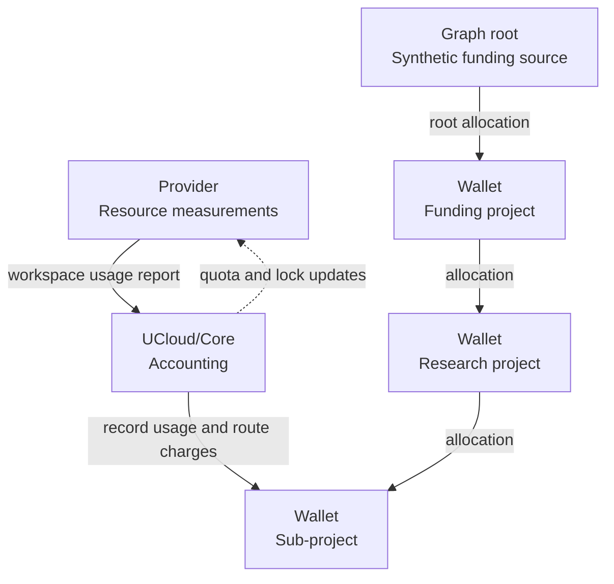
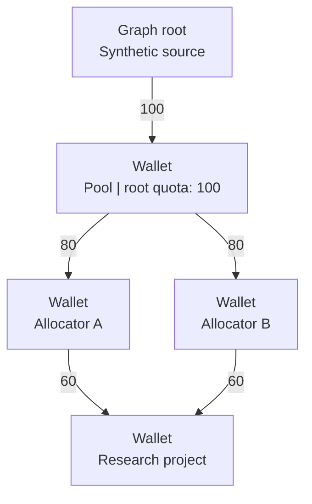

# Fundamentals

UCloud/Core records resource usage and decides how allocations fund it.
A [wallet](../../glossary.md#wallet) connects one workspace to one
[product category](../../glossary.md#product-category).

## Usage and allocations

An [allocation](../../glossary.md#allocation) gives a recipient quota from a parent for a fixed period.
The recipient can use resources or allocate quota to other recipients.
A provider reports usage for the workspace that used its resources.

UCloud/Core keeps that report, charges as much usage as possible through the allocation graph, and updates wallet lock states.
Retirement removes expired entitlement. It does not erase the provider's usage report.

<figure class="diagram">



<figcaption>

The provider reports usage and enforces resource limits. UCloud/Core records usage and routes charges through allocations.
The figure omits allocation periods and residual edges.

</figcaption>
</figure>

Arrows in allocation diagrams point from the funding parent to the recipient.
The charge is attributed to parents, but positive flow follows those arrows from the root toward the consuming wallet.
The root is an internal source, not a provider or a real workspace.

The complete operation has five parts:

1. Validate the report and find its wallet.
2. Apply due allocation transitions for the wallet and its ancestors.
3. Route the usage change through the current graph.
4. Keep the full accepted usage, including any amount that quota cannot fund.
5. Update lock states and notify providers about significant changes.

A report can succeed even when the wallet has no quota.
Acceptance records a fact. It does not authorize more resource use.

## Wallet graph

### Buckets keep categories separate

An `internalBucket` contains one graph for a `(provider, category)` pair.
No allocation edge crosses between buckets.
Two categories with the same name at different providers still have separate graphs.

Each owner has at most one wallet per bucket.
An owner is a user or a project. Project membership does not merge their wallets.
For one owner, product slices within one category share a wallet. Different categories do not share quota.

### Allocation groups are the edges

An allocation has a quota, a start, an end, a recipient, and a parent.
Several allocations from the same parent to the same recipient form one **allocation group**.
The routing graph has one edge for that group, not one edge per allocation.

For example, <span class="math-inline">P</span> grants <span class="math-inline">W</span> two overlapping allocations:

| Allocation | Period | Quota |
|------------|--------|------:|
| <span class="math-inline">A</span> | `[0, 10)` | 60 |
| <span class="math-inline">B</span> | `[5, 15)` | 40 |

At time 6, the group has 100 units of current quota.
If <span class="math-inline">W</span> uses 30 units, the group stores one `TreeUsage` value of 30.
UCloud/Core does not store a live 30-unit split between <span class="math-inline">A</span> and <span class="math-inline">B</span>.
It assigns retired usage when each allocation retires.

### The structure is a directed acyclic graph

A wallet can receive quota from several parents. Parents can share an ancestor.
The project hierarchy does not determine the accounting graph.

<figure class="diagram">



<figcaption>

Two funding paths share a 100-unit root allocation. The child quotas do not create 120 units of usable root funding.
The figure shows quota, not current usage.

</figcaption>
</figure>

UCloud/Core permits the 160 units granted by the pool, despite its 100-unit incoming quota.
This is **over-allocation**: promised child quota exceeds incoming entitlement.
It differs from **excess usage**: measured usage that does not propagate to a parent.

UCloud/Core rejects allocations that introduce a cycle.
The cycle check includes groups with only future, zero-quota, or retired allocations.
Retirement does not remove those structural links.

## Usage and funding

Three stored values explain most accounting behavior:

| Internal field | Meaning | What can change it? |
|----------------|---------|---------------------|
| Wallet `LocalUsage` | Usage reported directly for this workspace and category | An accepted usage report |
| Group `TreeUsage` | Usage charged through this parent-to-recipient edge | Routing, activation, retirement, or reflow |
| Wallet `ChildrenUsage[child]` | The parent's copy of that child's `TreeUsage` | The same `TreeUsage` updates |

The two copies of `TreeUsage` must agree:

```text
parent.ChildrenUsage[child] = child.AllocationsByParent[parent].TreeUsage
```

Let <span class="math-inline">L</span> be `LocalUsage`, <span class="math-inline">C</span> `ChildrenUsage` values,
<span class="math-inline">U</span> incoming group `TreeUsage`, and <span class="math-inline">Q</span> contributing quota.
Subscripts identify the wallet or edge. For a wallet <span class="math-inline">W</span>:

```math
\begin{aligned}
\operatorname{inNode}(W) &= L_W + \sum_c C_{W,c} \\
\operatorname{propagated}(W) &= \sum_p U_{p,W} \\
\operatorname{excess}(W) &= \operatorname{inNode}(W) - \operatorname{propagated}(W)
\end{aligned}
```

Stable state requires:

```math
\begin{aligned}
L_W &\ge 0 \\
0 &\le U_{p,W} \le Q_{p,W} \\
0 &\le \operatorname{propagated}(W) \le \operatorname{inNode}(W)
\end{aligned}
```

UCloud/Core derives excess from these values. It does not maintain a separate live excess counter.
Excess can occur at an intermediate wallet, not only at the wallet that received the report.

### Example: one report, two levels of excess

Suppose the graph is <span class="math-inline">\mathrm{root}\to P\to W</span>, with quotas 100 and 150.
The provider reports 180 units for <span class="math-inline">W</span>. <span class="math-inline">P</span> has no `LocalUsage`.

| Value | Wallet <span class="math-inline">P</span> | Wallet <span class="math-inline">W</span> |
|-------|----------------------------------------:|----------------------------------------:|
| `LocalUsage` | 0 | 180 |
| Usage received from children | 150 | 0 |
| `inNode` | 150 | 180 |
| `propagated` | 100 | 150 |
| `excess` | 50 | 30 |

The full 180 units remain in `W.LocalUsage`.
The root receives only 100 units of attributed usage.
The other 80 units remain visible as excess across the graph.

Do not sum every wallet's `TotalUsage`: that would count the same attributed usage at several levels.
For actual consumption across a chosen set of wallets, sum their `LocalUsage` values once per wallet.
In a shared graph, define that set explicitly rather than walking and counting each funding path.

## Accounting modes

The model uses the same graph for both modes, but retirement gives them different meanings.

| Property | Capacity-based | Consumption-based, called non-capacity in code |
|----------|----------------|-----------------------------------------------|
| Typical measurement | Current stored bytes or current resource count | Cumulative compute cost or inference credits |
| `LocalUsage` | Current amount, which can increase or decrease | Lifetime amount, which ordinary reports cannot decrease |
| Expired quota | Stops contributing | Shrinks to the consumption committed at retirement |
| Existing `TreeUsage` after expiration | Moves to current quota, or becomes excess usage | Retired consumption remains attached to its group |
| A new allocation | Funds the resources that still exist | Adds entitlement without resetting lifetime usage |

The current `IsCapacityBased` rule is precise:

- `ProductTypeInference` is always non-capacity, including when its frequency is `ONCE`.
- Other categories are capacity-based when `AccountingFrequency == ONCE`.
- Other frequencies are non-capacity.

Do not infer the mode from the unit name. Use the product type and frequency rules above.
Price conversion happens before this graph receives a usage amount.

### One renewal, two outcomes

A wallet uses 40 units under a 100-unit allocation. A new 100-unit allocation starts when the old one ends.
Assume no other wallets compete for funding.

| After renewal | Capacity | Consumption |
|---------------|---------:|------------:|
| `LocalUsage` | 40 | 40 |
| Old allocation's contributing quota | 0 | 40 |
| New allocation's quota | 100 | 100 |
| Wallet contributing quota | 100 | 140 |
| Propagated usage | 40 | 40 |
| Additional usable amount | 60 | 100 |

Capacity still occupies 40 units of the new allocation.
Consumption has already committed 40 units to the old allocation. The new allocation adds 100 fresh units.
See [retirement](./retirement.md) for the fields and transition rules.

## Wallet API values

| API field | Meaning | Not equivalent to |
|-----------|---------|-------------------|
| `localUsage` | This wallet's direct reported usage | Usage from all descendants |
| `totalUsage` | `LocalUsage + sum(ChildrenUsage)` | All actual usage below this wallet |
| `quota` | Incoming contributing quota | Original granted quota or `MaxUsable` |
| `totalAllocated` | Contributing quota granted to direct children | Incoming quota or measured usage |
| `maxUsable` | Additional usage that can currently be funded from the root | `quota - localUsage` |
| `allocationGroups[].group.usage` | `TreeUsage` charged through one parent group | This wallet's direct usage |
| `activeQuota` | UI-only quota from current allocations | All contributing quota in consumption mode |
| `activeUsage` | UI-only usage excluding retained consumption | All reported usage, including excess usage |

Internal `UiOnlyActiveQuota` and `UiOnlyActiveUsage` become `activeQuota` and `activeUsage` in JSON.
Do not use those presentation values for enforcement.
The allocation activation field has the legacy JSON name `actived`, not `activated`.

`WasLocked` is UCloud/Core's cached state for `MaxUsable <= 0`.
An exactly exhausted wallet is locked, even if its existing usage is fully funded.
A parent can lock its descendants by exhausting shared upstream funding.

The `reportUsage` result is the wallet's usability **after** recording the report:

- `true`: additional usable quota remains.
- `false` without an API error: UCloud/Core recorded the usage, but no additional usable quota remains.
- API error: UCloud/Core rejected the item. Do not treat it as an accepted measurement.

This result is not a reservation and does not report how many units were funded.
The `FreeToUse` path is an exception: the public API returns `true` without recording graph usage.

## Code map and next steps

Paths below are relative to the repository root.

| Subject | Source |
|---------|--------|
| Public request and wallet types | `provider-integration/shared/pkg/accounting/accounting.go` |
| Category and frequency types | `provider-integration/shared/pkg/accounting/products.go` |
| Authorization and public report handling | `core2/pkg/accounting/accounting.go`: `ReportUsage` |
| Stored model and mode selection | `core2/pkg/accounting/accounting_internal.go`: internal types, `IsCapacityBased` |
| State rules | `core2/pkg/accounting/accounting_invariants.go`: `lValidateAccountingWalletWithLockCheck` |

Continue with [Graph and flow internals](./graph-flow.md).
For practical sequences, use [Worked examples and edge cases](./examples.md).
