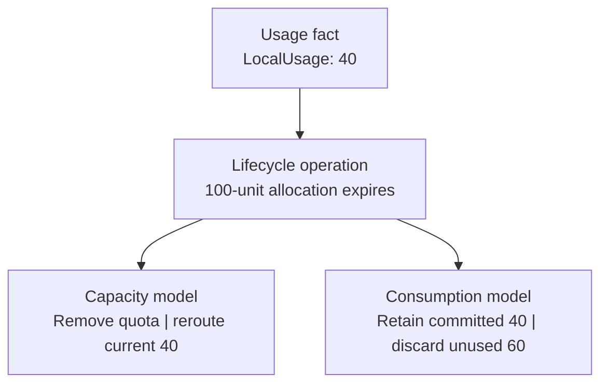
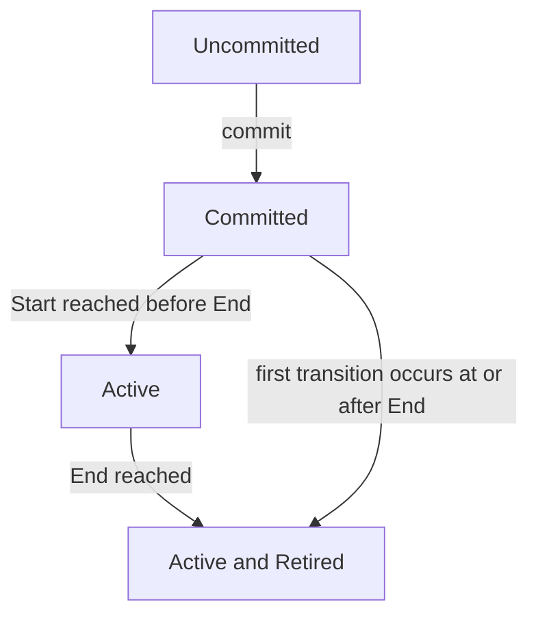
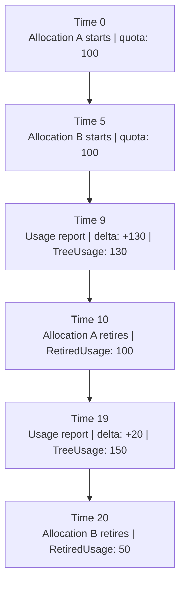

# Allocation retirement

Retirement ends an [allocation](../../glossary.md#allocation)'s current entitlement without deleting the
[wallet](../../glossary.md#wallet)'s measured usage.
It is part of the graph model, not a separate usage reset.

## Expiration

An allocation is current during `[Start, End)`.
It can fund current usage at `Start`, but not at `End`.

At retirement:

- UCloud/Core keeps wallet `LocalUsage` unchanged.
- UCloud/Core records the old quota and an attributed retired usage amount.
- Capacity accounting removes the expired quota and reroutes current usage.
- Consumption accounting retains the usage already committed to the expired allocation.

<figure class="diagram">



<figcaption>

The same 40-unit measurement has two retirement treatments. Neither treatment resets the provider report.
The figure assumes all 40 units were attributed through this allocation's group.

</figcaption>
</figure>

An expired capacity allocation cannot continue to fund current resources.
An expired consumption allocation cannot provide new unused entitlement.
These rules explain the different treatment of the same stored `Quota` field.

## Lifecycle fields

| Field | Meaning |
|-------|---------|
| `Committed` | The allocation is logically visible and can become usable |
| `Active` | Activation has occurred, or retirement has marked it as historically active |
| `Retired` | The end transition has run |
| `Quota` | Operational quota. Retirement changes it only for consumption |
| `RetiredQuota` | Quota immediately before retirement |
| `RetiredUsage` | Group `TreeUsage` attributed to this allocation at retirement |

The shared API marks `retiredUsage` as deprecated.
UCloud/Core still uses the internal value for attribution and consumption floors.
Providers should use `MaxUsable` for usability, not build enforcement rules from this field.

`Active` (aka. `Activated`) refers to whether the activation of the allocation has run. UCloud/Core does not clear it at
retirement. Do not use this flag alone to decide whether an allocation is current.

<figure class="diagram">



<figcaption>

Committed allocations activate or retire when UCloud/Core processes their time boundaries.
A delayed first transition can skip current availability entirely. The figure omits allocation updates.

</figcaption>
</figure>

Commit checks the sampled current time immediately.
An allocation committed during its period can activate immediately.
An allocation first processed after its end retires without gaining a period of new availability.
Retirement sets `Active = true` even in this last case.

The contributing-quota predicate is:

```text
Committed && Active && (!Retired || !IsCapacityBased)
```

For retired consumption, `Quota` has already shrunk to `RetiredUsage`.
Thus the predicate retains only enough quota to support historical consumption, not the original unused balance.

### Same 100-unit allocation, after retirement

Assume group `TreeUsage` is 40 and no earlier retired usage is in this group.

| Field or result | Capacity | Consumption |
|-----------------|---------:|------------:|
| `Active` | true | true |
| `Retired` | true | true |
| `RetiredQuota` | 100 | 100 |
| `RetiredUsage` | 40 | 40 |
| Stored `Quota` | 100 | 40 |
| Contribution from this allocation | 0 | 40 |
| Does the 40 remain fixed on this group? | No | Yes |

The retained `Quota = 100` in capacity mode is not usable funding.
The contribution predicate excludes it.
For historical original amounts, inspect `RetiredQuota`, not the wallet's current contributing quota.

## Retirement attribution

Live usage belongs to an allocation group, not to individual overlapping allocations.
UCloud/Core assigns each retired amount from group `TreeUsage`, but the calculation depends on the accounting mode.

For consumption, earlier retired usage remains committed.
Let <span class="math-inline">U</span> be group `TreeUsage`, <span class="math-inline">Q</span> the retiring allocation's quota,
and <span class="math-inline">R</span> previously committed retired usage.

```math
\begin{aligned}
R &= \sum_{a\text{ already retired}}\operatorname{RetiredUsage}(a) \\
u &= \max(0,\min(Q,U-R))
\end{aligned}
```

UCloud/Core stores <span class="math-inline">u</span> as `RetiredUsage` and updates the lifecycle fields:

```text
allocation.RetiredUsage = u
allocation.RetiredQuota = allocation.Quota
allocation.Retired      = true
allocation.Active       = true
```

For consumption, UCloud/Core then sets `allocation.Quota` to <span class="math-inline">u</span>.

For capacity, UCloud/Core captures each retiring group's `TreeUsage` before processing the lifecycle batch.
That `TreeUsage` becomes a temporary attribution budget:

For each group, let <span class="math-inline">B</span> be the remaining budget
and <span class="math-inline">U</span> its `TreeUsage` at the start of the batch.
Process allocations in transition order. For allocation <span class="math-inline">i</span>, with quota <span class="math-inline">Q_i</span>:

```math
\begin{aligned}
B_0 &= U \\
u_i &= \max(0,\min(Q_i,B_{i-1})) \\
B_i &= B_{i-1}-u_i
\end{aligned}
```

UCloud/Core stores each <span class="math-inline">u_i</span> as that allocation's `RetiredUsage`.
Earlier capacity retirement snapshots do not reduce this budget.
The same resources can remain present and receive a new snapshot in a later period.
Within one batch, allocations share the budget so they cannot count the same group `TreeUsage` twice.
Capacity retirement leaves `Quota` unchanged but stops counting it as contributing quota.

For two consecutive 100-unit capacity allocations, usage of 40 can produce a 40-unit snapshot for each period.
For two 100-unit allocations retired together against `TreeUsage` 150, transition order assigns 100 and 50.

This is group attribution at a transition, not a reconstruction of individual historical provider events.
The calculation cannot identify which overlapping allocation a job used at the time it ran.

### Example: overlapping consumption allocations

This example uses consumption accounting.
One parent wallet <span class="math-inline">P</span> funds one recipient wallet <span class="math-inline">W</span>
through a single allocation group.
Group `TreeUsage` is the total consumption charged through that group.
Retired usage is the part of group `TreeUsage` assigned to an allocation when it retires.
Contributing quota is the sum of operational quota that current and retired allocations contribute to the group.

The group has two allocations:

| Allocation | Period | Quota at start |
|------------|--------|---------------:|
| <span class="math-inline">A</span> | `[0, 10)` | 100 |
| <span class="math-inline">B</span> | `[5, 20)` | 100 |

<figure class="diagram">



<figcaption>

The sequence shows each allocation start and retirement, plus the usage reports between those events.
Each usage report gives the delta and the resulting `TreeUsage`.
The table lists the full allocation periods.
The group keeps one `TreeUsage` value across both periods.

</figcaption>
</figure>

At time 9, a delta report of +130 brings the group's `TreeUsage` to 130.
Both allocations are current.
The group contributing quota is 200.

At time 10, <span class="math-inline">A</span> retires.
No usage was retired before this point, so <span class="math-inline">A</span> receives:

```math
u_A = \min(100,130-0)=100
```

<span class="math-inline">A</span> retains an operational quota of 100.
<span class="math-inline">B</span> remains current with quota 100.
Group contributing quota is still 200, and the group's `TreeUsage` is still 130.
That leaves 70 units available for new usage if upstream funding permits it.

At time 19, another delta report of +20 brings the group's `TreeUsage` to 150.
Group contributing quota remains 200.
That leaves 50 units available for new usage if upstream funding permits it.

At time 20, <span class="math-inline">B</span> retires.
<span class="math-inline">A</span> already contributes 100 of retired usage, so <span class="math-inline">B</span> receives:

```math
u_B = \min(100,150-100)=50
```

<span class="math-inline">B</span> retains an operational quota of 50.
Both allocations are now retired.
Their operational quota is <span class="math-inline">100+50=150</span>, equal to the group's `TreeUsage`.
The remaining 50 units of original quota are no longer entitlement.

UCloud/Core assigns usage to an allocation only when that allocation retires.
It does not know which job used <span class="math-inline">A</span> or <span class="math-inline">B</span>.
The first-expiring allocation receives the first part of the group's `TreeUsage`.
Later allocations receive the remaining retired usage.
Do not present `RetiredUsage` as an event-level billing ledger.

## Flow after retirement

### Capacity retirement: rebuild current funding

Capacity usage is a current measurement. Existing bytes or resources still need funding after an allocation expires.
The normal lifecycle batch does the following:

1. Apply all selected activation and retirement state changes while evaluation is disabled.
2. Restore evaluation after the full transition batch.
3. Clear group `TreeUsage` and the mirrored `ChildrenUsage` values across the bucket.
4. Keep every `LocalUsage` value unchanged.
5. Replay positive `LocalUsage` in a deterministic order through the updated graph.
6. Recalculate lock states for all wallets in the bucket.

The replay is internal routing, not another provider charge.
It prevents old and new allocation states from mixing during the rebuild.
If current quota is insufficient, some measurement remains as excess.

Scans, reports, reads, commits, and updates all apply due lifecycle transitions through the same batch operation.

### Example: renew capacity without resetting the report

For <span class="math-inline">\mathrm{root}\to P\to W</span>, assume upstream quota remains sufficient.
<span class="math-inline">P</span> grants <span class="math-inline">W</span> 100 units for `[0, 10)` and another 100 for `[10, 20)`.
The provider's last absolute report is 40.

| Time | Old allocation contributes | New allocation contributes | `W.LocalUsage` | Group `TreeUsage` | `MaxUsable` |
|------|--------------------------:|--------------------------:|---------------:|-----------:|------------:|
| 9 | 100 | 0 | 40 | 40 | 60 |
| 10 | 0 | 100 | 40 | 40 | 60 |

UCloud/Core does not need a new provider report to fund the existing 40 units under the renewal.
If the provider sends absolute usage 40 again, its delta is zero.
Sending a new delta of 40 would incorrectly increase measured usage to 80.

### Consumption retirement: retain a lower bound

Consumption is cumulative. Retired consumption must not move to a new period simply because another parent becomes attractive.
The residual graph keeps a lower bound equal to the group's total `RetiredUsage`.
Only `TreeUsage` above that floor can be reversed.

<figure class="diagram">


<figcaption>

A retired allocation retains 40 units, and a current allocation adds 100. Only the 15 units above the floor can move.
The figure omits upstream constraints and temporary excess paths.

</figcaption>
</figure>

The UI-only active usage is `55 - 40 = 15`.
The lifetime local report can still be 55.
These are different views of the same state, not different usage reports.

Ordinary provider reports cannot decrease consumption, even above the floor.
The reversible residual amount supports internal routing. It does not expose a refund API.

## Transition order and late reports

### UCloud/Core does not depend only on the background scan

The background loop scans allocations before persisting dirty state.
Reports, wallet reads, updates, and `MaxUsable` checks also process due transitions.
They collect the target wallet's allocations and its ancestors' allocations.
The full scan processes every allocation in the bucket.

Transition batches sort allocations by:

1. Earlier end time.
2. Earlier start time, when end times match.
3. Lower allocation ID, when both times match.

For each allocation, the batch attempts activation, then retirement.
It delays reevaluation until the batch's state changes are complete.
This matters when one allocation ends exactly when its replacement starts.

It also makes retirement attribution reproducible for allocations processed in the same set.
It does not turn delayed scans into a replay of every intermediate historical state.

### Late report across a consumption boundary

Suppose a 100-unit allocation ends at time 10 with recorded usage 40.
A new 100-unit allocation starts at time 10.
At time 11, the provider reports absolute usage 50, including ten units measured before time 10.

The current report schema has no usage-event timestamp and no target allocation ID.
UCloud/Core processes retirement before routing the new delta:

| Step | Old retained usage | New-period `TreeUsage` | `LocalUsage` |
|------|-------------------:|----------------:|-------------:|
| Before the boundary | 0 | 0 | 40 |
| Retire old allocation | 40 | 0 | 40 |
| Apply absolute 50, delta +10 | 40 | 10 | 50 |

UCloud/Core does not backdate those ten units into the expired allocation.
If no current funding exists, the ten units remain as excess at the applicable wallet or ancestor.
The provider must report promptly when period attribution matters.
The API cannot recover the original measurement time from a cumulative amount alone.

The same rule applies if UCloud/Core creates an already expired allocation.
Retirement can attribute existing group `TreeUsage`, but cannot recover missing event history.

### Parent and child periods are independent

A child allocation can remain current after a parent's incoming allocation expires.
Retirement does not cascade by changing every child allocation's dates.

For capacity, current child `TreeUsage` can remain within the child's own quota while becoming excess usage at the parent.
For consumption, retained upstream usage stays committed. New child usage can become excess upstream.
In both modes, the child can have unused `quota` but no additional usable root funding.

## Updates and unusual intervals

Current update handling has these rules:

- Retired allocations cannot be edited.
- An allocation's start cannot change at or after `Start`, including the exact start boundary.
- Negative quota and reversed intervals are rejected.
- A current committed allocation's quota cannot fall below the group's existing `TreeUsage` after the proposed change.
- Extending an allocation before it retires can preserve its period. Extending an already retired allocation is rejected.
- A new allocation is the normal way to provide entitlement after retirement.

The quota check is group-level, not an individual usage assignment.
An overlapping allocation can supply the remaining group quota needed for an accepted reduction.

The implementation accepts `Start == End`.
That interval has no current instant and contributes no new usable period once processed.
An uncommitted allocation neither activates nor retires until it commits.

## Historical limits

Capacity snapshots describe attribution when UCloud/Core processes a retirement batch.
If processing spans several expired periods, the batch cannot recover a separate historical measurement for each boundary.
It distributes the available group `TreeUsage` in transition order.

The offline findings-repair planner uses the same group budget and end/start/ID ordering for newly retired allocations.
It does not subtract earlier capacity snapshots. Consumption and inference retain their committed-usage rules.

Older versions subtracted previous capacity retirement snapshots, which could undercount later snapshots in the same group.
The current calculation does not rewrite those stored values.
Exact historical repair needs measurements that the live graph might no longer contain.

## Source reference

All functions below are in `core2/pkg/accounting/accounting_internal.go` unless noted otherwise.

| Detail | Function |
|--------|----------|
| Batch order and evaluation suppression | `lInternalSortAllocations`, `lInternalTransitionSortedAllocationSet` |
| Target and ancestor transition set | `lInternalTransitionWallets` |
| Activation and retirement fields | `lInternalAttemptActivation`, `lInternalAttemptRetirement` |
| Capacity attribution rebuild | `lInternalRerouteCapacityUsage` |
| Incremental capacity rebalance | `lInternalRebalanceEx` |
| Retained consumption floor | `lInternalBuildGraph`, `lInternalGroupTotalRetired` |
| Update checks | `lValidateUpdate`, `internalUpdateAllocation` |
| Contribution predicate | `lInternalGroupTotalQuotaContributing` |
| Grant commit and persistence | `core2/pkg/accounting/accounting.go`: `accountingProcessTasksNow` |
| Retirement and start-boundary regression checks | `core2/pkg/accounting/accounting_retirement_test.go` |
| Offline retirement repair | `core2/pkg/accounting/accounting_repair_findings.go`: `planFindingsRepair` |

Next: [Worked examples and edge cases](./examples.md).
