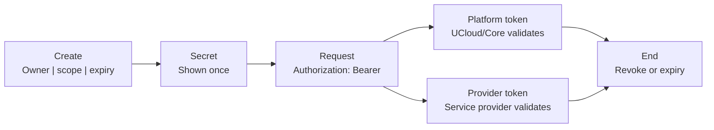

# API Tokens

UCloud has two kinds of API token. They share the same lifecycle and the same safe-handling rules. They differ in who
validates the token and what the token authorizes.

<figure class="diagram" id="token-kinds">

<figcaption>

The shared lifecycle of an API token and the two validation paths. The figure does not show the internal checks that
each validator performs.

</figcaption>
</figure>

## The two kinds

| Kind | Validated by | Scope | Use |
|------|--------------|-------|-----|
| [Platform API token](./platform-api-tokens.md) | UCloud/Core | A user and a workspace context | The UCloud/Core API, including provider-backed resources |
| [Provider API token](./provider-api-tokens.md) | A service provider | One service, its actions, and a user or project owner | An endpoint that the provider exposes directly |

The web interface calls the first kind **UCloud** and the second kind a **service provider**. Both kinds appear on the
API tokens page at `/app/api-tokens`.

A platform token authenticates as its user and can use the platform APIs that the user can use. It can manage
provider-backed resources through UCloud/Core, but it cannot call an endpoint that a provider exposes directly. It
does not carry a provider service permission. A provider token is bound to one provider and one service, and the
provider checks its actions.

## Data at a glance

| Data | Platform token | Provider token |
|------|----------------|----------------|
| Identity | A user and a workspace context | A user or a project owner |
| Permissions | Empty. The token acts as the user. | A service and its actions |
| Secret hash and salt | UCloud/Core | The provider |
| Last used | Not stored | The provider |
| Server URL | The UCloud/Core API base URL | The provider service URL |
| Audit reference | The UCloud/Core token reference | The provider token ID |
| Expiry | Set in UCloud/Core | Set in UCloud/Core and stored by the provider. Job tokens have no expiry. |
| Secret | Shown once, not stored | Shown once, not stored |

## What the kinds share

- Both kinds use the same token API. Visible tokens of both kinds appear in the same token list. Job tokens are
  hidden from the list.
- Both kinds show the secret once. The validating service stores a hash and a salt, not the secret.
- Both kinds use the `Authorization` header with a bearer secret.
- The owner and the permissions of a token are fixed when the platform creates it. A token has no rotate operation.
- A provider token for a project is tied to the user who created it. UCloud/Core sends project membership updates, and
  the provider revokes the token when that user is no longer a member. A short delay is possible. A token created by a
  remaining member stays valid. See [Project membership](./provider-api-tokens.md#project-membership).
- A token that a user creates has a fixed expiry date. A job token has no expiry and is revoked when the job ends. The
  platform does not extend a token. To continue after the expiry date, create a new token, update the client, and revoke
  the old token.
- Both kinds are bearer credentials. Anyone who has the secret can use it until the validator rejects it.
- Both kinds are audited. The platform records the create and revoke calls, and a request records the token reference.

## Security

- The secret is shown once. Store it before the client uses it.
- Do not put a token in source code, a container image, or a log.
- Use the shortest expiry date that works for the client when a user creates the token.
- Revoke a token when it leaks, when a person leaves a project, or when a client no longer needs it.
- Treat a token as visible to every process that can read the client configuration or the job environment.

## Audit

The platform audits the create and revoke calls as RPC calls. The create record holds the token metadata: title,
description, provider, service, permissions, and expiry. It does not hold the secret. The response that carries the
secret is not part of the audit record. See [Auditing](../procedures/auditing.md).

A request records the token reference. For inference requests, the reference is in the `token_reference` field. See
[Audit](../k8s/inference/audit.md).
