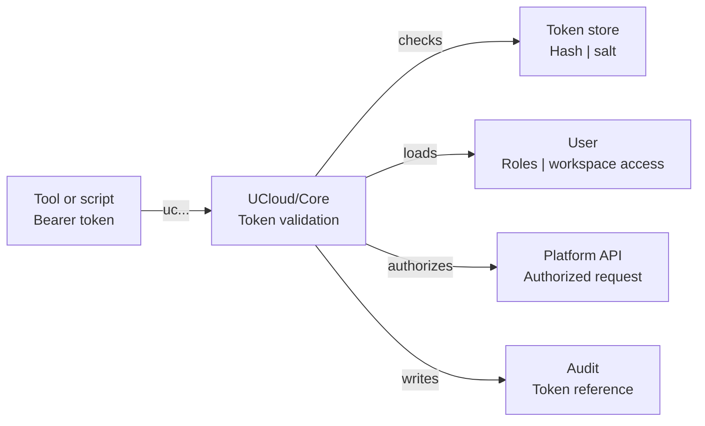

# Platform API Tokens

A platform API token is an API token that UCloud/Core validates. It authenticates as its user to UCloud/Core, not to a
provider endpoint. It uses one workspace context as the active context. Use it for scripts and tools that call the
UCloud/Core API.

You can use a platform API token to manage provider-backed resources through UCloud/Core, for example to submit a job or
read a file. UCloud/Core applies the roles and access rules of the user and calls the provider on the user's behalf. The
platform token itself is not sent to the provider.

A platform API token does not carry a provider service permission. It does not work on an endpoint that a provider
exposes directly. Examples are the AI inference endpoint and a container repository. Those endpoints validate a
[provider API token](./provider-api-tokens.md).

<figure class="diagram" id="platform-token-path">



<figcaption>

The path of a platform API token. UCloud/Core validates the token, loads the user, applies the roles and workspace
access, and authorizes the platform API call. The figure does not show how the token is stored.

</figcaption>
</figure>

## Token record

A token is created for a user and a workspace, with a title, description, and expiry. UCloud/Core stores the token as a
resource and in the API token table.

| Data | Stored by | Notes |
|------|-----------|-------|
| Token ID | UCloud/Core | The secret prefix `uc...` includes the ID. |
| Created by | UCloud/Core | The user that created the token. |
| Workspace | UCloud/Core | A project or the personal workspace. |
| Title and description | UCloud/Core | Metadata for the token resource. |
| Permissions | UCloud/Core | Empty. The token acts as the user. |
| Expiry | UCloud/Core | The platform rejects the token after this time. |
| Secret hash and salt | UCloud/Core | PBKDF2-SHA512 hash with a per-token salt. |
| Server URL | UCloud/Core | The base URL of the UCloud/Core API. A platform token has no provider server URL. |
| Secret | Neither | Shown once when the platform creates the token. |

A platform API token has no service or action. The platform applies the normal roles and access rules of the user. The
token acts as the user for the platform API.

## Use a token

Send the secret in the `Authorization` header:

```bash
curl https://cloud.example.org/api/tokens \
    -H "Authorization: Bearer uc..."
```

The server URL on a platform API token is the base URL of the UCloud/Core API. It has no provider server URL.

## Validation

The client sends `Authorization: Bearer uc<token-id>-<secret>`. UCloud/Core does the following:

1. Parse the token ID and the secret.
2. Load the token record.
3. Check the expiry and the password hash.
4. Load the user.
5. Check that the user still has access to the workspace.
6. Set the token reference.
7. Apply the roles and access rules of the user.

UCloud/Core rejects an invalid or expired token, and it rejects a token whose user no longer has access to the
workspace. The token has no service permissions. It does not authenticate against a provider endpoint.

## Scope

A platform API token belongs to one user and uses one workspace context as the active context. The platform checks that
the user still has access to that context. If the user is no longer a member of the selected project, the platform
rejects the token.

The token acts as the user, with the selected workspace as the active context. It has the same access as the user. Treat
it as a password for the user account. Do not share it between people.

## Expiry

The platform rejects a token after its expiry date. A token has the expiry date that the user selected when the
platform created it.

## Revoke a token

A user with edit access can revoke a token. The platform deletes the token resource.

## Security

A platform token has the full access of its user. Use a provider token when the client only needs one provider service.
Do not share a platform token between people.

## Audit

A platform API call records the token reference in the audit log. The secret is not part of the request. See
[Auditing](../procedures/auditing.md).

## Related

- [API Tokens](./api-tokens.md)
- [Provider API Tokens](./provider-api-tokens.md)
- [Audit](../procedures/auditing.md)
