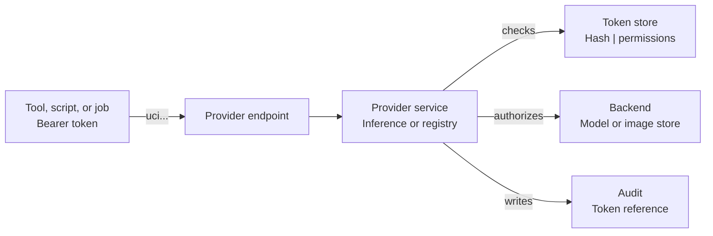

# Provider API Tokens

A provider API token is an API token that a service provider validates. It is bound to one provider and one service.
It carries one or more actions of that service. Use it for an endpoint that the provider exposes directly, such as the
AI inference API or a container registry.

A provider API token does not authenticate to the UCloud/Core API. For the platform API, use a
[platform API token](./platform-api-tokens.md).

<figure class="diagram" id="provider-token-path">



<figcaption>

The path of a provider API token. The provider endpoint accepts the request, the service validates the token against its
permission store, and the service authorizes the call. The figure does not show how the service implements the request.

</figcaption>
</figure>

## Token record

A token is created with a title, description, provider, service, actions, scope, and expiry. The platform returns the
secret once. UCloud/Core and the provider store different parts of the record.

| Data | Stored by | Notes |
|------|-----------|-------|
| Token ID | UCloud/Core and provider | The secret prefix `uci-...` includes the ID. The provider uses the ID to find the token. |
| Created by | UCloud/Core and provider | The user that created the token. |
| Title and description | UCloud/Core | Metadata for the token resource. |
| Provider and service | UCloud/Core and provider | A provider token names exactly one service. |
| Owner | UCloud/Core and provider | A user, or a project when the service uses a project scope. |
| Permissions | UCloud/Core and provider | The service and its actions. |
| Expiry | UCloud/Core and provider | The validator rejects the token after this time. A job token has no expiry. |
| Secret hash and salt | Provider | PBKDF2-SHA512 hash with a per-token salt. UCloud/Core does not store the hash for a provider token. |
| Last used | Provider | Updated when the provider validates the token. |
| Server URL | UCloud/Core | The base URL that the provider returns. |
| Secret | The provider job secret store for a job token. The token table stores no secret. | Shown once when the platform creates the token. A job token is kept until the job starts. |

A provider token must name exactly one service. It can name several actions of that service. The token is bound to the
provider that issued it. It does not work on another provider.

## Permissions

| Permission | Actions | Context | Used by |
|------------|---------|---------|---------|
| `inference` | `use` | Project | [AI Inference](../k8s/inference/overview.md) |
| `containerRepository` | `pull`, `push` | Personal | Container repositories |

A provider token acts as its owner for the permissions it names. The provider checks the permissions on each request.

## Use a token

Send the secret in the `Authorization` header:

```bash
curl https://chat.example.org/v1/models \
    -H "Authorization: Bearer uci-..."
```

The server URL on the token is the base URL of the provider service. The inference API uses the routes in
[Public surface](../k8s/inference/architecture.md#public-surface).

## Validation

The client sends `Authorization: Bearer uci-<token-id>-<secret>`. The provider does the following:

1. Parse the token ID and the secret.
2. Load the token record for the service.
3. Check the expiry and the password hash.
4. Check the service and its actions.
5. Update `last_used_at` when it loads the record.
6. Cache the result for up to one minute.

The provider rejects an invalid or expired token, and it rejects a request that the token permissions do not allow. A
provider token is not accepted by UCloud/Core.

## Scope

A provider token has one owner, either a user or a project. The owner and the permissions are fixed when the platform
creates the token. The service decides which scopes it allows. For inference, the token uses a project. For container
repositories, the token uses a personal scope.

The token can do only what its service and actions allow. It cannot give more access than its owner has in the
provider.

## Project membership

The provider does not check the current project membership on each request. It checks the token record instead.
UCloud/Core sends project membership updates to the provider on the project update stream.

The provider checks all provider tokens of the project when it receives an update, when it receives the replay after it
connects again, and in a periodic backstop. When the user who created a token is no longer a member, the provider
revokes the token.

A project token that a remaining member created stays valid. A token that other people know is a shared secret. If such
a person leaves the project, revoke the token manually.

A short delay is possible. The provider can accept a token from its cache for up to one minute after the revocation.

Job tokens follow the job lifecycle instead. See [Job tokens](#job-tokens).

## Expiry

The provider can cache a successful check for up to one minute. A request can succeed shortly after the expiry date.
Revocation invalidates the cache.

An inference token created from the model page expires after 90 days. See
[Where users meet the feature](../k8s/inference/overview.md#where-users-meet-the-feature).

## Revoke a token

A user with edit access can revoke a token. The platform asks the provider to revoke the token before it deletes the
token resource. If the provider fails, the token remains.

Revocation removes the token from the provider and invalidates its authentication cache. It does not remove data that a
client already received.

## Job tokens

UCloud/Core creates one inference token per available provider when a job asks for inference servers. The token is
linked to the job and has no fixed expiry. UCloud/Core revokes it when the job ends. The Integration Module receives
each token as a transient `api_server` resource and exposes it to the job as an environment variable. See
[Inference servers](../k8s/compute.md#inference-servers).

A job token is a provider token for the inference service. It is not a user-managed token, and it is hidden from the
default token list. It appears in the environment of the job container. Every process in the container can read it.

## Security

A job token is visible to every process in the job container. Do not print it. For a token that a user creates, use one
token for each client or person when you need to tell them apart in the audit log.

## Audit

An inference request records the token ID in the `token_reference` field. See
[Audit](../k8s/inference/audit.md).

## Related

- [API Tokens](./api-tokens.md)
- [Platform API Tokens](./platform-api-tokens.md)
- [Security](../k8s/inference/security.md)
- [Audit](../k8s/inference/audit.md)
