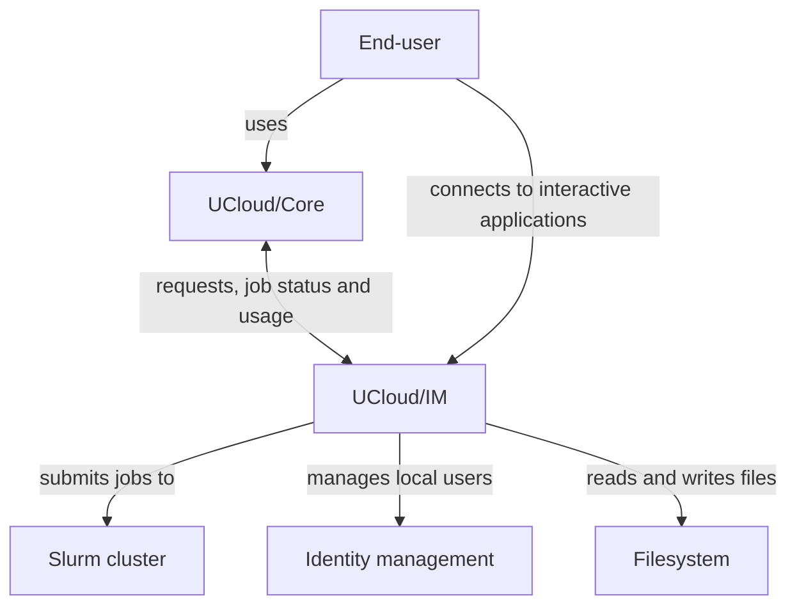

# Architecture and Networking

In this article we will go through the overall architecture and networking modes of UCloud/IM for Slurm. 
We will start by explaining the overall architecture, followed with a discussion on networking requirements.

## Architecture Views

This section describes UCloud/IM from the outside in. Each view answers one question. Start at the top and follow the
links when you need more detail.

| View | Question it answers | Where |
|------|---------------------|-------|
| System context | Who uses UCloud/IM, and which systems does it talk to? | [the first figure below](#system-context) |
| Deployment | Which containers make up UCloud/IM, and how does traffic reach them? | [the second figure below](#deployment), and [Networking Requirements](#networking-requirements) |
| Containers and mappings | How do projects, users and drives map to the provider's systems? | [User and Project Management](./id-management.md), [Filesystem Integration](./file-management.md) |
| Dynamic | How does a job travel from UCloud/Core to the cluster, and how does the cluster report back? | [Slurm Integration](./slurm.md) |
| Dynamic | How does a file move between two providers? | [Inter-provider file transfers](./file-transfers.md) |

## Overall Architecture

UCloud/IM is a software system that the provider installs at the HPC system. The figure below places it in its context:
the people who use it, the platform that forwards to it, and the provider systems it uses.

<figure class="diagram" id="system-context">

<figcaption>

UCloud/IM and the systems around it. The figure shows the people and the external systems, and how they relate. It does
not show the parts inside UCloud/IM.

</figcaption>
</figure>

The end-user reaches UCloud/IM through UCloud/Core. Interactive applications are the exception: the end-user connects
to those directly.

The figure below zooms in one step, to the deployment.

<figure class="diagram" id="deployment">

<figcaption>

The UCloud/IM deployment for Slurm-based HPC. This diagram depicts a production-like setup. It does not show the
networking modes; see [Networking Requirements](#networking-requirements).

</figcaption>
</figure>

In the deployment above, we have several actors. We have summarised the role of each actor in the table below:

<table>
<thead>
<tr>
<th>Actor</th>
<th>Purpose</th>
</tr>
</thead>

<tbody>
<tr>
<td>[End-user](../glossary.md#end-user)</td>
<td>

The end-user is a user of the UCloud platform and of the service provider. As we have discussed in the introduction
chapter, the end-user primarily communicates with UCloud/Core, and in rare cases 
directly with a service provider.

In this diagram, we assume that the user has already gone through the connection procedure (TODO link) and has
established a mapping from a UCloud identity to a local identity with uid `41231`.

</td>
</tr>

<tr>
<td>[UCloud/Core](../glossary.md#ucloudcore)</td>
<td>

The UCloud platform itself. This is the service hosting the user-interface and core APIs. It is not part of the
provider's deployment. You can read more about the role of UCloud/Core [here](../overview/introduction.md).

The core will to a large extent, forward requests to service providers after performing validation, authentication and
authorization.

</td>
</tr>

<tr>
<td>[HPC frontend](../glossary.md#hpc-frontend)</td>
<td>

UCloud/IM is hosted on the HPC's frontend node (or a similar node). This node is capable of consuming the services of
the HPC environment.

</td>
</tr>

<tr>
<td>[UCloud/IM (Gateway)](../glossary.md#ucloudim-gateway)</td>
<td>

The gateway is a publicly accessible web-server and is part of the integration module. It accepts all traffic destined
to the integration module. In then forwards to either the UCloud/IM server instance or one of the user instances. It
does this based on routing information from UCloud/Core or the end-user. Traffic which is related to a user action
almost always goes to a user instance matching the UID of the end-user.

</td>
</tr>

<tr>
<td>[UCloud/IM (Server)](../glossary.md#ucloudim-server)</td>
<td>

The server instance of the integration module. This server is responsible for handling server-to-server traffic which is
not related to an end-user request. For example, this server instance will tell UCloud/Core about which services it
exposes.

The server instance consumes some of the HPC services. This includes keeping track of Slurm jobs and reporting the state
back to UCloud/Core. This also includes the creation of filesets, user identities, projects and Slurm accounts.

It is the job of the server instance to start new user instances. The server instance is capable of doing this through
`sudo`. The configuration of `sudo` was covered in the [previous](./installation.md) section.

</td>
</tr>

<tr>
<td>[UCloud/IM (User)](../glossary.md#ucloudim-user)</td>
<td>

One of the integration module server instances. These instances are launched by the UCloud/IM server instance on demand.
Any end-user action through UCloud/Core will trigger the automatic launching of such an instance. This instance runs
with the same privileges as if the user had logged in through other means. All authorization checks are enforced
directly by the operating system.

The user instance consumes HPC services via the normal means. This is done through the same mechanisms that your users
would normally access your systems.

</td>
</tr>

<tr>
<td>[HPC services](../glossary.md#hpc-services)</td>
<td>

The HPC services are the services that make up your actual HPC environment. This includes systems such as:

- Your filesystem
- Identity management and group management
- Slurm

UCloud/IM does not require these services to be deployed in any specific way. The diagram show these on a single node
solely for illustrative purposes. The services can be deployed on any number of nodes.

</td>
</tr>

</tbody>

</table>

### Examples

In order to better illustrate how this works, we will go through a number of examples show-casing common communication
patterns.

#### Browsing Files

1. `End-user` → `UCloud/Core`: Request files at `$PATH`
2. `UCloud/Core` → `UCloud/IM (Gateway)`: Request files at `$PATH`
    1. If `UCloud/IM (UID 41231)` is running, skip to step 3
    2. `UCloud/IM (Gateway)` → `UCloud/Core`: User is not ready
    3. `UCloud/Core` → `UCloud/IM (Gateway)` → `UCloud/IM (Server)`: Spawn user instance
    4. Go to step 2
3. `UCloud/IM (Gateway)` → `UCloud/IM (UID 41231)`: Request files at `$PATH`
4. `UCloud/IM (UID 41231)` → `UCloud/IM (Gateway)` → `UCloud/Core` → `End-user`: File listing from `$PATH`

#### Uploading a File

1. `End-user` → `UCloud/Core`: Request upload at `$PATH`
2. `UCloud/Core` → `UCloud/IM (Gateway)`: Request upload at `$PATH`
    1. If `UCloud/IM (UID 41231)` is running, skip to step 3
    2. `UCloud/IM (Gateway)` → `UCloud/Core`: User is not ready
    3. `UCloud/Core` → `UCloud/IM (Gateway)` → `UCloud/IM (Server)`: Spawn user instance
    4. Go to step 2
3. `UCloud/IM (Gateway)` → `UCloud/IM (UID 41231)`: Request upload at `$PATH`
4. `UCloud/IM (UID 41231)` → `UCloud/IM (Gateway)` → `UCloud/Core` → `End-user`: Upload endpoint
5. `End-user` → `UCloud/IM (Gateway)` → `UCloud/IM (User)`: File data

#### Starting a Job

1. `End-user` → `UCloud/Core`: Start job given `$PARAMETERS`
2. `UCloud/Core` → `UCloud/IM (Gateway)`: Start job given `$PARAMETERS`
    1. If `UCloud/IM (UID 41231)` is running, skip to step 3
    2. `UCloud/IM (Gateway)` → `UCloud/Core`: User is not ready
    3. `UCloud/Core` → `UCloud/IM (Gateway)` → `UCloud/IM (Server)`: Spawn user instance
    4. Go to step 2
3. `UCloud/IM (Gateway)` → `UCloud/IM (UID 41231)` → `Slurm`: Start job given `$PARAMETERS`
4. `UCloud/IM (UID 41231)` → `UCloud/IM (Gateway)` → `UCloud/Core` → `End-user`: Job has been submitted to the queue

Followed by periodic monitoring by `UCloud/IM (Server)`:

1. `UCloud/IM (Server)` → `Slurm`: List jobs
2. `UCloud/IM (Server)` → `UCloud/Core`: Send job updates
3. `UCloud/Core` → `End-user(s)`: Notify about relevant job updates

## Networking Requirements

In this section, we will recap the requirements listed from the section above. 

### DNS and Certificates

In this section we will list DNS entries and accompanying TLS certificates required for your service. All certificates
must be signed by a trusted root CA. DNS entries must resolve through public DNS servers. In the table below we use
`my-provider.example.com` as a placeholder representing your provider, please replace this with whichever domain you
control (for example `hippo.cloud.sdu.dk`).

| Mandatory | Hostname                    | Resolves to | Purpose                                        |
|-----------|-----------------------------|-------------|------------------------------------------------|
| Yes       | `my-provider.example.com`   | Gateway IP  | Accepting general IM traffic (user and server) |
| No        | `*.my-provider.example.com` | Gateway IP  | Traffic destined for interactive applications  |

The gateway IP refers to the IP address on which the UCloud/IM gateway listens. This must be a publicly routable IP
address.

### Firewall Configuration

| Protocol | Port | Source     | Destination | Purpose                                                  |
|----------|------|------------|-------------|----------------------------------------------------------|
| TCP      | 80   | All        | Gateway IP  | Redirecting to HTTPS (443)                               |
| TCP      | 443  | All        | Gateway IP  | Accepting IM traffic and interactive application traffic |
| TCP      | 443  | Gateway IP | UCloud      | Sending messages to UCloud/Core                          |

